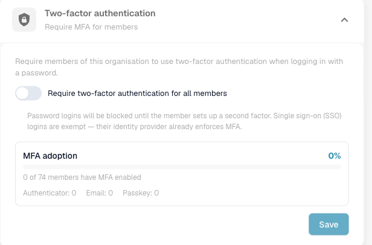
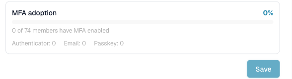

# 双重身份验证（管理员）

## 概述

作为组织管理员，您可以**要求所有成员在使用密码登录时启用双重身份验证（2FA）**。启用此要求后，尚未设置第二种验证方式的成员在完成登录前，系统会引导其完成注册。

单点登录（SSO）方式——Google、Microsoft、SAML——**不受此要求限制**：其身份提供方已强制执行自己的多重身份验证（MFA），因此此要求仅影响密码登录。

此设置位于 **Settings → Global Settings → Company Information → Two-factor authentication**，仅组织管理员可以使用。

## 为组织要求启用 MFA

1. 前往 **Settings → Global Settings → Company Information**。
2. 打开 **Two-factor authentication** 部分。
3. 开启 **Require two-factor authentication for all members**，然后点击 **Save**。

<figure><figcaption>
为所有成员开启此要求，并在下方监控使用情况。
</figcaption></figure>

保存后，更改会在一分钟内生效。此后：

* **已设置**第二种验证方式的成员，照常在输入密码后进行该方式的验证。
* **尚未设置**第二种验证方式的成员，必须先注册一种方式才能获得会话。
* SSO / 社交登录不受影响。


启用此设置后，尚未设置第二种验证方式的成员将无法通过密码登录，直到完成注册。请将此更改告知团队，并考虑在业务非高峰时段启用。


## MFA 使用情况报告

开关下方的 **MFA adoption** 面板会显示在强制执行前，组织内 2FA 的使用情况：

* 整体**使用率**和进度条，
* 已启用 2FA 的成员数量（例如，*74 名成员中有 0 名*），
* 按验证方式划分的明细——**Authenticator**、**Email** 和 **Passkey**。

<figure><figcaption>
MFA 使用情况报告：整体百分比、已注册成员数量以及按验证方式划分的明细。
</figcaption></figure>

使用此报告评估准备情况：先提高使用率，再启用此要求，从而减少成员在注册环节受阻的情况。

## 成员会看到什么

需要注册的成员下次登录时会进入 2FA 设置页面，并选择一种方式（身份验证器应用、电子邮件验证码或通行密钥）。终端用户的操作步骤请参阅[双重身份验证（2FA）](../../../../overview-and-basics/two-factor-authentication.md)。

## 相关安全控制

组织范围的 MFA 要求与以下内置保护措施相辅相成：用户启用 2FA 后，这些措施始终生效，包括一次性登录码、TOTP 重放防护、每次验证挑战和每个账户的尝试次数限制（失败次数过多时，账户会被临时锁定），以及成员更改密码时自动撤销受信任设备。
