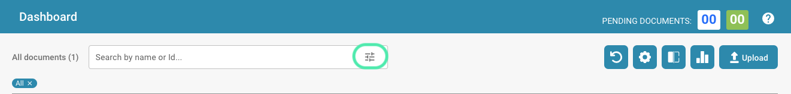
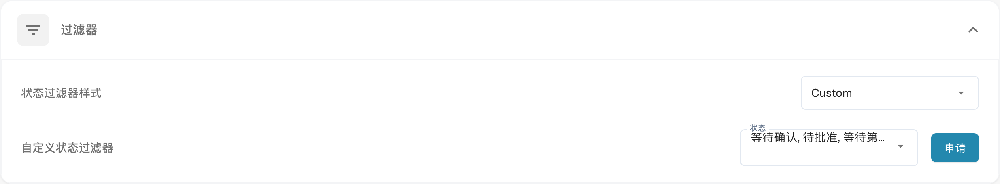
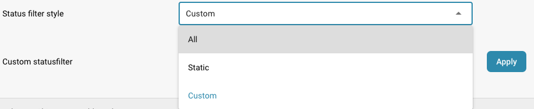
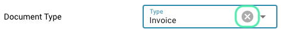
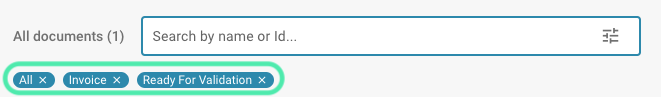

# 自定义筛选器

如果您要查找一份或多份特定文档，可以使用以下选项。我们在搜索栏中提供了多种工具，帮助您找到所需的文档。要使用这些工具，请选择以下图标。

<figure><figcaption></figcaption></figure>

使用筛选器可以帮助用户快速找到相关信息，并将数据范围缩小到必要内容。

## 如何在 DocBits 中自定义和应用筛选器

**访问筛选器设置并打开仪表板：**

* 登录 DocBits，然后打开包含您要筛选数据的仪表板。

**访问筛选器菜单：**

* 点击筛选器图标或搜索字段。

<figure><figcaption></figcaption></figure>

### 自定义筛选器

#### **使用预定义筛选器**

* 打开筛选器菜单。
* 从预定义的筛选器选项中选择（例如：日期、文档类型、分配人员）。
* 选择或输入相应的值来调整筛选条件（例如：日期范围、特定文档类型）。

#### **创建自定义筛选器**

* 在设置中的“Dashboard”（仪表板）下打开筛选器菜单，然后点击“Filters”（筛选器）。

<figure><figcaption>
仪表盘的状态筛选样式和自定义筛选器。 “Custom”尚未翻译，“申请”实际表示应用筛选。
</figcaption></figure>

* 选择要筛选的字段（例如：状态）。

<figure><figcaption></figcaption></figure>

* 定义筛选条件，例如：状态筛选器样式。

<figure><figcaption></figcaption></figure>

* 下拉菜单：从预定义选项中选择。

<figure><figcaption></figcaption></figure>

* 点击“Apply”（应用）以保存自定义筛选器。

<figure><figcaption></figcaption></figure>

#### **使用组合筛选器**

* 打开筛选器菜单，一次选择多个筛选条件。
* 组合筛选条件。
* **示例：** 查找由作者“Max Mustermann”创建，且创建时间在上个月的文档。
* 选择筛选器后，它会自动应用。

#### **应用和管理筛选器**

**应用筛选器**

* 选择并调整所需的筛选器后，筛选器会自动应用。

**移除筛选器**

* 打开筛选器菜单。
* 步骤 2：点击“Clear Filters”（清除筛选器）、已选筛选器旁的 X 图标（位于筛选器菜单或筛选器栏下方），以清除或移除已应用的筛选器。

<figure><figcaption></figcaption></figure>

<figure><figcaption></figcaption></figure>

<figure><figcaption></figcaption></figure>

* 数据将重新显示，不再应用之前的筛选条件。
