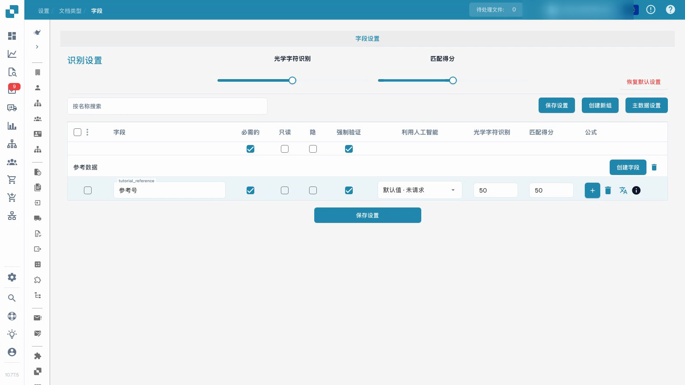

# 文档类型

视频演示了在独立的自定义测试文档类型中配置字段。


文档类型


[带字幕观看](https://docbits-videos.fra1.cdn.digitaloceanspaces.com/settings-assistant/document-types-fields-admin/v1/zh.html)

注意：某些原生产品标签可能未翻译。录像保留了实际的用户界面。

## 概览

文档类型定义用于不同种类文档的配置。DocBits 提供发票和贷记单等标准类型。自定义类型允许管理员为其他类别的业务文档配置字段与处理设置。标准类型无法删除；在组织权限内管理自定义类型。

## 文档类型卡片上的控件

| 控件 | 目的 |
| --- | --- |
| 激活 | 启用或禁用文档类型以进行处理。 |
| Extraction | 选择界面控件显示的提取模式：Flex 或 Fix。这是一种模式选择，与激活开关分开。 |
| 设置，显示为齿轮 | 打开该文档类型的进一步配置。 |

可用的链接取决于类型、权限和启用的模块。当前界面可以提供布局、字段、表格、脚本、模型训练和文档子类型。转换规则、验证规则和电子文档配置在各自功能适用的地方可用。其他配置选项可以位于文档类型的设置中，而不是每张卡片下方的单独选项卡中。

## 配置字段和所需信息

视频使用已创建的、独立的自定义测试文档类型。它更改了该类型的参考字段；它不会更改现有的发票配置。

1. 打开文档类型并选择其字段。
2. 检查字段组和稳定的技术字段名称。可读的显示标签是一个单独的设置；更改它不会创建新的字段 ID。
3. 使参考字段成为必填项，同时保持其可见和可编辑。必须提供所需信息；该设置不会自动补全缺失值或保证正确提取。
4. 将显式字段审查与所需值分开配置。只读、隐藏、OCR 阈值和 Match Score 阈值有其自身的影响；它们不是可互换的开关。
5. 保存配置，重新打开它并验证保存的显示标签和选项。

<figure><figcaption>
独立的测试文档类型中保存的字段。
</figcaption></figure>

演示的结果证明字段配置已保存并重新加载。它不构成模型训练、发票批准、导出或下游验证测试。在生产环境中使用配置之前，请测试代表性文档和预期的普通用户工作流程。

## 自定义验证规则

在提供此功能的地方，打开文档类型的验证规则。要重用现有规则，请遵循 [复制自定义验证规则](duplicate-a-custom-validation-rule.md)。这与视频中显示的各个字段选项是分开的。

## 创建自定义文档类型

打开自定义文档类型部分，选择新建并输入一个清晰的名称。完成针对预期提取模式、字段、组和任何表格提供的设置步骤。模型训练和提取配置与仅仅保存必填字段选项是分开的。


有关设置过程，请参阅 [设置文档类型](../../../setup/document-types/)。


## 附加录像


文档类型

