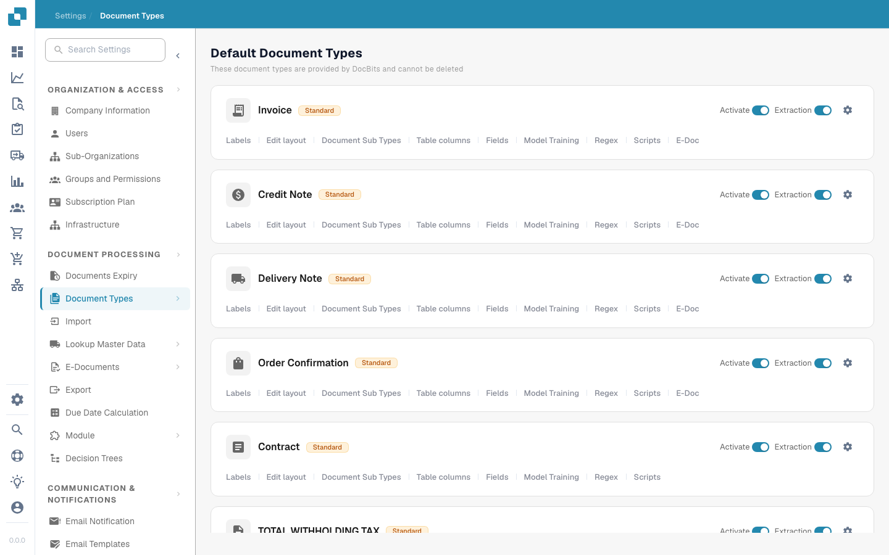

# 文档类型


DocBits 文档类型说明：创建、配置并分配处理设置


<figure><figcaption>
文档类型页面
</figcaption></figure>

## 概览

文档类型页面列出了 DocBits 识别和处理的所有文档类型。页面分为两个部分：

* **默认文档类型**：DocBits 提供的预配置类型（发票、贷项通知单、交货单、订单确认书、合同、ZUGFeRD 等）。这些类型不能删除。
* **自定义文档类型**：为满足特定业务需求而创建的类型。这些类型可以编辑和删除。

## 每种文档类型的控件

每张文档类型卡片都显示以下控件：

| 控件 | 说明 |
|---------|-------------|
| **Activate** | 切换开关，用于启用或停用此文档类型的处理功能。 |
| **Extraction** | 切换开关，用于启用或停用此类型的 AI 数据提取功能。 |
| **Settings**（齿轮图标） | 打开此文档类型的其他配置选项。 |

## 配置选项卡

每种文档类型下方都可以访问以下配置选项卡：

| 选项卡 | 说明 |
|-----|-------------|
| **Labels** | 管理此文档类型的显示标签和翻译。 |
| **Edit layout** | 修改文档在验证视图中的显示方式，包括字段位置。 |
| **Document Sub Types** | 为此文档类型配置子类别（例如不同的发票格式）。 |
| **Table columns** | 自定义行项目表中显示的数据列。 |
| **Fields** | 管理从文档中提取的数据字段（添加、编辑或删除字段）。 |
| **Model Training** | 配置并训练用于识别和提取数据的 AI 模型。 |
| **Regex** | 设置用于基于模式提取数据的正则表达式。 |
| **Scripts** | 编写在文档处理期间运行的自定义处理脚本。 |
| **E-Doc** | 配置电子文档标准（XRechnung、ZUGFeRD、EDI、FatturaPA）。 |

## 自定义验证规则

打开一种文档类型并选择 **Custom Validation Rules**，即可管理该类型专属的验证规则。若要重复使用现有规则而无需重新创建，请参阅[复制自定义验证规则](duplicate-a-custom-validation-rule.md)。该指南介绍规则名称、规则键和确认控件。

## 创建自定义文档类型

1. 向下滚动到 **Custom Document Types** 部分。
2. 点击 **+ New**。
3. 输入新文档类型的名称。
4. 根据需要配置字段、布局和提取设置。


详细设置说明请参阅[设置文档类型](../../../setup/document-types/)。

