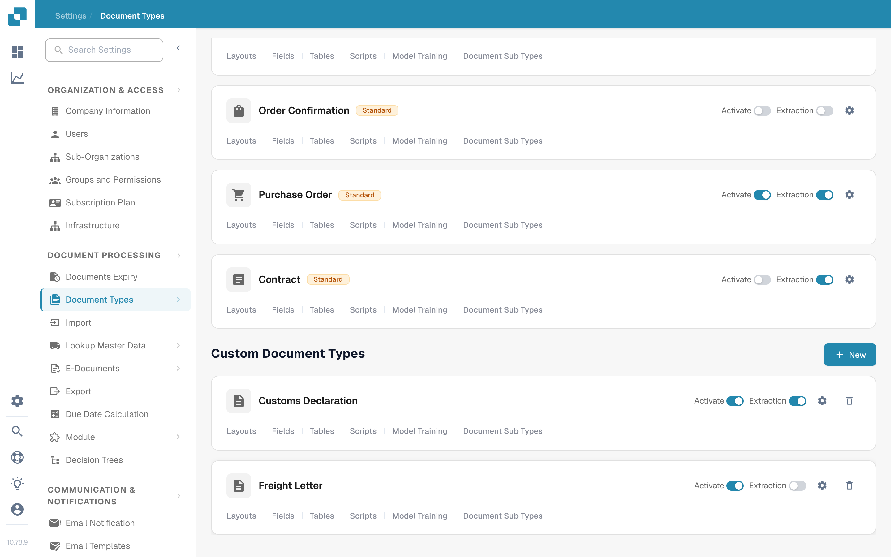
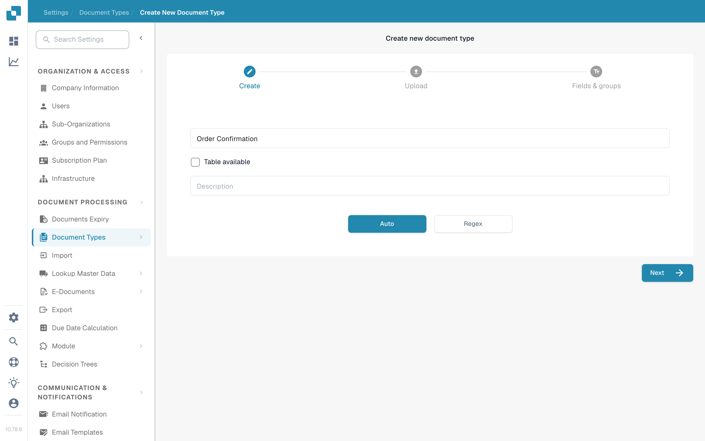

# 添加/编辑文档类型

管理员可以创建自定义文档类型，也可以更改现有文档类型的设置。打开 **Settings → Document Processing → Document Types**。此页面将内置的 **Default Document Types** 与 **Custom Document Types** 分开展示。

<figure><figcaption>
使用文档类型卡片打开要更改的设置。
</figcaption></figure>

## 创建自定义文档类型

1. 滚动到 **Custom Document Types** 并选择 **+ New**。DocBits 提供的默认类型无法删除；如需新增类别，请创建自定义类型。
2. 在 **Create** 页面中，输入清晰的 **Name** 和 **Description**。如果此文档类型需要行项目表格，请选择 **Table available**。选择 **Auto**，使用示例文档训练模型；选择 **Regex**，则使用基于模式的识别。
3. 选择 **Next** 创建文档类型并继续设置。**Next 会在此时保存新类型**，并非仅用于预览。请勿在生产组织中输入测试名称。
4. 对于 **Auto**，请先上传至少 **10 份示例文档**再继续。对于 **Regex**，请至少创建**两个模式**。这些要求来自当前创建流程。有关训练详情，请参阅 [模型训练](model-training/)。
5. 在 **Fields & groups** 下，创建所需的组和至少一个字段。如果已选择 **Table available**，请继续前往 **Tables & columns** 并配置表格。完成所需设置后，选择 **Finish**。

<figure><figcaption>
使用 New 按钮启动自定义文档类型向导。
</figcaption></figure>

<figure><figcaption>
选择类型和识别方法后，再选择 Next。
</figcaption></figure>

## 编辑现有文档类型

在 **Default Document Types** 或 **Custom Document Types** 下找到相应类型的卡片。每张卡片上的控件用途各不相同：

| 控件                   | 功能                                                                                                                                                           |
| ---------------------- | -------------------------------------------------------------------------------------------------------------------------------------------------------------- |
| **Activate**           | 开启或关闭此文档类型的处理功能。更改前请检查当前状态。                                                                                                         |
| **Extraction**         | 在 **Flex** 和 **Fix** 提取模式之间切换；此操作不会启用或停用文档类型。将鼠标悬停在开关上可查看当前模式。                                                     |
| **Settings**（齿轮）   | 打开此文档类型的 **More Settings**。                                                                                                                           |
| **Layouts**            | 打开验证布局。请参阅[导航布局管理器](layout-manager/navigating-the-layout-manager.md)。                                                                          |
| **Fields**             | 打开字段配置。请参阅[添加和编辑字段](fields/adding-and-editing-fields.md)。                                                                                     |
| **Tables**             | 打开此文档类型的表格列设置。                                                                                                                                   |
| **Scripts**            | 如果该功能可用，则打开处理脚本。                                                                                                                               |
| **Model Training**     | 打开训练数据和模型选项。                                                                                                                                       |
| **E-Doc**              | 如果可用，则打开电子文档设置。请参阅 [E-Doc 设置](edi/)。                                                                                                       |
| **Document Sub Types** | 打开子类型设置；请参阅 [文档子类型](document-sub-types.md)。                                                                                                   |

卡片上显示的链接取决于组织启用的功能和文档类型。打开相关部分并进行所需更改，然后在验证视图中检查示例文档，再将更新后的类型用于常规处理。
