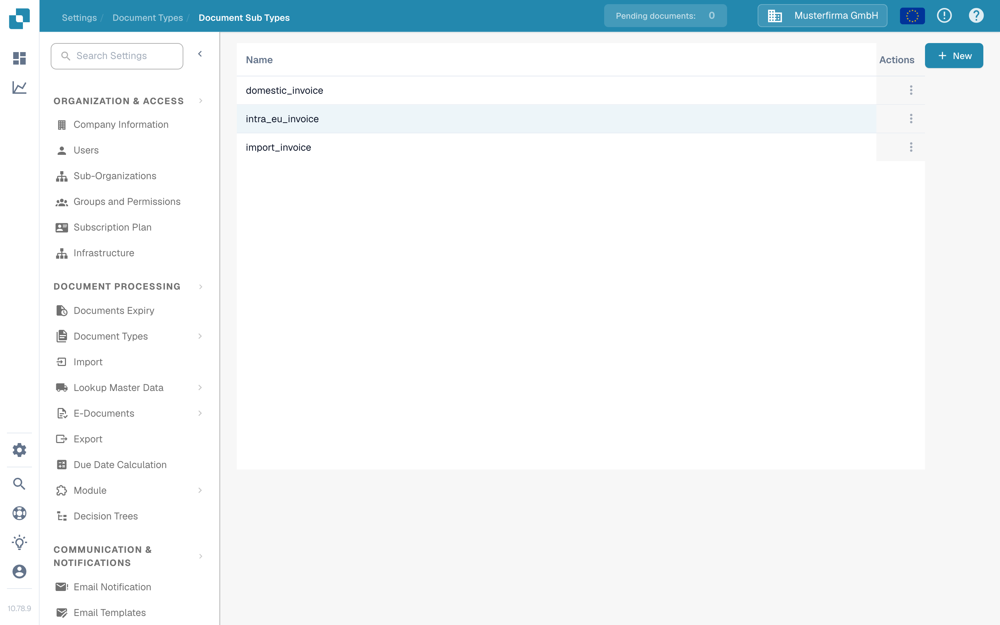
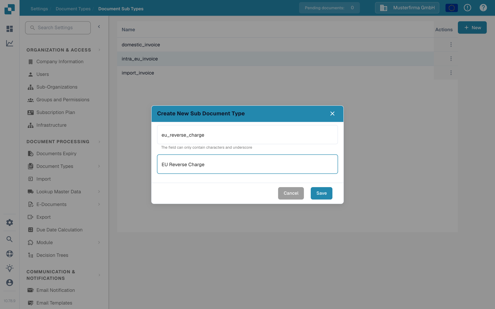

# 创建新的子类型

当某一类文档需要使用独立的字段设置、验证布局或脚本时，请创建文档子类型。你需要有权访问 **Settings → Document Types**。

## 1. 打开文档类型

打开 **Settings → Document Types**。在相关文档类型的卡片中，选择 **Document Sub Types**。以下示例使用 **Invoice**；请选择与你的文档相匹配的类型。卡片中的其他链接用于配置整个文档类型的设置。

<figure><figcaption>
打开要配置的文档类型的子类型。
</figcaption></figure>

## 2. 新建子类型

在 **Document Sub Types** 页面中，选择 **+ New**。现有子类型会显示在列表中；三点 **Actions** 菜单适用于已有行。如果鼠标点击 **+ New** 按钮没有响应，请使用键盘将焦点移至该按钮，然后按 **Enter**。

<figure><figcaption>
文档测试组织中仅包含一个合成示例子类型。
</figcaption></figure>

## 3. 命名并保存

使用字母和下划线输入 **Name**，然后输入描述性的 **Title**。这两个字段都是必填项。此截图中的名称仅为示例。选择 **Save** 创建子类型，或选择 **Cancel** 离开且不创建。

<figure><figcaption>
创建时只需输入 Name 和 Title。
</figcaption></figure>

保存后，新子类型会显示在列表中。要设置其字段、布局或脚本，请打开它的 **Actions** 菜单，并按照[配置子类型](configure-subtypes.md)中的说明操作。这些设置需要在创建后进行，而不是在 **+ New** 对话框中完成。
