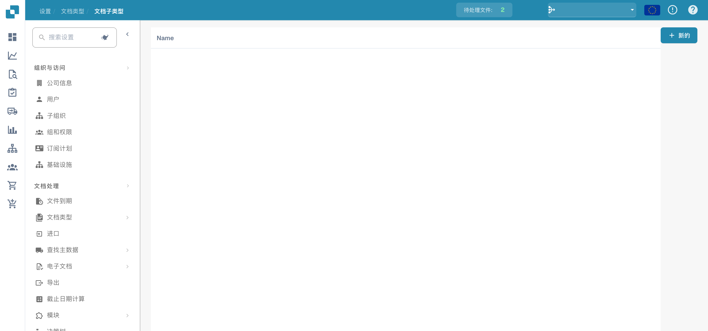
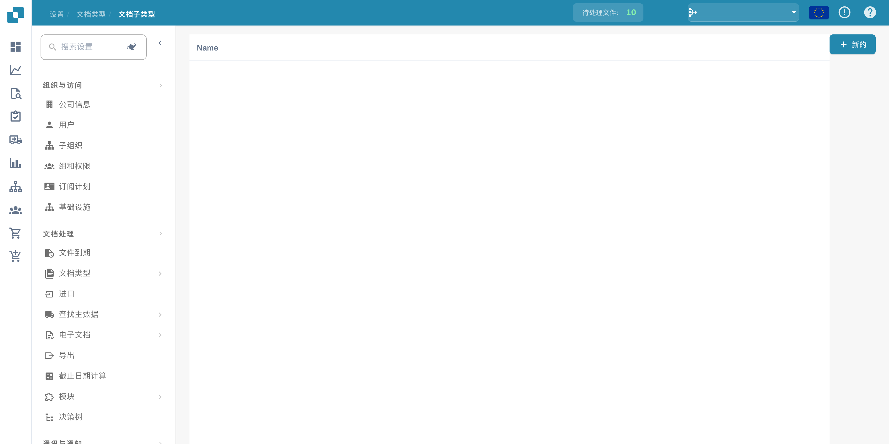

# 文档子类型

文档子类型用于细分文档类型。打开文档类型的子类型管理。

<figure><figcaption>
文档子类型概览。
</figcaption></figure>

检查现有列表及启用选项。

<figure><figcaption>
设置中的文档子类型列表。
</figcaption></figure>

保存前检查子类型、分类规则和相关流程是否一致。可用操作取决于权限和文档类型。图片没有保存或启用新的子类型。
