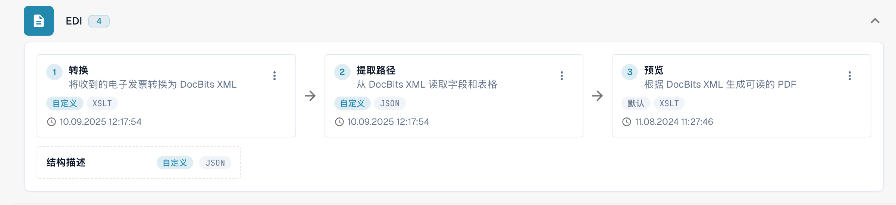
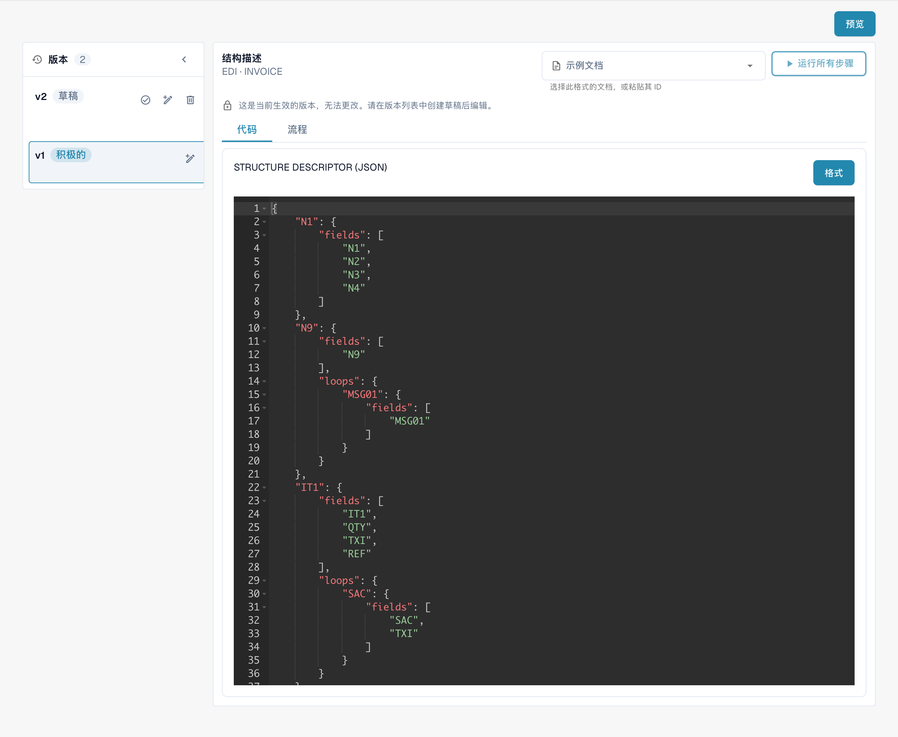

# 电子单据


DocBits 电子发票教程：处理 XRechnung / ZUGFeRD (Factur-X)、验证数据并自动化工作流


<figure><figcaption>
EDI 配置中的转换、提取路径、预览及结构描述入口。
</figcaption></figure>

#### 概览

在 DocBits 中，EDI 设置提供了用于定义和管理 EDI 消息结构与格式的工具，这些消息对应于各种文档类型，例如发票或采购订单。这些设置支持自定义 EDI 消息，以符合不同贸易伙伴和行业的特定标准与要求。

#### 主要功能和选项

1. **EDI 配置元素**：
   * **结构描述符**：定义 EDI 文档的基本结构，包括使 EDI 文档有效所需的分段顺序、必填字段和限定符。
   * **转换**：指定将文档数据转换为 EDI 格式消息时应用的转换规则。这通常包括指定文档字段到 EDI 分段和元素的映射。
   * **预览**：允许管理员查看转换后的 EDI 消息效果，以便在传输前确保准确性。
   * **提取路径**：显示用于从文档中提取值的路径，这些值随后用于填充 EDI 消息。
2. **XSLT 编辑器**：
   * 用于编辑和验证转换过程中使用的 XSLT（可扩展样式表语言转换）。XSLT 是一种功能强大的语言，专为将 XML 文档转换为其他 XML 文档或 HTML、文本等其他格式，甚至其他 XML 结构而设计。

<figure><figcaption>
已生效的结构描述版本：只读编辑器中显示 JSON 配置。
</figcaption></figure>

## 实际生效的规则与激活

如果电子贷项通知单显示为 Invoice，请按照[分类故障排查指南](credit-note-recognized-as-invoice.md)进行检查。该指南涵盖实际生效的自定义或默认源代码、类型代码、Extraction Paths，以及安全激活步骤。

## 国家指南

请参阅国家指南，了解准确格式名称、语法、版本限制和已检查的配置状态。 [eDocs 格式、版本和国家指南](supported-electronic-documents/README.md).

这些视图显示现有配置及其版本。设置因文档类型和格式而异。请在草稿中验证更改后再激活。

图片展示中文流程卡片和只读配置。在所示版本中，Active 状态误译为“积极的”，实际表示已生效。技术编辑器标题、属性标识符及配置代码保留原文。
