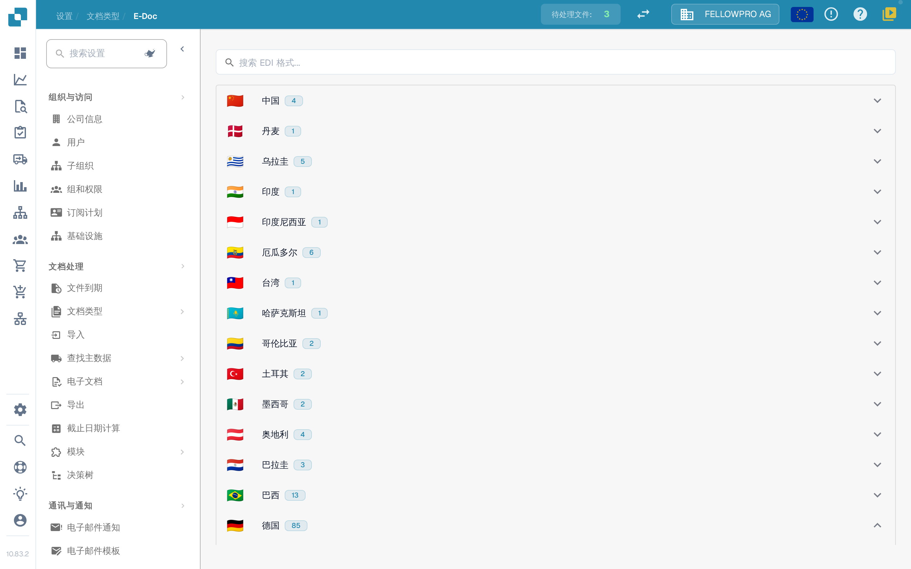
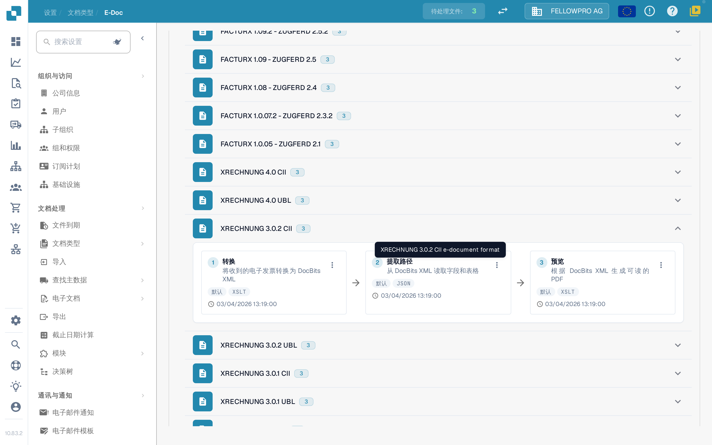
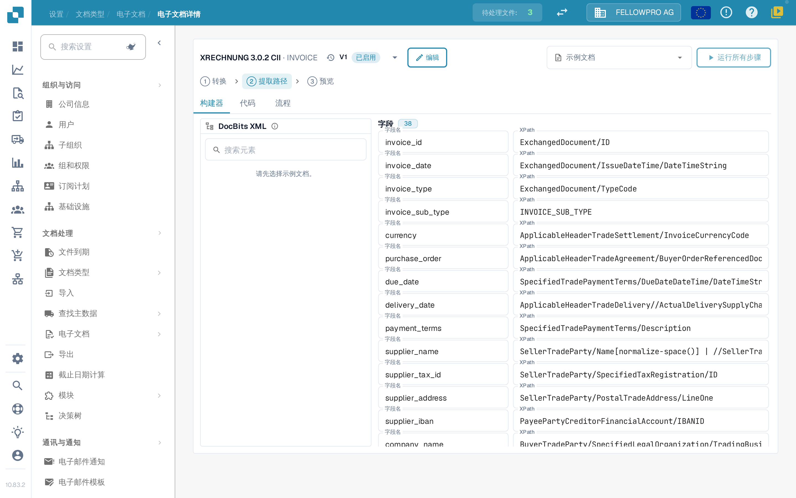

# 电子单据

XRechnung、ZUGFeRD/Factur-X、CFDI 或 FatturaPA 等电子单据以 XML 或混合 PDF 的形式到达。DocBits 读取文件、提取发票数据并生成可读的 PDF。**E-Doc** 设置中保存着贵组织使用的每种格式的规则。

## 打开 E-Doc 管理

1. 打开**设置 → 单据类型**。
2. 选择单据类型（例如**发票**），然后打开**E-Doc**。

格式按国家/地区分组。每个国家/地区显示其国旗、名称及其包含的格式数量。

<figure><figcaption>
格式按国家/地区分组，初始处于折叠状态。
</figcaption></figure>

选择一个国家/地区即可打开其格式。在同一国家/地区内，最新版本排在最前面。Factur-X / ZUGFeRD 等组合格式位于德国之下。搜索字段可同时检索格式名称和国家/地区名称。

<figure><figcaption>
打开一个国家/地区即可查看其格式。
</figcaption></figure>

## 格式及其步骤

每种格式将其步骤显示为通过箭头连接的三张卡片，顺序与 DocBits 执行它们的顺序一致：

| 步骤 | 作用 |
| --- | --- |
| **转换** | 将传入的 XML 映射到 DocBits XML。 |
| **提取路径** | 定义 DocBits 从转换后的 XML 中提取哪些值。 |
| **预览** | 定义 DocBits 生成的可读 PDF 的布局。 |

格式的其他属性列在卡片下方。

<figure><figcaption>
格式的三个步骤：转换、提取路径和预览。
</figcaption></figure>

选择一张卡片即可打开该步骤。

## 编辑步骤

三种步骤的详情页面结构相同：

* 页眉显示格式以及包含其版本的下拉菜单，其中显示每个版本的状态。通过下拉菜单可以激活、编辑或删除版本。
* **构建器**、**代码**和**流程**在可视化编辑器、底层样式表或 JSON 以及流水线结果之间切换。
* **示例文档**提供此格式的最新单据；也可以粘贴单据 ID 或 URL。
* **运行所有步骤**一次性为示例单据运行转换、提取和预览。
* **Ctrl + S** 保存草稿。

编辑已激活或已使用的版本不会直接更改它：DocBits 会创建草稿副本并打开该副本。未使用的草稿将直接编辑。手写的步骤会保留在**代码**中，直到构建器能够原样接管它为止。

<figure><figcaption>
详情页面：页眉中的版本下拉菜单、构建器、代码和流程标签页、示例文档和步骤本身。
</figcaption></figure>

### 转换

**构建器**在左侧显示源 XML，中间显示映射，右侧显示生成的 XML。在源树中选择一个元素并将其拖到字段上，或者添加固定的文本值。

一个字段可以由多个部分组成，每个部分可以带有条件：**存在**、**缺失**、**等于**、**不等于**或自由 XPath 表达式，并通过**全部**或**任意**连接。这三个面板可以调整大小，结果区域有**字段**列表和 **XML** 视图。

### 提取路径

提取路径构建器在左侧显示 DocBits XML，中间显示字段，右侧显示每个字段使用的路径。选择一个字段并设置其路径；现有条目（包括较早的扁平条目）仍会继续工作。

<figure><figcaption>
提取路径构建器：DocBits XML、字段及其路径。
</figcaption></figure>

### 预览

预览构建器通过拖放块来编排 PDF，并在其旁边显示结果。页面大小、页边距、字号、颜色和块间距针对整个单据设置，并应用于每个块。

### 流程

**流程**显示所选示例单据的完整流水线：转换产生了什么、提取路径找到了哪些值以及预览如何呈现它们。使用它可以在不离开页面的情况下端到端检查更改。

## 相关页面

* [eDocs 格式、版本和国家指南](supported-electronic-documents/README.md)

本页面的屏幕截图显示中文界面。
