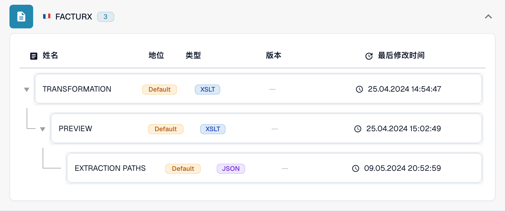
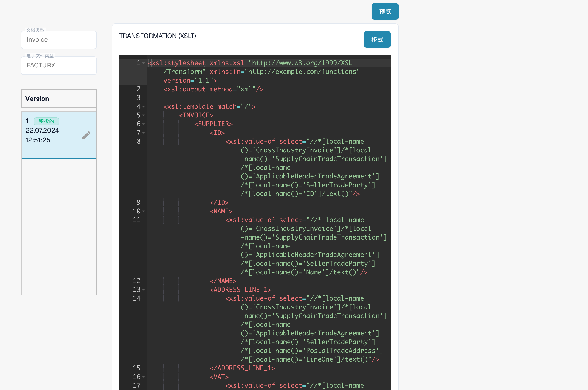

# 电子贷项通知单被识别为发票

即使原始 XML 中包含贷项通知单代码，电子贷项通知单仍可能显示为 **Invoice**。在将其视为产品缺陷之前，请先检查实际生效的配置。对于同一种 eDoc 格式，组织专属的 **TRANSFORMATION** 优先于默认规则。因此，`<INVOICE_TYPE>Invoice</INVOICE_TYPE>` 这样的固定值可能覆盖默认分类。

## 检查电子贷项通知单分类

视频以 FACTURX 1.0.05 / ZUGFeRD 2.1 为例，展示在 DocBits 中进行只读检查的过程。您组织中的映射和版本可能不同。请始终检查所识别格式的活动 Transformation。

视频中的旧版 XSLT 示例包含针对 381 和 389 的分支。请检查实际的 Transformation，确认这一具体版本保留哪些代码；通用代码列表不能证明每个历史映射都支持这些代码。



[检查电子贷项通知单分类](https://docbits-videos.fra1.cdn.digitaloceanspaces.com/settings-assistant/edocs_credit_note/v2/zh.mp4)

[WebVTT](https://docbits-videos.fra1.cdn.digitaloceanspaces.com/settings-assistant/edocs_credit_note/v2/zh.vtt)

## 检查文档代码

请读取原始 XML 中的类型代码，不要仅依据 PDF 或文档标题。代码的位置取决于 XML 语法：CII 使用 `ExchangedDocument/TypeCode`；UBL 使用 `InvoiceTypeCode` 或 `CreditNoteTypeCode`。检查 XPath 时，请注意 XML 命名空间。

| 代码 | 含义 | 分类检查 |
| --- | --- | --- |
| `380` | 商业发票 | Invoice |
| `381` | 贷项通知单 | Credit Note |
| `261` | 由买方代开具的贷项通知单 | 默认映射为 Credit Note (FACTURX/ZUGFeRD) |
| `383` | 借项通知单 | 不要仅因其调整发票就映射为 Credit Note |
| `384` | 更正发票 | 不要仅因其更正发票就映射为 Credit Note |

FACTURX/ZUGFeRD 默认的贷项通知单映射包括 **381 和 261**。即使业务需求只提到 381，383 或 384 也不会因此成为贷项通知单代码。如果需要偏离默认映射，请与会计系统集成负责人确认。

## 查明值在哪一步发生变化

1. **确认实际格式。** 打开**设置 → 文档类型 → Invoice → E-Doc**。选择受影响文档实际检测出的格式，例如 **FACTURX**。ZUGFeRD PDF 可能包含 Factur-X XML；检查其他格式的规则无法解释此文档的处理结果。
2. **检查实际生效的源代码和版本。** 查看 **TRANSFORMATION**。列表通过 **Default** 和 **Custom** 区分规则来源。打开规则，记录活动版本及其源代码。较新的草稿不一定已经生效。对于历史文档，请确认当时处理时实际使用的来源和版本；它可能与当前活动版本不同。请将组织的自定义源代码与默认源代码比较，不要假定系统正在使用默认规则。

<figure><figcaption>状态用于标识每条规则的来源。此示例使用默认规则。</figcaption></figure>

3. **检查转换后的 XML。** 对于 FACTURX/ZUGFeRD，请在实际生效的 XSLT 中搜索 `INVOICE_TYPE`。如果原始代码为 381，而输出却固定为 `<INVOICE_TYPE>Invoice</INVOICE_TYPE>`，则存在配置问题。测试拟采用的转换并检查输出；贷项通知单的预期结果为 `Credit Note`。请保留组织所需的其他自定义映射。
4. **检查 Extraction Paths。** 确认 DocBits 字段 ID `invoice_type` 读取的是**转换后 XML** 中预期的分类节点。FACTURX/ZUGFeRD 通常使用 `INVOICE_TYPE`；XRechnung 可能保留 `TypeCode`（CII）、`InvoiceTypeCode` 或 `CreditNoteTypeCode`（UBL）。选择路径前，请检查实际生效的来源及其输出。XML 结构发生变化后，指向原始文件的路径可能不再有效。请参阅 [Extraction Paths 指南](edi/edi-extraction-paths-file-guide.md)。
5. **检查后续处理。** 查看可能为 `invoice_type` 赋值的脚本，然后比较已保存的字段、仪表板和导出数据。仅有正确的转换并不能证明后续脚本会保留该值。渲染后的 **Preview** 展示的是呈现效果，不能证明已保存的分类正确。

<figure><figcaption>在创建或激活更改之前，请检查所选源代码和版本。</figcaption></figure>

完整 MCP 流程请参阅[使用 Claude 或 Codex 配置 DocBits](../../../../../advanced-functions-and-tools/docbits-mcp/configuration-with-claude-or-codex.md)。`list_edoc_custom_attributes`、`get_edoc_attribute_source` 和 `list_edoc_attribute_versions` 用于确定源代码和激活值。`preview_edoc_custom_xslt` 可预览候选转换。`compare_edoc_extraction` 只比较 Extraction Paths，并要求已有自定义提取路径属性。`test_electronic_document` 测试当前激活配置，不会测试未激活草稿。

## 安全地纠正并激活

1. 记录当前活动版本，并保留其源代码，以便回滚。
2. 通过铅笔图标创建**草稿**。修改诊断中发现有问题的分类条件或提取路径。避免为了纠正一个字段而替换整个转换。
3. 选择草稿并**保存（Save）**。保存草稿**不会**激活该草稿。
4. 在开发或测试组织中，使用有代表性的文档测试草稿：包括代码 380 和 381。如果检测出的格式和工作流接受代码 261、383 和 384，也应纳入测试。检查分类、金额和其他自定义字段，并与活动版本的结果进行比较。
5. 检查通过后，使用草稿旁的**勾号**将其激活。确认目标版本现在显示为 **Active**。使用 MCP 时，通过 `activate_edoc_attribute_version` 激活；激活与试运行是两个独立操作。
6. 处理一个新的测试文档。验证已保存的 `invoice_type`、仪表板、金额，以及导出到 **Infor ERP / SAP** 或其他目标系统的数据。保留上一版本，以便回滚。


在比较并保留组织所需的自定义配置之前，不要将其规则重置为默认规则。不要批量重新启动历史文档。重新启动会删除已提取的数据和导出日志，并可能再次触发审批或导出处理。决定如何重新处理文档之前，请逐一检查其导出状态、审批情况和手动修改。


## 单独检查金额正负号

分类与金额正负号需要结合检查。[Set Negative Sign for Credit Notes](../../../document-processing/module/set-negative-sign-for-credit-notes.md) 默认启用，但可以禁用。启用时，此设置会将贷项通知单金额保存为负值。请检查组织的实际设置和接收系统的正负号约定，不要仅凭金额正负号推断文档类型。

如果确认活动源代码无误后，结果仍然不正确，请保留原始 XML、检测出的格式、版本 ID、转换输出、提取映射，以及后续脚本造成的任何更改，并提供给支持团队。这些信息有助于确定差异是由配置引起，还是需要进一步调查产品行为。

<!-- 内部依据：TRL-72。组织专属的固定值是一个可能原因；尚未最终排除后续脚本或历史实际生效版本的影响。 -->
