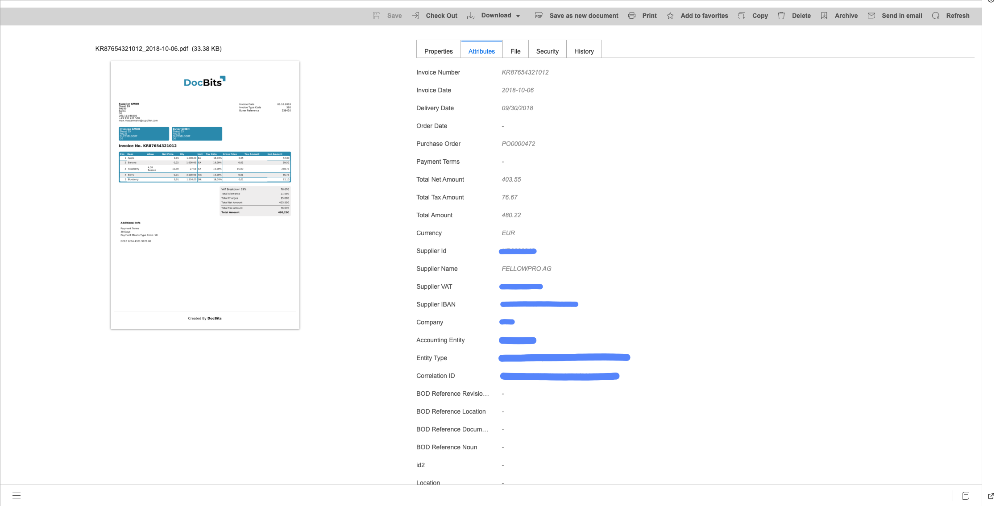
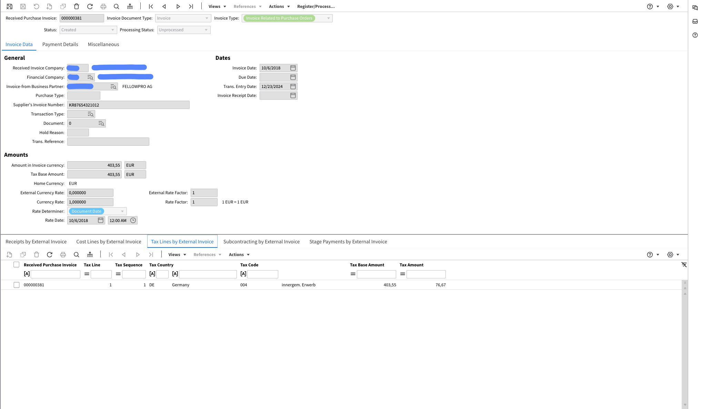
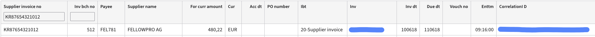
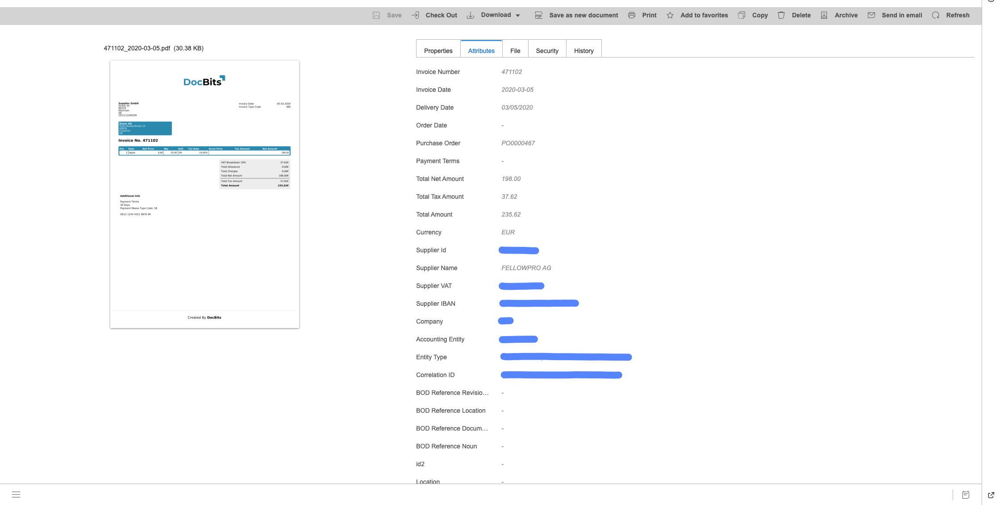
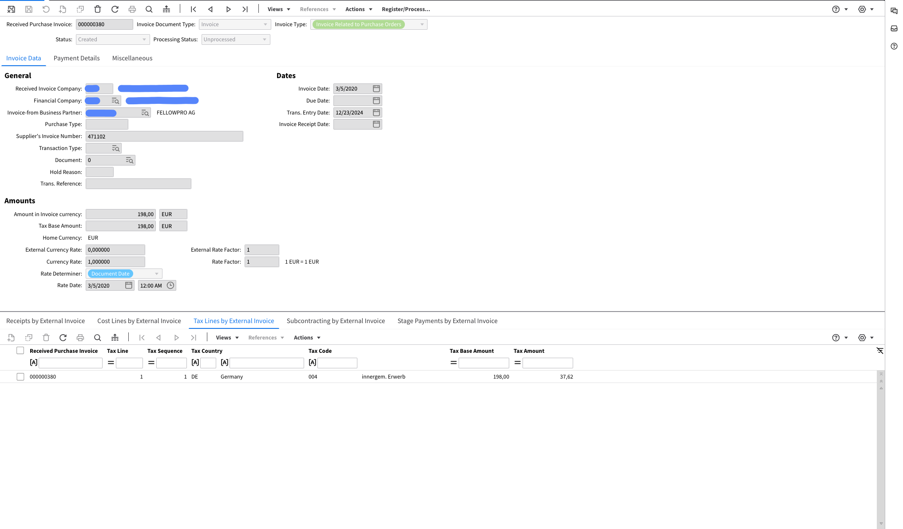
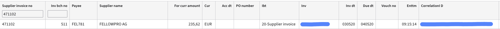

# FacturX

### **扩展版：**

导出到文档管理系统（IDM）：

<figure><figcaption></figcaption></figure>

导出到 Infor LN：

<figure><figcaption></figcaption></figure>

导出到 Infor M3：

<figure><figcaption></figcaption></figure>

### **基础版：**

导出到文档管理系统（IDM）：

<figure><figcaption></figcaption></figure>

导出到 Infor LN：

<figure><figcaption></figcaption></figure>

导出到 Infor M3：

<figure><figcaption></figcaption></figure>
