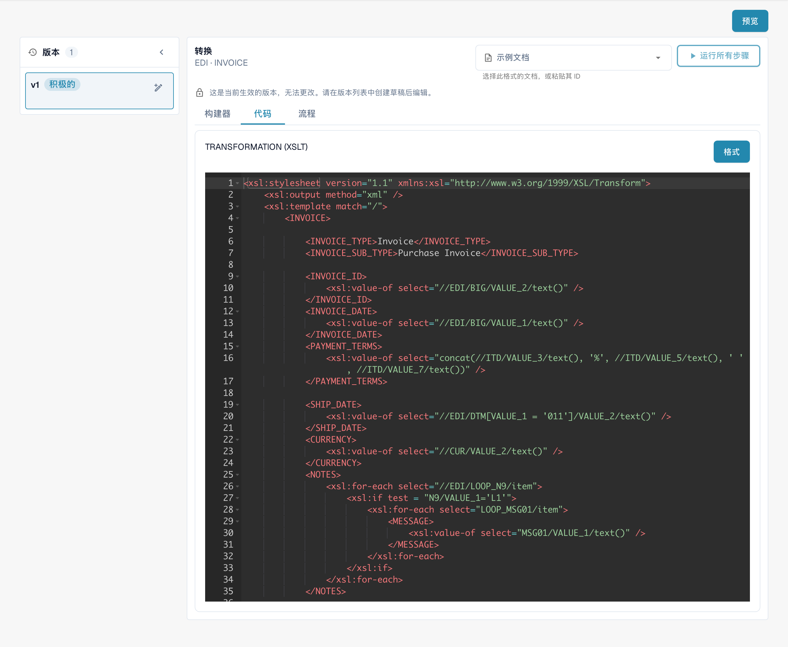
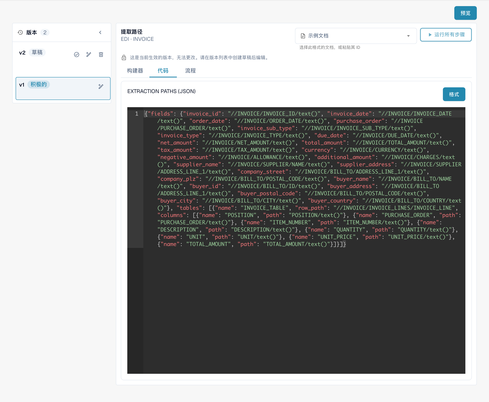

# 设置 EDI 模板

## 以下是设置 EDI 模板的分步说明：

<figure><figcaption>
EDI 配置中的转换、提取路径、预览及结构描述入口。
</figcaption></figure>

**定义结构描述符：**

* 确定您正在处理的 EDI 消息类型，例如 ANSI X12、EDIFACT 或自定义格式。
* 确定 EDI 结构中的段、元素和子元素。
* 创建能够准确反映 EDI 消息层级和组织方式的结构描述符。您可以使用 XML 或 JSON 等特殊语法创建。

<figure><figcaption>
已生效的结构描述版本：只读编辑器中显示 JSON 配置。
</figcaption></figure>

**设置转换：**

* 使用支持 EDI 转换的合适工具或软件，例如 EDI 转换器。
* 定义将 EDI 消息转换为系统内部格式以及反向转换的规则。
* 配置转换规则，根据系统要求解析和处理段、元素和子元素。彻底测试转换，确保数据得到正确解析和格式化。

<figure><figcaption>
已生效的转换版本：将电子文档转换为 DocBits XML 的 XSLT 源代码。
</figcaption></figure>

**配置提取路径，以优化数据提取和格式化：**

* 确定要提取并传输到内部系统的数据字段。
* 定义提取路径或规则，从 EDI 消息中提取相关数据字段。
* 考虑传入 EDI 消息中可能出现的不同变体和格式，并确保提取路径具有足够的灵活性，能够适应这些情况。
* 验证提取结果，确保提取的数据字段正确且格式正确。

<figure><figcaption>
已生效的提取路径版本：包含 XPath 表达式的 JSON 配置。
</figcaption></figure>

通过谨慎定义结构描述符、设置转换并配置提取路径，您可以确保 EDI 模板中的数据提取和格式化达到最佳效果。这有助于提高电子商务通信的效率和准确性。

这些视图显示现有配置及其版本。设置因文档类型和格式而异。请在草稿中验证更改后再激活。

图片展示中文流程卡片和只读配置。在所示版本中，Active 状态误译为“积极的”，实际表示已生效。技术编辑器标题、属性标识符及配置代码保留原文。
