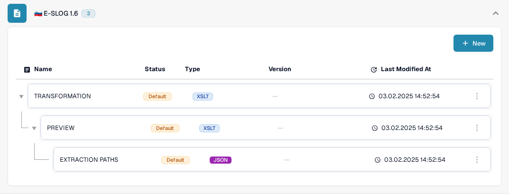

# eSLOG 1.6 和 2.0

**eSLOG 1.6** 和 **eSLOG 2.0** 在 DocBits 中显示为单独的电子发票格式。请根据收到的斯洛文尼亚发票选择所用版本。以下截图展示的是文档测试组织中当前的英文 Sandbox 界面；它们不能证明任何一个版本的发票已成功处理。

## 查找配置

1. 前往 **Settings → Document Types → Invoice → E-Doc**。
2. 展开 **E-SLOG 1.6** 或 **E-SLOG 2.0**。每种格式都有自己的三项配置。

<figure><figcaption>Invoice E-Doc 列表中的 E-SLOG 1.6。</figcaption></figure>

<figure><figcaption>E-SLOG 2.0 为相同的三个步骤提供了单独的配置。</figcaption></figure>

| 条目 | 控制内容 | 后续指南 |
| --- | --- | --- |
| **TRANSFORMATION (XSLT)** | 将该格式的源数据转换为结构化 XML。 | [转换](edi/edi-transformation-file-guide.md) |
| **PREVIEW (XSLT)** | 定义可读的文档视图。 | [预览](edi/edi-preview-file-guide.md) |
| **EXTRACTION PATHS (JSON)** | 将 XML 值映射到 DocBits 字段和表格列。 | [提取路径](edi/edi-extraction-paths-file-guide.md) |

点击某一行可查看其版本和配置。**Default** 表示系统提供的条目。**Last Modified At** 显示该条目上次更改的时间。**New** 按钮用于新增配置条目。默认行上的三点菜单提供 **Customize**（创建组织专用副本）和 **Delete**；使用 Delete 前，请仔细确认所选行。

在配置中，点击活动版本旁的铅笔图标可创建草稿。使用 **Preview** 测试面板和一个具有代表性的已上传文档 ID 检查草稿，然后点击勾选图标将其激活。草稿的垃圾桶图标会删除该草稿。实际字段名称和 XML 路径取决于你的 eSLOG 文件；编辑器的具体操作请参阅上方相应指南。
