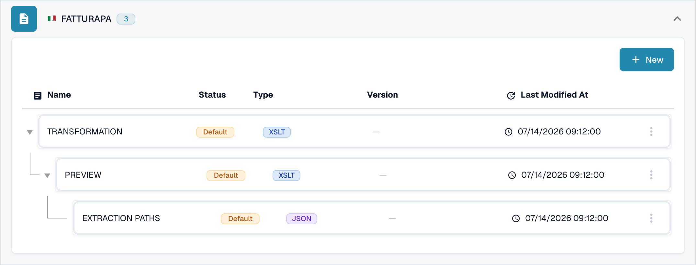
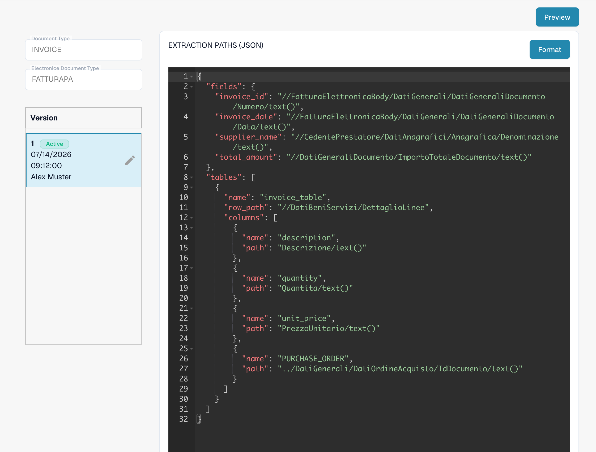
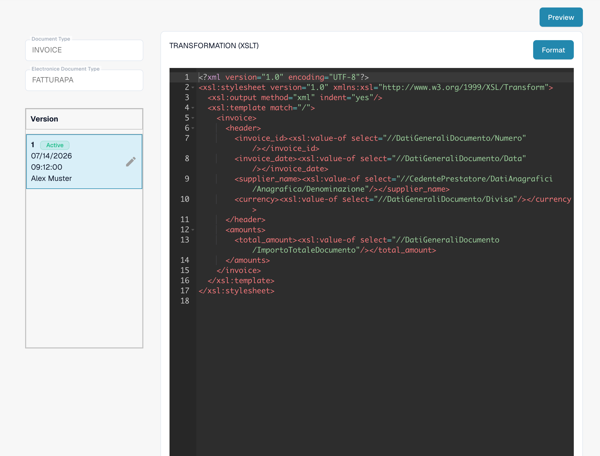
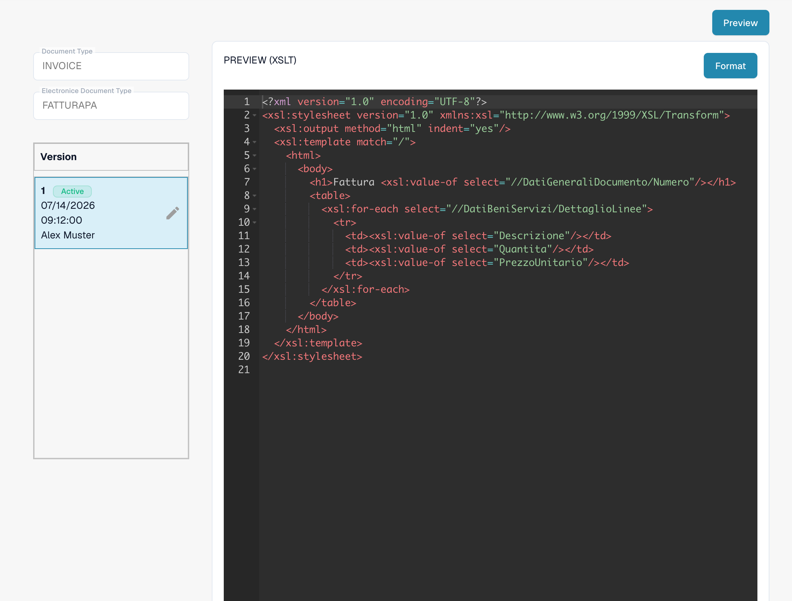

# FatturaPA：在发票行上显示属性

FatturaPA 是意大利电子发票格式。本页介绍如何在更改映射或发票预览之前检查行属性，例如采购订单编号。**检查当前生效的映射之前，请勿添加第二个 `PURCHASE_ORDER` 列：当前 Sandbox 映射中已经包含一个。**

## 查找三个 FatturaPA 文件

打开 **Settings → Document Types → E-Doc**，选择 **Invoice**，然后展开 **FATTURAPA**。当前列表中有三个不同的文件：

* **TRANSFORMATION (XSLT)** 读取源 FatturaPA XML，并生成规范化的发票数据。
* **PREVIEW (XSLT)** 根据这些数据生成可视化的 HTML/PDF 风格发票预览。
* **EXTRACTION PATHS (JSON)** 将规范化后的值映射到 DocBits 字段和表格列。

<figure><figcaption>
英文 Sandbox 中当前的 FATTURAPA 文件列表。
</figcaption></figure>

## 检查提取的行值

打开 **EXTRACTION PATHS (JSON)**。在生效版本中，找到 `tables` 数组及其中的 `columns`。Sandbox 当前显示的版本已包含 `{"name": "PURCHASE_ORDER", "path": "PURCHASE_ORDER"}`。编辑前，请在真实测试发票中检查该值。如果需要添加其他属性，请先在规范化数据中确认其值，然后在草稿版本中添加一个不同的列名及对应路径。

<figure><figcaption>
生效的 JSON 提取映射中已包含采购订单列。
</figcaption></figure>

## 仅在需要时更改转换或预览

如果缺少规范化后的值，请检查 **TRANSFORMATION (XSLT)** 以及应生成该值的源 XML 路径。此处的更改会影响后续映射和预览步骤所使用的数据。如果提取的值正确，但未显示在可视化发票中，请检查 **PREVIEW (XSLT)** 以及该模板中的相关表格行。这两个 XSLT 文件的用途不同。

<figure><figcaption>
转换会读取源 XML 并生成规范化的发票字段。
</figcaption></figure>

<figure><figcaption>
预览控制发票的可视化输出。
</figcaption></figure>

使用版本卡片上的铅笔图标准备更改。检查草稿，并使用一张有代表性的 FatturaPA 发票通过 **Preview** 进行预览。截图展示的是当前生效版本；在本次 Sandbox 会话中，没有保存草稿，也没有运行预览测试。

此前关于所有 E-Document 均以英国为原产地的说明，并非普遍适用的可靠规则。请根据源文档和组织配置，检查发票的国家/地区、货币和编号格式。
