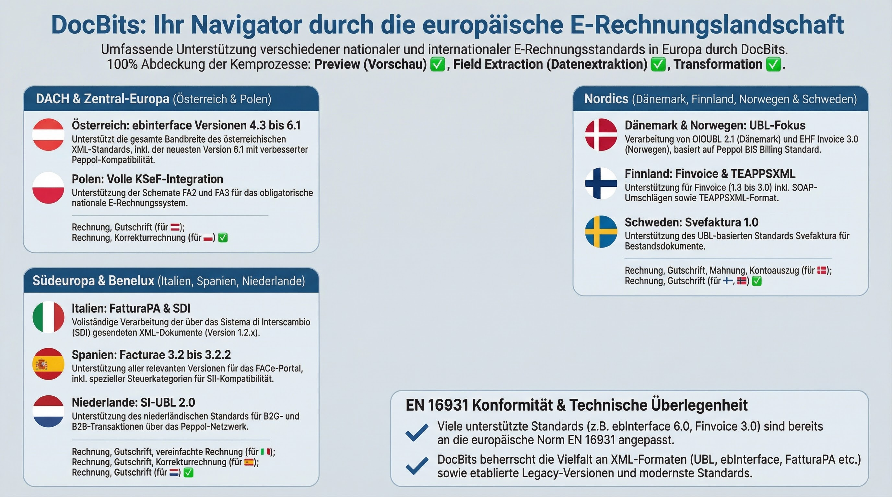
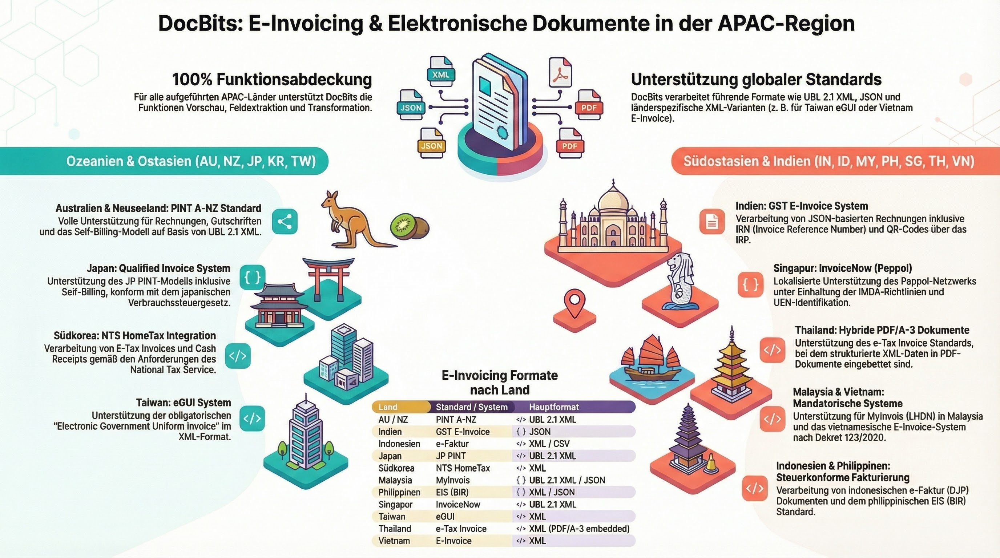

# 支持的电子文档

DocBits 支持 **120 多种电子发票和文档标准**，覆盖 **30 多个国家/地区**。系统会自动检测并解析每种格式，提取其中的字段，从而实现无缝的文档处理。

## 电子文档在 DocBits 中的工作方式

1. **上传** — 上传 XML/EDI 文件，或通过 API/电子邮件接收文件
2. **自动检测** — DocBits 识别确切的标准和版本
3. **预览** — 生成便于阅读的 HTML 预览
4. **字段提取** — 提取关键字段（发票编号、金额、行项目）
5. **验证和导出** — 验证数据并将其导出到 ERP 系统


有关详细配置，请参阅 [EDI 设置](../)。有关 Peppol、XRechnung 和 ZUGFeRD 的深入介绍，请参阅下方的专门页面。


## 快速链接

| 主题                         | 链接                                                                         |
| ---------------------------- | ---------------------------------------------------------------------------- |
| EDI 概览                     | [EDI 设置](../)                                                              |
| XRechnung（所有版本）        | [XRechnung](../xrechnung/)                                                   |
| ZUGFeRD / Factur-X           | [ZUGFeRD](../zugferd/)                                                       |
| Peppol BIS 3.0               | [Peppol BIS Billing](../peppol-bis-billing-3.0)                              |
| 电子发票标准概览             | [当前支持的标准](../currently-supported-e-invoice-standards/)                 |

***

## 欧洲

<figure><figcaption>
欧洲电子发票标准概览
</figcaption></figure>

### 🇩🇪 德国

<figure><figcaption>
XRechnung — 全部 26 个版本（CII &#x26; UBL）
</figcaption></figure>

<figure><figcaption>
ZUGFeRD / Factur-X — 所有版本
</figcaption></figure>

### 🇦🇹 奥地利

| 标准                   | 页面                                                  |
| ---------------------- | ----------------------------------------------------- |
| ebInterface（概览）    | [AUSTRIA EBINTERFACE](austria-ebinterface.md)         |
| ebInterface 6.0        | [AUSTRIA EBINTERFACE 6.0](austria-ebinterface-6-0.md) |
| ebInterface 6.1        | [AUSTRIA EBINTERFACE 6.1](austria-ebinterface-6-1.md) |

### 🇩🇰 丹麦

| 标准              | 页面                                |
| ----------------- | ----------------------------------- |
| OIOUBL（概览）    | [DENMARK OIOUBL](denmark-oioubl.md) |
| OIOUBL 2.1        | [OIOUBL 2.1](oioubl-2-1.md)         |

### 🇫🇮 芬兰

| 标准      | 页面                              |
| --------- | --------------------------------- |
| Finvoice 1.3  | [FINVOICE 1.3](finvoice-1-3.md)   |
| Finvoice 2.0  | [FINVOICE 2.0](finvoice-2-0.md)   |
| Finvoice 2.01 | [FINVOICE 2.01](finvoice-2-01.md) |
| Finvoice 3.0  | [FINVOICE 3.0](finvoice-3-0.md)   |
| TEAPPSXML     | [TEAPPSXML](teappsxml.md)         |

### 🇫🇷 法国

| 标准                               | 页面                                                  |
| ---------------------------------- | ----------------------------------------------------- |
| Factur-X（通用）                  | [FACTURX](facturx.md)                                 |
| Factur-X 1.0.05 / ZUGFeRD 2.1     | [FACTURX 1.0.05](facturx-1-0-05-zugferd-2-1.md)       |
| Factur-X 1.0.07.2 / ZUGFeRD 2.3.2 | [FACTURX 1.0.07.2](facturx-1-0-07-2-zugferd-2-3-2.md) |

### 🇩🇪 德国

| 标准                            | 页面                                                      |
| ------------------------------- | --------------------------------------------------------- |
| XRechnung 1.0–3.0.2（CII & UBL） | [26 个版本](xrechnung-1-0-cii.md) — 查看下方完整列表 |
| ZUGFeRD 1.0–2.3.2               | [7 个版本](zugferd-1-0.md) — 查看下方完整列表        |

全部 26 个 XRechnung 版本

| 版本    | CII                           | UBL                           |
| ------- | ----------------------------- | ----------------------------- |
| 1.0     | [CII](xrechnung-1-0-cii.md)   | [UBL](xrechnung-1-0-ubl.md)   |
| 1.1     | [CII](xrechnung-1-1-cii.md)   | [UBL](xrechnung-1-1-ubl.md)   |
| 1.2     | [CII](xrechnung-1-2-cii.md)   | [UBL](xrechnung-1-2-ubl.md)   |
| 1.2.1   | [CII](xrechnung-1-2-1-cii.md) | [UBL](xrechnung-1-2-1-ubl.md) |
| 1.2.2   | [CII](xrechnung-1-2-2-cii.md) | [UBL](xrechnung-1-2-2-ubl.md) |
| 2.0     | [CII](xrechnung-2-0-cii.md)   | [UBL](xrechnung-2-0-ubl.md)   |
| 2.0.1   | [CII](xrechnung-2-0-1-cii.md) | [UBL](xrechnung-2-0-1-ubl.md) |
| 2.1     | [CII](xrechnung-2-1-cii.md)   | [UBL](xrechnung-2-1-ubl.md)   |
| 2.2     | [CII](xrechnung-2-2-cii.md)   | [UBL](xrechnung-2-2-ubl.md)   |
| 2.3     | [CII](xrechnung-2-3-cii.md)   | [UBL](xrechnung-2-3-ubl.md)   |
| 3.0     | [CII](xrechnung-3-0-cii.md)   | [UBL](xrechnung-3-0-ubl.md)   |
| 3.0.1   | [CII](xrechnung-3-0-1-cii.md) | [UBL](xrechnung-3-0-1-ubl.md) |
| 3.0.2   | [CII](xrechnung-3-0-2-cii.md) | [UBL](xrechnung-3-0-2-ubl.md) |

全部 7 个 ZUGFeRD 版本

| 版本                   | 页面                                            |
| ---------------------- | ----------------------------------------------- |
| ZUGFeRD 1.0            | [ZUGFERD 1.0](zugferd-1-0.md)                   |
| ZUGFeRD 1.0 Basic      | [ZUGFERD 1.0 BASIC](zugferd-1-0-basic.md)       |
| ZUGFeRD 1.0 Comfort    | [ZUGFERD 1.0 COMFORT](zugferd-1-0-comfort.md)   |
| ZUGFeRD 1.0 Extended   | [ZUGFERD 1.0 EXTENDED](zugferd-1-0-extended.md) |
| ZUGFeRD 2.2            | [ZUGFERD 2.2](zugferd-2-2.md)                   |
| ZUGFeRD 2.3            | [ZUGFERD 2.3](zugferd-2-3.md)                   |
| ZUGFeRD 2.3.2          | [ZUGFERD 2.3.2](zugferd-2-3-2.md)               |

### 🇮🇹 意大利

| 标准      | 页面                      |
| --------- | ------------------------- |
| FatturaPA | [FATTURAPA](fatturapa.md) |

### 🇳🇱 荷兰

| 标准       | 页面                        |
| ---------- | --------------------------- |
| SI-UBL 2.0 | [SI-UBL 2.0](si-ubl-2-0.md) |

### 🇳🇴 挪威

| 标准            | 页面                                  |
| --------------- | ------------------------------------- |
| EHF Invoice 3.0 | [EHF INVOICE 3.0](ehf-invoice-3-0.md) |

### 🇵🇱 波兰

| 标准     | 页面                    |
| -------- | ----------------------- |
| KSeF     | [KSEF](ksef.md)         |
| KSeF FA2 | [KSEF FA2](ksef-fa2.md) |
| KSeF FA3 | [KSEF FA3](ksef-fa3.md) |

### 🇪🇸 西班牙

| 标准                 | 页面                                |
| -------------------- | ----------------------------------- |
| Facturae（概览）     | [FACTURAE](facturae.md)             |
| Facturae 3.2         | [FACTURAE 3.2](facturae-3-2.md)     |
| Facturae 3.2.1       | [FACTURAE 3.2.1](facturae-3-2-1.md) |
| Facturae 3.2.2       | [FACTURAE 3.2.2](facturae-3-2-2.md) |

### 🇸🇪 瑞典

| 标准          | 页面                                |
| ------------- | ----------------------------------- |
| Svefaktura 1.0 | [SVEFAKTURA 1.0](svefaktura-1-0.md) |

***

## 亚太地区

<figure><figcaption>
亚太地区电子发票标准概览
</figcaption></figure>

### 🇦🇺 澳大利亚 / 🇳🇿 新西兰

| 标准                   | 页面                                                |
| ---------------------- | --------------------------------------------------- |
| AUNZ PINT              | [AUNZ PINT](aunz-pint.md)                           |
| AUNZ PINT Self-Billing | [AUNZ PINT SELF-BILLING](aunz-pint-self-billing.md) |
| PINT A-NZ              | [PINT A-NZ](pint-a-nz.md)                           |

### 🇮🇳 印度

| 标准          | 页面                                          |
| ------------- | --------------------------------------------- |
| GST 电子发票 | [INDIA GST E-INVOICE](india-gst-e-invoice.md) |

### 🇮🇩 印度尼西亚

| 标准    | 页面                                        |
| ------- | ------------------------------------------- |
| E-Faktur | [INDONESIA E-FAKTUR](indonesia-e-faktur.md) |

### 🇨🇳 中国

| 标准             | 页面                            |
| ---------------- | ------------------------------- |
| Fapiao（概览）   | [CHINA FAPIAO](china-fapiao.md) |

### 🇯🇵 日本

| 标准                 | 页面                                            |
| -------------------- | ----------------------------------------------- |
| JP PINT              | [JP PINT](jp-pint.md)                           |
| JP PINT Self-Billing | [JP PINT SELF-BILLING](jp-pint-self-billing.md) |

### 🇰🇷 韩国

| 标准          | 页面                                          |
| ------------- | --------------------------------------------- |
| E-Tax Invoice | [KOREA E-TAX INVOICE](korea-e-tax-invoice.md) |
| NTS           | [KOREA NTS](korea-nts.md)                     |

### 🇲🇾 马来西亚

| 标准    | 页面                    |
| ------- | ----------------------- |
| MyInvois | [MYINVOIS](myinvois.md) |

### 🇵🇭 菲律宾

| 标准 | 页面                                  |
| ---- | ------------------------------------- |
| EIS  | [PHILIPPINES EIS](philippines-eis.md) |

### 🇸🇬 新加坡

| 标准          | 页面                              |
| ------------- | --------------------------------- |
| InvoiceNow    | [INVOICENOW](invoicenow.md)       |
| InvoiceNow SG | [INVOICENOW SG](invoicenow-sg.md) |

### 🇹🇼 台湾

| 标准 | 页面                          |
| ---- | ----------------------------- |
| eGUI | [TAIWAN EGUI](taiwan-egui.md) |

### 🇹🇭 泰国

| 标准          | 页面                                                |
| ------------- | --------------------------------------------------- |
| E-Tax Invoice | [THAILAND E-TAX INVOICE](thailand-e-tax-invoice.md) |

### 🇻🇳 越南

| 标准       | 页面                                      |
| ---------- | ----------------------------------------- |
| E-Invoice | [VIETNAM E-INVOICE](vietnam-e-invoice.md) |

***

## 拉丁美洲

<figure><figcaption>
拉丁美洲电子发票标准概览
</figcaption></figure>

### 🇦🇷 阿根廷

| 标准                                   | 页面                                                              |
| -------------------------------------- | ----------------------------------------------------------------- |
| AFIP（Factura A）                     | [ARGENTINA AFIP](argentina-afip.md)                               |
| 电子发票（其他所有类型）              | [ARGENTINA FACTURA ELECTRONICA](argentina-factura-electronica.md) |

### 🇧🇷 巴西

| 标准                                           | 页面                           |
| ---------------------------------------------- | ------------------------------ |
| NF-e（Nota Fiscal Eletrônica）                 | [BRAZIL NF-E](brazil-nfe.md)   |
| NFC-e（Nota Fiscal de Consumidor Eletrônica）  | [BRAZIL NFC-E](brazil-nfce.md) |
| CT-e（Conhecimento de Transporte Eletrônico）  | [BRAZIL CT-E](brazil-cte.md)   |
| NFS-e（Nota Fiscal de Serviços Eletrônica）    | [BRAZIL NFS-E](brazil-nfse.md) |

### 🇨🇱 智利

| 标准 | 页面                      |
| ---- | ------------------------- |
| DTE  | [CHILE DTE](chile-dte.md) |

### 🇨🇴 哥伦比亚

| 标准 | 页面                              |
| ---- | --------------------------------- |
| DIAN | [COLOMBIA DIAN](colombia-dian.md) |

### 🇨🇷 哥斯达黎加

| 标准             | 页面                        |
| ---------------- | --------------------------- |
| 电子发票         | [COSTA RICA](costa-rica.md) |

### 🇪🇨 厄瓜多尔

| 标准 | 页面                          |
| ---- | ----------------------------- |
| SRI  | [ECUADOR SRI](ecuador-sri.md) |

### 🇲🇽 墨西哥

| 标准    | 页面                                  |
| ------- | ------------------------------------- |
| CFDI 3.3 | [MEXICO CFDI 3.3](mexico-cfdi-3-3.md) |
| CFDI 4.0 | [MEXICO CFDI 4.0](mexico-cfdi-4-0.md) |

### 🇵🇾 巴拉圭

| 标准      | 页面                                        |
| --------- | ------------------------------------------- |
| DTE       | [PARAGUAY DTE](paraguay-dte.md)             |
| SIFEN     | [PARAGUAY SIFEN](paraguay-sifen.md)         |
| SIFEN 150 | [PARAGUAY SIFEN 150](paraguay-sifen-150.md) |

### 🇵🇪 秘鲁

| 标准               | 页面                                                    |
| ------------------ | ------------------------------------------------------- |
| CPE                | [PERU CPE](peru-cpe.md)                                 |
| CPE UBL 2.0        | [PERU CPE UBL 2.0](peru-cpe-ubl-2-0.md)                 |
| CPE UBL 2.1        | [PERU CPE UBL 2.1](peru-cpe-ubl-2-1.md)                 |
| 电子发票           | [PERU FACTURA ELECTRONICA](peru-factura-electronica.md) |

### 🇺🇾 乌拉圭

| 标准            | 页面                                                |
| --------------- | --------------------------------------------------- |
| CFE             | [URUGUAY CFE](uruguay-cfe.md)                       |
| CFE 24          | [URUGUAY CFE 24](uruguay-cfe-24.md)                 |
| CFE 25          | [URUGUAY CFE 25](uruguay-cfe-25.md)                 |
| E-Factura       | [URUGUAY E-FACTURA](uruguay-e-factura.md)           |
| E-Nota Credito  | [URUGUAY E-NOTA CREDITO](uruguay-e-nota-credito.md) |

***

## 中东和中亚

<figure><figcaption>
中东和中亚电子发票标准概览
</figcaption></figure>

### 🇰🇿 哈萨克斯坦

| 标准 | 页面                                |
| ---- | ----------------------------------- |
| ESF  | [KAZAKHSTAN ESF](kazakhstan-esf.md) |

### 🇸🇦 沙特阿拉伯

| 标准              | 页面                                      |
| ----------------- | ----------------------------------------- |
| ZATCA Fatoorah    | [ZATCA FATOORAH](zatca-fatoorah.md)       |
| ZATCA Reporting   | [ZATCA REPORTING](zatca-reporting.md)     |
| ZATCA Simplified  | [ZATCA SIMPLIFIED](zatca-simplified.md)   |
| ZATCA Tax Invoice | [ZATCA TAX INVOICE](zatca-tax-invoice.md) |

### 🇹🇷 土耳其

| 标准     | 页面                                  |
| -------- | ------------------------------------- |
| E-Arsiv  | [TURKEY E-ARSIV](turkey-e-arsiv.md)   |
| E-Fatura | [TURKEY E-FATURA](turkey-e-fatura.md) |

### 🇦🇪 阿联酋

| 标准        | 页面                                  |
| ----------- | ------------------------------------- |
| VAT 发票    | [UAE VAT INVOICE](uae-vat-invoice.md) |

***

## 国际标准

<figure><figcaption>
国际标准概览（Peppol、UBL、EDIFACT、SPS Commerce）
</figcaption></figure>

| 标准                   | 页面                                                |
| ---------------------- | --------------------------------------------------- |
| PEPPOL BIS 3.0         | [PEPPOL BIS 3.0](peppol-bis-3-0.md)                 |
| UBL 2.1                | [UBL 2.1](ubl-2-1.md)                               |
| INVOIC02（EDIFACT）    | [INVOIC02](invoic02.md)                             |
| SPS Commerce RSX 7.7.4 | [SPS COMMERCE RSX 7.7.4](sps-commerce-rsx-7-7-4.md) |
