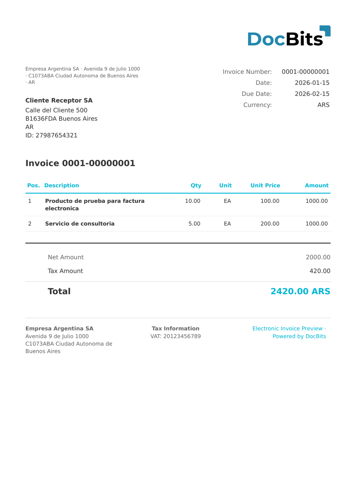

# 🇦🇷 阿根廷 AFIP

| 属性                 | 值                                                                       |
| -------------------- | -------------------------------------------------------------------------- |
| **国家 / 地区**       | 阿根廷                                                                    |
| **文档类型**          | 发票                                                                      |
| **格式**              | XML                                                                        |
| **标准**              | AFIP 电子凭证（阿根廷联邦公共收入管理局）                                  |
| **区域设置**          | `es_AR`                                                                    |

阿根廷 AFIP 标准是阿根廷联邦税务机关（AFIP）的电子发票格式。文档通过 `<tipoComprobante>` 进行识别，例如类型 `001` 表示 A 类发票（Factura A）。每张发票都包含用于 AFIP 验证的 CAE（Código de Autorización Electrónica，电子授权代码）编号和条形码。

## 支持状态

| 组件       | 状态       |
| ---------- | ---------- |
| 预览       | ✅ 支持     |
| 字段提取   | ✅ 支持     |
| 转换       | ✅ 支持     |

## 默认预览

<figure><figcaption><p>阿根廷 AFIP A 类发票的 DocBits 默认预览</p></figcaption></figure>

## 字段映射

### 抬头字段

| DocBits 字段          | 源 XML 元素                                          | 备注                                              |
| ---------------------- | ---------------------------------------------------- | -------------------------------------------------- |
| `invoice_id`           | `<puntoVenta>` + `<numeroComprobante>`               | 格式为 `PPPP-NNNNNNNN`                             |
| `invoice_date`         | `<cabecera>/<fechaEmision>`                          |                                                    |
| `due_date`             | `<cabecera>/<fechaVencimiento>`                      |                                                    |
| `currency`             | 固定值：`ARS`                                        | 始终为阿根廷比索                                   |
| `total_amount`         | `<totales>/<total>`                                  |                                                    |
| `net_amount`           | `<totales>/<netoGravado>` 或 `<subtotal>`             |                                                    |
| `tax_amount`           | `<totales>/<totalIVA>`                               |                                                    |
| `supplier_name`        | `<emisor>/<razonSocial>`                             |                                                    |
| `supplier_id`          | `<emisor>/<CUIT>` 或 `<cabecera>/<CUIT>`              | CUIT = 阿根廷税号                                  |
| `supplier_address`     | `<emisor>/<domicilioComercial>/<calle>` + `<numero>` |                                                    |
| `supplier_postal_code` | `<emisor>/<domicilioComercial>/<codigoPostal>`       |                                                    |
| `supplier_city`        | `<emisor>/<domicilioComercial>/<localidad>`          |                                                    |
| `supplier_country`     | 固定值：`AR`                                         |                                                    |
| `buyer_name`           | `<receptor>/<razonSocial>`                           |                                                    |
| `buyer_id`             | `<receptor>/<CUIT>`                                  |                                                    |
| `buyer_address`        | `<receptor>/<domicilio>/<calle>` + `<numero>`        |                                                    |
| `buyer_postal_code`    | `<receptor>/<domicilio>/<codigoPostal>`              |                                                    |
| `buyer_city`           | `<receptor>/<domicilio>/<localidad>`                 |                                                    |
| `buyer_country`        | 固定值：`AR`                                         |                                                    |
| `iban`                 | `<PAYMENT/IBAN>`                                     | 通常为空——AFIP 文档很少包含银行信息                |
| `bic`                  | `<PAYMENT/BIC>`                                      | 通常为空                                          |
| `payment_terms`        | `<PAYMENT_TERMS>`                                    | 通常为空                                          |
| `purchase_order`       | `<PURCHASE_ORDER>`                                   | 通常为空                                          |

### 行项目表（`INVOICE_TABLE`）

行路径：`<items>/<item>`

| 列            | 源属性 / 元素              | 备注                                    |
| ------------- | -------------------------- | --------------------------------------- |
| `POSITION`    | `@numero` 属性             | 行项目序号                              |
| `DESCRIPTION` | `<descripcion>`            |                                         |
| `QUANTITY`    | `<cantidad>`               |                                         |
| `UNIT`        | `<unidadMedida>`           | AFIP 单位代码（例如 `7` = 件）           |
| `UNIT_PRICE`  | `<precioUnitario>`         |                                         |
| `VAT_RATE`    | `<alicuotaIVA>`            | 例如标准阿根廷增值税为 `21.00`            |
| `VAT`         | `<importeIVA>`             |                                         |
| `NET_AMOUNT`  | `<subtotal>`               | 税前行项目总额                          |

## 分类规则

DocBits 使用以下正则表达式模式检测阿根廷 AFIP 文档：

```
<tipoComprobante>001\s*</tipoComprobante>
```

类型 `001` 对应 **A 类发票**（开给已登记增值税的买方）。其他凭证类型由阿根廷电子发票（ARGENTINA FACTURA ELECTRONICA）标准处理。

## 相关内容

* [阿根廷电子发票](argentina-factura-electronica.md)
* [支持的电子文档](./)
