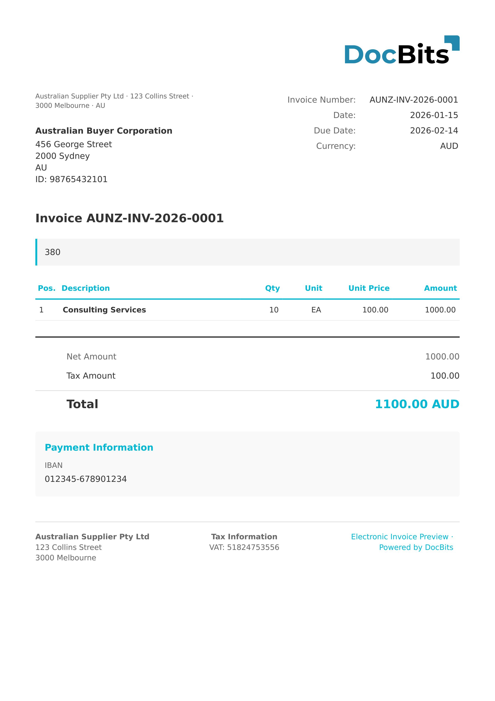

# 🇦🇺 AUNZ PINT SELF-BILLING

<!-- edocs-country-scope -->


请参阅国家指南，了解版本限制、实际生效的配置和国家说明视频。 [澳大利亚](countries/australia.md). 活动的格式系列名称没有固定的 PINT 发布版本号。请检查自定义标识和业务规范标识；网络送达需要单独的集成。


| 属性 | 值 |
| -------------------- | ----------------------- |
| **国家 / 地区** | 澳大利亚 / 新西兰 |
| **文档类型** | 自开票发票 |
| **格式** | UBL 2.1 XML |
| **标准** | PINT A-NZ Self-Billing |
| **区域设置** | `en_AU` |

AUNZ PINT Self-Billing 是 A-NZ Peppol 国际发票模型的自开票变体。在自开票场景中，买方代表供应商创建发票。此文档类型遵循相同的 PINT A-NZ 结构，但双方角色相反——`AccountingCustomerParty` 成为开票方，`AccountingSupplierParty` 则成为被开票方。

## 支持状态

| 组件 | 状态 |
| ---------------- | ----------- |
| 预览 | ✅ 支持 |
| 字段提取 | ✅ 支持 |
| 转换 | ✅ 支持 |

## 默认预览

<figure><figcaption><p>AUNZ PINT Self-Billing 发票的 DocBits 默认预览</p></figcaption></figure>

## 字段映射

字段映射与 [AUNZ PINT](aunz-pint.md) 相同，主要区别如下：

* **双方角色相反**：在自开票中，买方是开票方，供应商是被开票方
* `CustomizationID` 包含 `urn:peppol.org:pint:selfbilling-1@aunz`，而不是 `billing-1@aunz`

完整字段映射表请参见 [AUNZ PINT](aunz-pint.md#field-mapping)。

## 分类规则

DocBits 通过匹配 `CustomizationID` 来检测自开票文档：

```
urn:peppol.org:pint:selfbilling-1@aunz
```

自开票和常规开票模式都归类为 `PINT A-NZ` 电子文档类型。

## 相关内容

* [AUNZ PINT](aunz-pint.md)
* [支持的电子文档](./)
