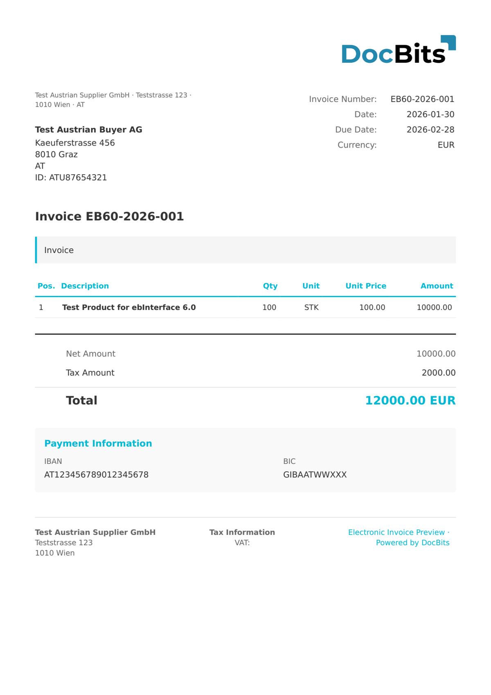

# 🇦🇹 奥地利 EBINTERFACE

| 属性                   | 值                               |
| ---------------------- | -------------------------------- |
| **国家 / 地区**       | 奥地利                           |
| **文档类型**           | 发票、贷项通知单                  |
| **格式**               | XML                              |
| **标准**               | ebInterface（版本 4.3 – 6.1）     |
| **区域设置**           | `de_AT`                          |

ebInterface 是奥地利电子发票标准，由奥地利联邦经济商会（WKÖ — Wirtschaftskammer Österreich）维护。它定义了一种结构化 XML 格式，用于电子发票，主要应用于奥地利的 B2G（企业对政府）和 B2B 交易。DocBits 支持从 4.3 到 6.1 的所有版本，每个版本都有各自的 XML 命名空间。

## 支持状态

| 组件           | 状态       |
| -------------- | ---------- |
| 预览           | ✅ 支持     |
| 字段提取       | ✅ 支持     |
| 转换           | ✅ 支持     |

## 默认预览

<figure><figcaption>
AUSTRIA EBINTERFACE 发票的 DocBits 默认预览
</figcaption></figure>

## 字段映射

### 抬头字段

| DocBits 字段          | 源 XML 元素                                                                 | 说明                               |
| --------------------- | --------------------------------------------------------------------------- | ---------------------------------- |
| `invoice_id`          | `eb:InvoiceNumber`                                                          | 发票编号                           |
| `invoice_date`        | `eb:InvoiceDate`                                                            | ISO 8601 日期                      |
| `due_date`            | `eb:PaymentConditions/eb:DueDate`                                           | 付款到期日                         |
| `delivery_date`       | `eb:Delivery/eb:Date`                                                       | 交付日期                           |
| `currency`            | `@eb:InvoiceCurrency`                                                       | 根属性；对于 AT 始终为 `EUR`       |
| `total_amount`        | `eb:TotalGrossAmount`                                                       | 含增值税的总额                     |
| `net_amount`          | `eb:Tax/eb:VAT/eb:VATItem/eb:TaxedAmount`                                   | 应税净额                           |
| `tax_amount`          | `eb:Tax/eb:VAT/eb:VATItem/eb:Amount`                                        | 增值税金额                         |
| `purchase_order`      | `eb:OrderReference/eb:OrderID`                                              | 采购订单引用                       |
| `payment_terms`       | `eb:PaymentConditions/eb:Comment`                                           | 自由文本付款条款                   |
| `supplier_name`       | `eb:Biller/eb:Address/eb:Name`                                              | 开票方公司名称                     |
| `supplier_tax_id`     | `eb:Biller/eb:VATIdentificationNumber`                                      | 奥地利 UID（例如 ATU12345678）     |
| `supplier_street`     | `eb:Biller/eb:Address/eb:Street`                                            | 开票方街道地址                     |
| `supplier_city`       | `eb:Biller/eb:Address/eb:Town`                                              | 开票方城市                         |
| `supplier_postal_code`| `eb:Biller/eb:Address/eb:ZIP`                                               | 开票方邮政编码                     |
| `supplier_country`    | `eb:Biller/eb:Address/eb:Country/@eb:CountryCode`                           | ISO 国家代码                      |
| `supplier_email`      | `eb:Biller/eb:Address/eb:Email`                                             | 开票方电子邮件                     |
| `supplier_iban`       | `eb:PaymentMethod/eb:UniversalBankTransaction/eb:BeneficiaryAccount/eb:IBAN`| 开票方 IBAN                        |
| `customer_name`       | `eb:InvoiceRecipient/eb:Address/eb:Name`                                    | 收件方公司名称                     |
| `customer_tax_id`     | `eb:InvoiceRecipient/eb:VATIdentificationNumber`                            | 收件方 UID                         |
| `customer_street`     | `eb:InvoiceRecipient/eb:Address/eb:Street`                                  | 收件方街道地址                     |
| `customer_city`       | `eb:InvoiceRecipient/eb:Address/eb:Town`                                    | 收件方城市                         |
| `customer_postal_code`| `eb:InvoiceRecipient/eb:Address/eb:ZIP`                                     | 收件方邮政编码                     |
| `customer_country`    | `eb:InvoiceRecipient/eb:Address/eb:Country/@eb:CountryCode`                 | ISO 国家代码                      |
| `iban`                | `eb:PaymentMethod/eb:UniversalBankTransaction/eb:BeneficiaryAccount/eb:IBAN`| 付款 IBAN                          |
| `bic`                 | `eb:PaymentMethod/eb:UniversalBankTransaction/eb:BeneficiaryAccount/eb:BIC` | 付款 BIC                           |

### 行项目表（`INVOICE_TABLE`）

行路径：`eb:Details/eb:ItemList/eb:ListLineItem`

| 列              | 源 XML 元素                          | 说明                           |
| --------------- | ------------------------------------ | ------------------------------ |
| `POSITION`      | 顺序索引                             | 从 1 开始的行号                 |
| `DESCRIPTION`   | `eb:Description`                     | 产品/服务描述                  |
| `QUANTITY`      | `eb:Quantity`                        | 数值数量                       |
| `UNIT`          | `eb:Quantity/@eb:Unit`               | 单位代码（例如 `STK` = 件）     |
| `UNIT_PRICE`    | `eb:UnitPrice`                       | 不含增值税的单价                |
| `VAT_RATE`      | `eb:VAT/eb:VATItem/eb:VATRate`        | 增值税税率（%）                 |
| `VAT`           | `eb:VAT/eb:VATItem/eb:TaxedAmount`    | 每行增值税金额                 |
| `NET_AMOUNT`    | `eb:LineItemAmount`                   | 不含增值税的行总额              |

## 分类规则

DocBits 通过匹配 XML 命名空间检测 ebInterface 版本：

| 版本              | 命名空间                                 |
| ---------------- | ---------------------------------------- |
| ebInterface 4.3 | `http://www.ebinterface.at/schema/4p3/` |
| ebInterface 5.0 | `http://www.ebinterface.at/schema/5p0/` |
| ebInterface 6.0 | `http://www.ebinterface.at/schema/6p0/` |
| ebInterface 6.1 | `http://www.ebinterface.at/schema/6p1/` |

所有版本的根元素均为 `<eb:Invoice>`，并使用各自对应的命名空间 URI。

## 相关内容

* [奥地利 ebInterface 6.0](austria-ebinterface-6-0.md)
* [奥地利 ebInterface 6.1](austria-ebinterface-6-1.md)
* [支持的电子文档](./)
