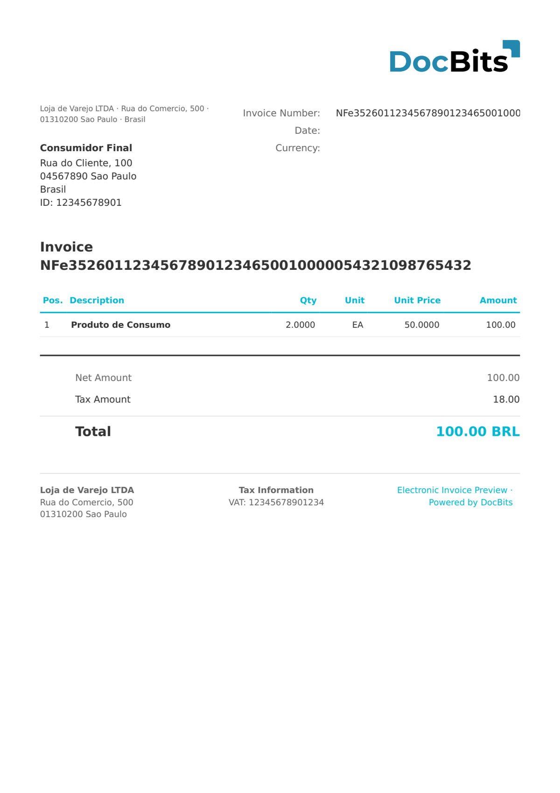

# 🇧🇷 巴西 NF-E

| 属性 | 值 |
| -------------------- | --------------------------------------------------------------- |
| **国家 / 地区** | 巴西 |
| **文档类型** | 发票（Nota Fiscal Eletrônica） |
| **格式** | XML |
| **标准** | NF-e 4.0（Nota Fiscal Eletrônica — 商品及州际贸易） |
| **区域设置** | `pt_BR` |

NF-e（Nota Fiscal Eletrônica，`<mod>55</mod>`）是巴西用于商品及州际贸易的电子发票，由 SEFAZ 监管。每张 NF-e 都包含唯一的 44 位访问密钥（`chNFe`）、详细的产品行项目以及多级税务数据（ICMS、IPI、PIS、COFINS）。DocBits 通过检测 `http://www.portalfiscal.inf.br/nfe` 命名空间来分类 NF-e。

## 支持状态

| 组件 | 状态 |
| ---------------- | ----------- |
| 预览 | ✅ 支持 |
| 字段提取 | ✅ 支持 |
| 转换 | ✅ 支持 |

## 默认预览

<figure><figcaption><p>巴西 NF-E 文档的 DocBits 默认预览</p></figcaption></figure>

## 字段映射

### 表头字段

| DocBits 字段 | 来源 XPath | 说明 |
| --------------- | ---------------------------------------------------------- | ----------------------------------- |
| `invoice_id` | `//*[local-name()='ide']/*[local-name()='nNF']` | Nota Fiscal 编号 |
| `invoice_date` | `//*[local-name()='ide']/*[local-name()='dhEmi']` | ISO 8601 格式，带 BRT 时区偏移 |
| `currency` | 固定值：`BRL` | 始终为巴西雷亚尔 |
| `total_amount` | `//*[local-name()='ICMSTot']/*[local-name()='vNF']` | NF-e 总金额 |
| `net_amount` | `//*[local-name()='ICMSTot']/*[local-name()='vProd']` | 产品总金额 |
| `tax_amount` | `//*[local-name()='ICMSTot']/*[local-name()='vICMS']` | ICMS 税额总计 |
| `supplier_name` | `//*[local-name()='emit']/*[local-name()='xNome']` | 开票公司名称 |
| `supplier_id` | `//*[local-name()='emit']/*[local-name()='CNPJ']` 或 `CPF` | CNPJ（14 位）或 CPF（11 位） |
| `buyer_name` | `//*[local-name()='dest']/*[local-name()='xNome']` | 收件公司名称 |
| `buyer_id` | `//*[local-name()='dest']/*[local-name()='CNPJ']` 或 `CPF` | CNPJ 或 CPF |

### 行项目表（`INVOICE_TABLE`）

行路径：`//*[local-name()='det']`

| 列 | 相对 XPath | 说明 |
| --------------- | ------------------------------------------------------------------------------- | -------------------------- |
| `POSITION` | `@nItem` | 行项目序号 |
| `ITEM_CODE` | `*[local-name()='prod']/*[local-name()='cProd']` | 产品代码 |
| `DESCRIPTION` | `*[local-name()='prod']/*[local-name()='xProd']` | 产品描述 |
| `NCM_CODE` | `*[local-name()='prod']/*[local-name()='NCM']` | NCM 海关分类 |
| `CFOP_CODE` | `*[local-name()='prod']/*[local-name()='CFOP']` | 业务税务代码 |
| `UNIT` | `*[local-name()='prod']/*[local-name()='uCom']` | 计量单位 |
| `QUANTITY` | `*[local-name()='prod']/*[local-name()='qCom']` | 商业数量 |
| `UNIT_PRICE` | `*[local-name()='prod']/*[local-name()='vUnCom']` | 单价 |
| `TOTAL_AMOUNT` | `*[local-name()='prod']/*[local-name()='vProd']` | 行项目总额 |
| `ICMS_AMOUNT` | `*[local-name()='imposto']/*[local-name()='ICMS']//*[local-name()='vICMS']` | 每个行项目的 ICMS 税额 |
| `PIS_AMOUNT` | `*[local-name()='imposto']/*[local-name()='PIS']//*[local-name()='vPIS']` | 每个行项目的 PIS 税额 |
| `COFINS_AMOUNT` | `*[local-name()='imposto']/*[local-name()='COFINS']//*[local-name()='vCOFINS']` | 每个行项目的 COFINS 税额 |
| `VAT_RATE` | `*[local-name()='imposto']/*[local-name()='ICMS']//*[local-name()='pICMS']` | ICMS 税率（%） |

## 分类规则

DocBits 通过检查以下字符串来检测巴西 NF-E 文档：

```
http://www.portalfiscal.inf.br/nfe
```

在 XML 命名空间中检测该字符串（NF-e 使用 `mod=55`，NFC-e 使用 `mod=65`，二者会分别识别）。

## 相关内容

* [巴西 NFC-E](brazil-nfce.md)
* [巴西 CT-E](brazil-cte.md)
* [巴西 NFS-E](brazil-nfse.md)
* [支持的电子文档](./)
