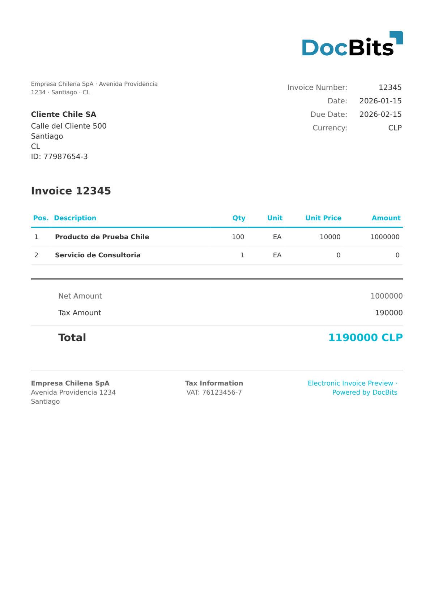

# 🇨🇱 CHILE DTE

| 属性 | 值 |
| -------------------- | ---------------------------------------------------------- |
| **国家/地区** | 智利 |
| **文档类型** | 发票（Factura）、贷项通知单、借项通知单、发货指南 |
| **格式** | XML |
| **标准** | DTE（Documento Tributario Electrónico），SII |
| **区域设置** | `es_CL` |

DTE（Documento Tributario Electrónico）是智利的电子税务文档标准，由 Servicio de Impuestos Internos（SII）监管。所有 DTE 文档均使用 `http://www.sii.cl/SiiDte` 命名空间。DocBits 会自动检测 DTE 类型代码（`TipoDTE`），并应用相应的提取规则：

| 类型代码 | 文档类型 |
| --------- | ----------------------------------------------- |
| 33 | Factura Electrónica（电子发票） |
| 34 | Factura No Afecta o Exenta（免税发票） |
| 52 | Guía de Despacho（发货指南） |
| 56 | Nota de Débito（借项通知单） |
| 61 | Nota de Crédito（贷项通知单） |

## 支持状态

| 组件 | 状态 |
| ---------------- | ----------- |
| 预览 | ✅ 支持 |
| 字段提取 | ✅ 支持 |
| 转换 | ✅ 支持 |

## 默认预览

<figure><figcaption>
CHILE DTE FACTURA（类型 33）的 DocBits 默认预览
</figcaption></figure>

## 字段映射

### 页眉字段

| DocBits 字段 | 源 XML 元素 | 说明 |
| ------------------ | ------------------ | ------------------------------ |
| `invoice_id` | `Folio` | 文档流水号 |
| `invoice_date` | `FchEmis` | ISO 8601 签发日期 |
| `due_date` | `FchVenc` | 付款到期日 |
| `currency` | 固定值：`CLP` | 始终为智利比索 |
| `total_amount` | `MntTotal` | 含增值税的总金额 |
| `net_amount` | `MntNeto` | 净应税金额 |
| `tax_amount` | `IVA` | 增值税金额（标准税率为 19%） |
| `supplier_name` | `RznSoc`（Emisor） | 开票方公司名称 |
| `supplier_id` | `RUTEmisor` | 开票方 RUT（例如 `76123456-7`） |
| `supplier_address` | `DirOrigen` | 开票方街道地址 |
| `supplier_city` | `CiudadOrigen` | 开票方城市 |
| `supplier_country` | 固定值：`CL` | 始终为智利 |
| `buyer_name` | `RznSocRecep` | 收件方公司名称 |
| `buyer_id` | `RUTRecep` | 收件方 RUT |
| `buyer_address` | `DirRecep` | 收件方街道地址 |
| `buyer_city` | `CiudadRecep` | 收件方城市 |
| `buyer_country` | 固定值：`CL` | 始终为智利 |

### 行项目表（`INVOICE_TABLE`）

行路径：`Detalle`

| 列 | 源 XML 元素 | 说明 |
| ------------- | ----------------------- | ----------------------------- |
| `POSITION` | `NroLinDet` | 行序号 |
| `DESCRIPTION` | `NmbItem` | 项目名称 |
| `QUANTITY` | `QtyItem` | 数量 |
| `UNIT` | `UnmdItem` | 计量单位 |
| `UNIT_PRICE` | `PrcItem` | 不含增值税的单价 |
| `VAT_RATE` | `TasaIVA`（来自页眉） | IVA 税率（通常为 19%） |
| `VAT` | 计算得出 | 每行增值税 |
| `NET_AMOUNT` | `MontoItem` | 行合计 |

## 分类规则

DocBits 通过匹配 XML 命名空间和 `TipoDTE` 来检测智利 DTE 文档：

| 电子文档类型 | 匹配模式 |
| ----------------------------- | ---------------------------------------------------- |
| CHILE DTE FACTURA | `http://www.sii.cl/SiiDte` + `<TipoDTE>33</TipoDTE>` |
| CHILE DTE FACTURA ELECTRONICA | `http://www.sii.cl/SiiDte` + `<TipoDTE>34</TipoDTE>` |
| CHILE DTE GUIA DESPACHO | `http://www.sii.cl/SiiDte` + `<TipoDTE>52</TipoDTE>` |
| CHILE DTE NOTA CREDITO | `http://www.sii.cl/SiiDte` + `<TipoDTE>61</TipoDTE>` |

信封元素为 `<EnvioDTE>`，每个 DTE 都封装在 `<DTE><Documento>` 中。

## 相关内容

* [当前支持的电子发票标准](https://github.com/Fellow-Consulting-AG/docbits/tree/main/readme/administration-and-setup/settings/global-settings/document-types/currently-supported-e-invoice-standards/README.md)
* [支持的电子文档](./)
