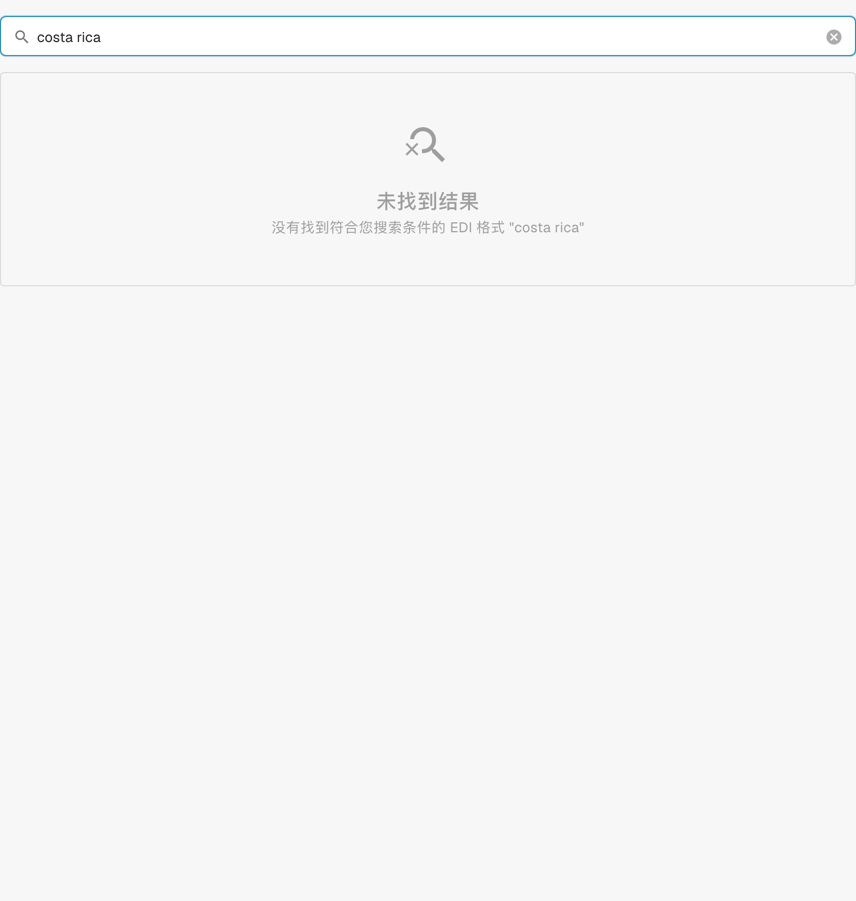

# 哥斯达黎加

在测试原始文件之前，使用本指南确定已配置的格式系列和版本范围。

[所有国家和支持范围](../README.md)

## 变体与版本限制

较早的文档提到了哥斯达黎加，但在所检查的开发环境目录中未找到匹配的分类或配置条目。

**语法:** 尚未确认

本次检查未能确认当前的内置处理能力。上线前，请支持团队核实已部署的映射，并测试有代表性的原始文件。

这些表格记录了 2026 年 10 月 17 日对开发环境目录及相应处理代码的检查结果。它们说明有哪些规则和配置组件可用，并不代表对所有文件、法律要求或生产部署的认证。组织配置可以覆盖默认规则。

## 已检查的规则和组件矩阵

未找到匹配的分类或配置条目。本次检查未能确认当前的内置支持。

## 在 DocBits 中查找映射

<figure><figcaption>
真实开发界面：在所检查的目录中，搜索此国家名称未返回匹配的配置条目。
</figcaption></figure>

## 国家说明视频

本地化旁白和 WebVTT 字幕说明格式选择、配置和验收检查。

此只读演示展示该国家或地区在 DocBits 中的现有配置。请检查实际使用的来源和活动版本，并在您自己的组织中测试有代表性的发票、贷项通知单和导出。


哥斯达黎加 — 国家说明视频



WebVTT


## 验收检查

组件检查只能确认配置存在，并非针对所有版本的端到端处理测试。请测试准确的数据载荷，以及集成所需的发票或贷项通知单处理路径。

## 检查组织中的格式

1. 保留原始 XML 或内嵌 XML 的 PDF。查看命名空间、架构或自定义标识，以及声明的版本和业务规范。

2. 针对适用的业务文档，打开设置 → 文档类型 → E-Doc。搜索指南中所列的准确电子文档格式名称。

3. 检查实际生效的 Default 或 Custom 来源及其活动配置版本。查看 Transformation、Preview 和 Extraction Paths。保存草稿不会将其激活。

4. 针对所需的每一种语法、版本和业务文档，测试有代表性的原始文件。验证关键字段、金额、税额、发票或贷项通知单分类，以及 ERP 导出结果。

5. 单独确认验证策略和传输方式。保留自定义映射，并在重新启动现有文档之前检查审批和导出历史。

## 相关格式参考

- [🇨🇷 哥斯达黎加](../costa-rica.md)
