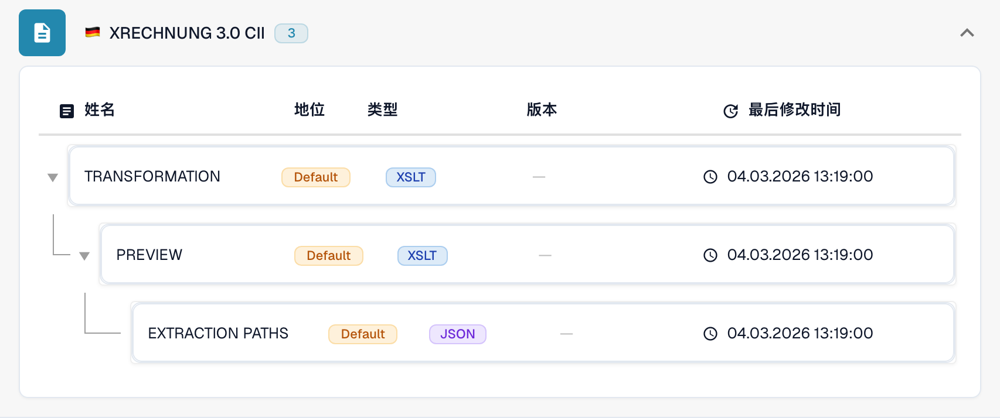

# 德国

在测试原始文件之前，使用本指南确定已配置的格式系列和版本范围。

[所有国家和支持范围](../README.md)

## 变体与版本限制

XRechnung 从 1.0 到 3.0.2 共有十三个版本名称，每个版本均有 CII 和 UBL 条目。ZUGFeRD 包含早期业务规范，以及 2.5 的 CII 和 UBL 条目。

**语法:** CII / UBL / PDF + XML

语法、发布版本和业务规范是不同的选择。不要根据共用的 1p0 标记推断 Factur-X 发布版本。

这些表格记录了 2026 年 10 月 17 日对开发环境目录及相应处理代码的检查结果。它们说明有哪些规则和配置组件可用，并不代表对所有文件、法律要求或生产部署的认证。组织配置可以覆盖默认规则。

## 已检查的规则和组件矩阵

| 准确格式名称 | 规则文档键 | 可用组件 |
| --- | --- | --- |
| `EDNA UTILITY CII` | `INVOICE` | C / T / P / E |
| `XRECHNUNG 1.0 CII` | `INVOICE` | C / T / P / E |
| `XRECHNUNG 1.0 UBL` | `INVOICE` | C / T / P / E |
| `XRECHNUNG 1.1 CII` | `INVOICE` | C / T / P / E |
| `XRECHNUNG 1.1 UBL` | `INVOICE` | C / T / P / E |
| `XRECHNUNG 1.2 CII` | `INVOICE` | C / T / P / E |
| `XRECHNUNG 1.2 UBL` | `INVOICE` | C / T / P / E |
| `XRECHNUNG 1.2.1 CII` | `INVOICE` | C / T / P / E |
| `XRECHNUNG 1.2.1 UBL` | `INVOICE` | C / T / P / E |
| `XRECHNUNG 1.2.2 CII` | `INVOICE` | C / T / P / E |
| `XRECHNUNG 1.2.2 UBL` | `INVOICE` | C / T / P / E |
| `XRECHNUNG 2.0 CII` | `INVOICE` | C / T / P / E |
| `XRECHNUNG 2.0 UBL` | `INVOICE` | C / T / P / E |
| `XRECHNUNG 2.0.1 CII` | `INVOICE` | C / T / P / E |
| `XRECHNUNG 2.0.1 UBL` | `INVOICE` | C / T / P / E |
| `XRECHNUNG 2.1 CII` | `INVOICE` | C / T / P / E |
| `XRECHNUNG 2.1 UBL` | `INVOICE` | C / T / P / E |
| `XRECHNUNG 2.2 CII` | `INVOICE` | C / T / P / E |
| `XRECHNUNG 2.2 UBL` | `INVOICE` | C / T / P / E |
| `XRECHNUNG 2.3 CII` | `INVOICE` | C / T / P / E |
| `XRECHNUNG 2.3 UBL` | `INVOICE` | C / T / P / E |
| `XRECHNUNG 3.0 CII` | `INVOICE` | C / T / P / E |
| `XRECHNUNG 3.0 CII CREDITNOTE` | `CREDIT_NOTE` | C / T / P / E |
| `XRECHNUNG 3.0 UBL` | `INVOICE` | C / T / P / E |
| `XRECHNUNG 3.0.1 CII` | `INVOICE` | C / T / P / E |
| `XRECHNUNG 3.0.1 CII CREDITNOTE` | `CREDIT_NOTE` | C / T / P / E |
| `XRECHNUNG 3.0.1 UBL` | `INVOICE` | C / T / P / E |
| `XRECHNUNG 3.0.2 CII` | `INVOICE` | C / T / P / E |
| `XRECHNUNG 3.0.2 CII CREDITNOTE` | `CREDIT_NOTE` | C / T / P / E |
| `XRECHNUNG 3.0.2 UBL` | `INVOICE` | C / T / P / E |
| `XRECHNUNG ORDER` | `PURCHASE_ORDER` | C / T / P / E |
| `XRECHNUNG ORDER RESPONSE` | `ORDER_CONFIRMATION` | C / T / P / E |
| `ZUGFERD 1.0 BASIC` | `INVOICE` | C / T / P / E |
| `ZUGFERD 1.0 COMFORT` | `INVOICE` | C / T / P / E |
| `ZUGFERD 1.0 EXTENDED` | `INVOICE` | C / T / P / E |
| `ZUGFERD 2.2` | `INVOICE` | C / T / P / E |
| `ZUGFERD 2.3.2` | `INVOICE` | C / T / P / E |
| `ZUGFERD 2.4` | `INVOICE` | C / T / P / E |
| `ZUGFERD 2.5 CII` | `INVOICE` | C / T / P / E |
| `ZUGFERD 2.5 UBL` | `INVOICE` | C / T / P / E |

C = 分类，T = Transformation，P = Preview，E = Extraction Paths。文档键用于查找规则或配置，不能保证最终保存的 invoice_type 值。转换可以通过 INVOICE 映射将文档分类为贷项通知单。

短横线表示状态检查未报告该准确格式与文档键组合的专用组件。这不排除使用共享或回退映射的可能性。在依赖此处理路径之前，请验证实际生效的映射选择逻辑，并测试有代表性的文件。

### 其他配置名称

这些名称在所检查的目录中有配置条目，但没有独立的分类规则。通用格式系列或更细化的格式识别可能会选中兼容的处理路径。仅有这些条目，并不能证明系统能够自动检测相应发布版本或业务规范。

- `ZUGFERD 1.0`
- `ZUGFERD 2.1 BASIC`
- `ZUGFERD 2.1 BASIC WL`
- `ZUGFERD 2.1 EN16931`
- `ZUGFERD 2.1 EXTENDED`
- `ZUGFERD 2.1 MINIMUM`
- `ZUGFERD 2.2 BASIC`
- `ZUGFERD 2.2 BASIC WL`
- `ZUGFERD 2.2 EN16931`
- `ZUGFERD 2.2 EXTENDED`
- `ZUGFERD 2.2 MINIMUM`
- `ZUGFERD 2.3`
- `ZUGFERD 2.3 BASIC`
- `ZUGFERD 2.3 BASIC WL`
- `ZUGFERD 2.3 EN16931`
- `ZUGFERD 2.3 EXTENDED`
- `ZUGFERD 2.3 MINIMUM`
- `ZUGFERD 2.3.2 BASIC`
- `ZUGFERD 2.3.2 BASIC WL`
- `ZUGFERD 2.3.2 EN16931`
- `ZUGFERD 2.3.2 EXTENDED`
- `ZUGFERD 2.3.2 MINIMUM`
- `ZUGFERD 2.4 BASIC`
- `ZUGFERD 2.4 BASIC WL`
- `ZUGFERD 2.4 EN16931`
- `ZUGFERD 2.4 EXTENDED`
- `ZUGFERD 2.4 MINIMUM`
- `ZUGFERD 2.5 CII BASIC`
- `ZUGFERD 2.5 CII BASIC WL`
- `ZUGFERD 2.5 CII EN16931`
- `ZUGFERD 2.5 CII EXTENDED`
- `ZUGFERD 2.5 CII MINIMUM`
- `ZUGFERD 2.5 UBL BASIC`
- `ZUGFERD 2.5 UBL BASIC WL`
- `ZUGFERD 2.5 UBL EN16931`
- `ZUGFERD 2.5 UBL EXTENDED`
- `ZUGFERD 2.5 UBL MINIMUM`

### Factur-X / ZUGFeRD：不要臆测发布版本

协调统一的 CII Guideline ID 可以标识格式系列和业务规范，但多个发布版本可能使用相同的 1p0 标记。Factur-X XMP Version 1.0 是架构标记，并非 1.08 或 1.09 这样的发布版本。ZUGFeRD XMP 可以声明其版本。如果缺少权威元数据，请保留通用格式系列的识别结果，并向发送方确认原始文件。

MINIMUM 和 BASIC WL 可能不包含后续处理所需的行项目信息。BASIC、EN16931/COMFORT 和 EXTENDED 涵盖的数据范围各不相同。数据更全面的业务规范可能包含提取映射未使用的字段。请用真实样例检查必需字段。

## 在 DocBits 中查找映射

<figure><figcaption>
真实开发界面：具有代表性的格式及其可用配置组件。其他版本列于矩阵中。
</figcaption></figure>

## 国家说明视频

本地化旁白和 WebVTT 字幕说明格式选择、配置和验收检查。

此只读演示展示该国家或地区在 DocBits 中的现有配置。请检查实际使用的来源和活动版本，并在您自己的组织中测试有代表性的发票、贷项通知单和导出。


德国 — 国家说明视频



WebVTT


## 验收检查

组件检查只能确认配置存在，并非针对所有版本的端到端处理测试。请测试准确的数据载荷，以及集成所需的发票或贷项通知单处理路径。

## 检查组织中的格式

1. 保留原始 XML 或内嵌 XML 的 PDF。查看命名空间、架构或自定义标识，以及声明的版本和业务规范。

2. 针对适用的业务文档，打开设置 → 文档类型 → E-Doc。搜索指南中所列的准确电子文档格式名称。

3. 检查实际生效的 Default 或 Custom 来源及其活动配置版本。查看 Transformation、Preview 和 Extraction Paths。保存草稿不会将其激活。

4. 针对所需的每一种语法、版本和业务文档，测试有代表性的原始文件。验证关键字段、金额、税额、发票或贷项通知单分类，以及 ERP 导出结果。

5. 单独确认验证策略和传输方式。保留自定义映射，并在重新启动现有文档之前检查审批和导出历史。

## 相关格式参考

- [🇩🇪 XRECHNUNG 1.0 CII](../xrechnung-1-0-cii.md)
- [🇩🇪 XRECHNUNG 1.0 UBL](../xrechnung-1-0-ubl.md)
- [🇩🇪 XRECHNUNG 1.1 CII](../xrechnung-1-1-cii.md)
- [🇩🇪 XRECHNUNG 1.1 UBL](../xrechnung-1-1-ubl.md)
- [🇩🇪 XRECHNUNG 1.2 CII](../xrechnung-1-2-cii.md)
- [🇩🇪 XRECHNUNG 1.2 UBL](../xrechnung-1-2-ubl.md)
- [🇩🇪 XRECHNUNG 1.2.1 CII](../xrechnung-1-2-1-cii.md)
- [🇩🇪 XRECHNUNG 1.2.1 UBL](../xrechnung-1-2-1-ubl.md)
- [🇩🇪 XRECHNUNG 1.2.2 CII](../xrechnung-1-2-2-cii.md)
- [🇩🇪 XRECHNUNG 1.2.2 UBL](../xrechnung-1-2-2-ubl.md)
- [🇩🇪 XRECHNUNG 2.0 CII](../xrechnung-2-0-cii.md)
- [🇩🇪 XRECHNUNG 2.0 UBL](../xrechnung-2-0-ubl.md)
- [🇩🇪 XRECHNUNG 2.0.1 CII](../xrechnung-2-0-1-cii.md)
- [🇩🇪 XRECHNUNG 2.0.1 UBL](../xrechnung-2-0-1-ubl.md)
- [🇩🇪 XRECHNUNG 2.1 CII](../xrechnung-2-1-cii.md)
- [🇩🇪 XRECHNUNG 2.1 UBL](../xrechnung-2-1-ubl.md)
- [🇩🇪 XRECHNUNG 2.2 CII](../xrechnung-2-2-cii.md)
- [🇩🇪 XRECHNUNG 2.2 UBL](../xrechnung-2-2-ubl.md)
- [🇩🇪 XRECHNUNG 2.3 CII](../xrechnung-2-3-cii.md)
- [🇩🇪 XRECHNUNG 2.3 UBL](../xrechnung-2-3-ubl.md)
- [🇩🇪 XRECHNUNG 3.0 CII](../xrechnung-3-0-cii.md)
- [🇩🇪 XRECHNUNG 3.0 UBL](../xrechnung-3-0-ubl.md)
- [🇩🇪 XRECHNUNG 3.0.1 CII](../xrechnung-3-0-1-cii.md)
- [🇩🇪 XRECHNUNG 3.0.1 UBL](../xrechnung-3-0-1-ubl.md)
- [🇩🇪 XRECHNUNG 3.0.2 CII](../xrechnung-3-0-2-cii.md)
- [🇩🇪 XRECHNUNG 3.0.2 UBL](../xrechnung-3-0-2-ubl.md)
- [🇩🇪 ZUGFERD 1.0](../zugferd-1-0.md)
- [🇩🇪 ZUGFERD 1.0 BASIC](../zugferd-1-0-basic.md)
- [🇩🇪 ZUGFERD 1.0 COMFORT](../zugferd-1-0-comfort.md)
- [🇩🇪 ZUGFERD 1.0 EXTENDED](../zugferd-1-0-extended.md)
- [🇩🇪 ZUGFERD 2.2](../zugferd-2-2.md)
- [🇩🇪 ZUGFERD 2.3](../zugferd-2-3.md)
- [🇩🇪 ZUGFERD 2.3.2](../zugferd-2-3-2.md)
- [🇩🇪 ZUGFERD 2.5](../zugferd-2-5.md)
