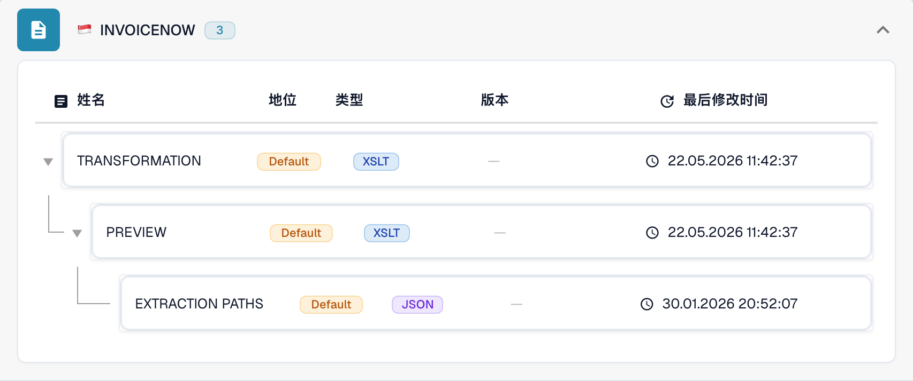

# 新加坡

在测试原始文件之前，使用本指南确定已配置的格式系列和版本范围。

[所有国家和支持范围](../README.md)

## 国家说明视频

本地化旁白和 WebVTT 字幕说明格式选择、配置和验收检查。

此只读演示展示该国家或地区在 DocBits 中的现有配置。请检查实际使用的来源和活动版本，并在您自己的组织中测试有代表性的发票、贷项通知单和导出。



[新加坡 — 国家说明视频](https://docbits-videos.fra1.cdn.digitaloceanspaces.com/settings-assistant/edocs_country_singapore/v2/zh.mp4)

[WebVTT](https://docbits-videos.fra1.cdn.digitaloceanspaces.com/settings-assistant/edocs_country_singapore/v2/zh.vtt)

## 变体与版本限制

InvoiceNow 有发票和贷项通知单条目；InvoiceNow SG 是另一个已配置的名称。

**语法:** UBL XML

请检查新加坡业务规范标识。国家业务规范与通用 Peppol BIS 可以共用 UBL 语法，但业务规则未必完全相同。

这些表格记录了 2026 年 10 月 17 日对开发环境目录及相应处理代码的检查结果。它们说明有哪些规则和配置组件可用，并不代表对所有文件、法律要求或生产部署的认证。组织配置可以覆盖默认规则。

## 已检查的规则和组件矩阵

| 准确格式名称 | 规则文档键 | 可用组件 |
| --- | --- | --- |
| `INVOICENOW` | `CREDIT_NOTE` | C / T / P / E |
| `INVOICENOW` | `INVOICE` | C / T / P / E |
| `INVOICENOW SG` | `INVOICE` | C / T / P / E |

C = 分类，T = Transformation，P = Preview，E = Extraction Paths。文档键用于查找规则或配置，不能保证最终保存的 invoice_type 值。转换可以通过 INVOICE 映射将文档分类为贷项通知单。

短横线表示状态检查未报告该准确格式与文档键组合的专用组件。这不排除使用共享或回退映射的可能性。在依赖此处理路径之前，请验证实际生效的映射选择逻辑，并测试有代表性的文件。

## 在 DocBits 中查找映射

<figure><figcaption>
真实开发界面：具有代表性的格式及其可用配置组件。其他版本列于矩阵中。
</figcaption></figure>

## 验收检查

组件检查只能确认配置存在，并非针对所有版本的端到端处理测试。请测试准确的数据载荷，以及集成所需的发票或贷项通知单处理路径。

## 检查组织中的格式

1. 保留原始 XML 或内嵌 XML 的 PDF。查看命名空间、架构或自定义标识，以及声明的版本和业务规范。

2. 针对适用的业务文档，打开设置 → 文档类型 → E-Doc。搜索指南中所列的准确电子文档格式名称。

3. 检查实际生效的 Default 或 Custom 来源及其活动配置版本。查看 Transformation、Preview 和 Extraction Paths。保存草稿不会将其激活。

4. 针对所需的每一种语法、版本和业务文档，测试有代表性的原始文件。验证关键字段、金额、税额、发票或贷项通知单分类，以及 ERP 导出结果。

5. 单独确认验证策略和传输方式。保留自定义映射，并在重新启动现有文档之前检查审批和导出历史。

## 相关格式参考

- [🇸🇬 INVOICENOW](../invoicenow.md)
- [🇸🇬 INVOICENOW SG](../invoicenow-sg.md)
