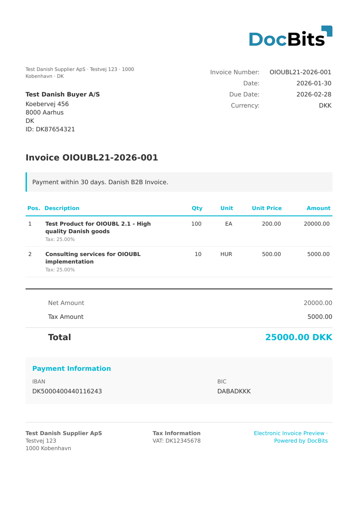

# 🇩🇰 丹麦 OIOUBL

<!-- edocs-country-scope -->


请参阅国家指南，了解版本限制、实际生效的配置和国家说明视频。 [丹麦](countries/denmark.md). OIOUBL 与 Peppol BIS 是不同的业务规范。仅凭 UBL 语法无法确定国家业务规范。


| 属性                 | 值                                            |
| -------------------- | --------------------------------------------- |
| **国家 / 地区**      | 丹麦                                         |
| **文档类型**         | 发票（Faktura）、贷项通知单                   |
| **格式**             | XML（UBL 2.1）                                |
| **标准**             | OIOUBL 2.1（Offentlig Information Online UBL） |
| **区域设置**         | `da_DK`                                       |

OIOUBL（Offentlig Information Online UBL）是基于 UBL 2.1 的丹麦电子发票标准。向丹麦公共部门实体开具发票时必须使用该标准，该标准也广泛用于 B2B 交易。DocBits 通过检测 `<cbc:CustomizationID>OIOUBL-2.1</cbc:CustomizationID>` 来识别 OIOUBL 2.1 文档。配置文件标识符 `urn:www.nesubl.eu:profiles:profile5:ver2.0` 表示 NES（北欧子集）发票配置文件。

## 支持状态

| 组件                 | 状态       |
| -------------------- | ---------- |
| 预览                 | ✅ 支持     |
| 字段提取             | ✅ 支持     |
| 转换                 | ✅ 支持     |

## 默认预览

<figure><figcaption>
DocBits 中丹麦 OIOUBL 2.1 发票（Faktura）的默认预览
</figcaption></figure>

## 字段映射

### 发票头字段

| DocBits 字段          | 源 XML 元素                                                                        | 说明                                             |
| ---------------------- | ---------------------------------------------------------------------------------- | ------------------------------------------------ |
| `invoice_id`           | `cbc:ID`                                                                           | 发票编号                                         |
| `invoice_date`         | `cbc:IssueDate`                                                                    | ISO 8601 开具日期                                |
| `due_date`             | `cbc:DueDate`                                                                      | 付款到期日                                       |
| `invoice_type`         | `cbc:InvoiceTypeCode`                                                              | UNCL 1001 代码（380=发票，381=贷项通知单）       |
| `currency`             | `cbc:DocumentCurrencyCode`                                                         | 始终为 `DKK`（丹麦克朗）                         |
| `purchase_order`       | `cac:OrderReference/cbc:ID`                                                        | 买方采购订单参考编号                             |
| `buyer_reference`      | `cbc:BuyerReference`                                                               | 买方内部参考号 / EAN 地点编号                    |
| `note`                 | `cbc:Note`                                                                         | 付款说明或备注自由文本                           |
| `net_amount`           | `cac:LegalMonetaryTotal/cbc:TaxExclusiveAmount`                                    | 不含增值税的净额                                 |
| `tax_amount`           | `cac:TaxTotal/cbc:TaxAmount`                                                       | 增值税总额（标准税率为 25%）                     |
| `total_amount`         | `cac:LegalMonetaryTotal/cbc:PayableAmount`                                         | 含增值税的总额                                   |
| `tax_rate`             | `cac:TaxTotal/cac:TaxSubtotal/cac:TaxCategory/cbc:Percent`                         | 增值税税率（%）                                  |
| `supplier_name`        | `cac:AccountingSupplierParty/cac:Party/cac:PartyName/cbc:Name`                     | 供应商公司名称                                   |
| `supplier_id`          | `cac:AccountingSupplierParty/cac:Party/cac:PartyIdentification/cbc:ID`             | CVR 编号（例如 `DK12345678`）                    |
| `supplier_vat`         | `cac:AccountingSupplierParty/cac:Party/cac:PartyTaxScheme/cbc:CompanyID`           | 增值税 / CVR 编号                                |
| `supplier_address`     | `cac:AccountingSupplierParty/.../cbc:StreetName`                                   | 供应商街道地址                                   |
| `supplier_city`        | `cac:AccountingSupplierParty/.../cbc:CityName`                                     | 供应商城市                                       |
| `supplier_postal_code` | `cac:AccountingSupplierParty/.../cbc:PostalZone`                                   | 供应商邮政编码                                   |
| `supplier_country`     | `cac:AccountingSupplierParty/.../cbc:IdentificationCode`                           | ISO 国家代码（`DK`）                            |
| `customer_name`        | `cac:AccountingCustomerParty/cac:Party/cac:PartyName/cbc:Name`                     | 客户公司名称                                     |
| `customer_id`          | `cac:AccountingCustomerParty/cac:Party/cac:PartyIdentification/cbc:ID`             | CVR 编号                                         |
| `customer_vat`         | `cac:AccountingCustomerParty/cac:Party/cac:PartyTaxScheme/cbc:CompanyID`           | 增值税 / CVR 编号                                |
| `customer_address`     | `cac:AccountingCustomerParty/.../cbc:StreetName`                                   | 客户街道地址                                     |
| `customer_city`        | `cac:AccountingCustomerParty/.../cbc:CityName`                                     | 客户城市                                         |
| `customer_postal_code` | `cac:AccountingCustomerParty/.../cbc:PostalZone`                                   | 客户邮政编码                                     |
| `customer_country`     | `cac:AccountingCustomerParty/.../cbc:IdentificationCode`                           | ISO 国家代码（`DK`）                            |
| `iban`                 | `cac:PaymentMeans/cac:PayeeFinancialAccount/cbc:ID`                                | 银行账户 / IBAN                                 |
| `bic`                  | `cac:PaymentMeans/cac:PayeeFinancialAccount/cac:FinancialInstitutionBranch/cbc:ID` | BIC/SWIFT 代码                                   |

### 行项目表（`INVOICE_TABLE`）

行路径：`cac:InvoiceLine`

| 列            | 源 XML 元素                | 说明                    |
| ------------- | --------------------------- | ----------------------- |
| `POSITION`    | `cbc:ID`                    | 行序号                  |
| `DESCRIPTION` | `cac:Item/cbc:Name`         | 项目名称 / 描述         |
| `QUANTITY`    | `cbc:InvoicedQuantity`      | 开票数量                |
| `UNIT_PRICE`  | `cac:Price/cbc:PriceAmount` | 不含增值税的单价        |
| `NET_AMOUNT`  | `cbc:LineExtensionAmount`   | 不含增值税的行总额      |

## 分类规则

DocBits 通过匹配 `CustomizationID` 元素来检测 OIOUBL 2.1 文档：

| 电子文档类型             | 模式                                                        |
| ------------------------ | ----------------------------------------------------------- |
| OIOUBL 2.1               | `<cbc:CustomizationID>OIOUBL-2\.1\s*</cbc:CustomizationID>` |

UBL 2.1 命名空间 `urn:oasis:names:specification:ubl:schema:xsd:Invoice-2` 中的根元素为 `<Invoice>`（或 `<CreditNote>`）。

## 相关内容

* [当前支持的电子发票标准](https://github.com/Fellow-Consulting-AG/docbits/tree/main/readme/administration-and-setup/settings/global-settings/document-types/currently-supported-e-invoice-standards/README.md)
* [支持的电子文档](./)
