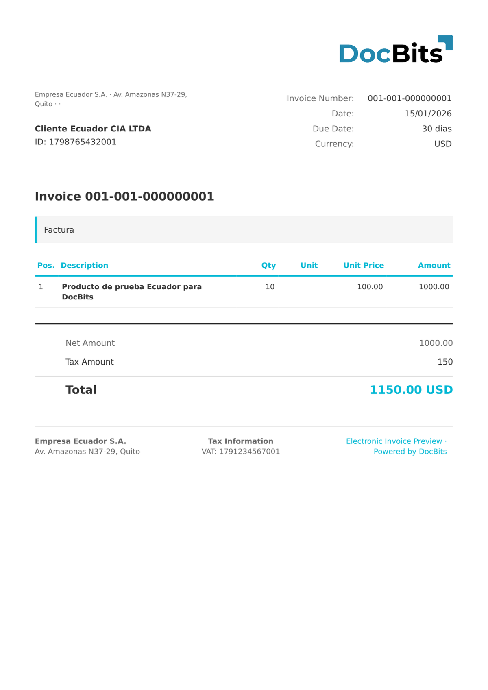

# 🇪🇨 ECUADOR SRI

| 属性                 | 值                                                                                             |
| -------------------- | ---------------------------------------------------------------------------------------------- |
| **国家 / 地区**      | Ecuador                                                                                        |
| **文档类型**         | Factura（发票）、Nota de Crédito、Nota de Débito、Guía de Remisión、Comprobante de Retención |
| **格式**             | XML                                                                                            |
| **标准**             | SRI（Servicio de Rentas Internas）                                                             |
| **区域设置**         | `es_EC`                                                                                        |

Ecuador SRI 电子发票标准由 Servicio de Rentas Internas（SRI，即 Ecuador 的税务机关）发布。文档采用专有 XML 格式，根元素为 `<factura id="comprobante" version="X.X.X">`。DocBits 会根据 `version` 属性自动检测版本，并根据 `codDoc` 检测文档类型：

| version 属性 | 文档类型                        |
| ------------- | ------------------------------- |
| `1.0.0`       | SRI 1.0.0                       |
| `1.1.0`       | SRI 1.1.0                       |
| `2.0.0`       | SRI 2.0.0                       |
| `2.1.0`       | SRI 2.1.0 / FACTURA ELECTRONICA |

发票编号由三个字段组成：`estab-ptoEmi-secuencial`（例如 `001-001-000000001`）。`claveAcceso` 是由 SRI 签发的 49 位访问密钥，用于文档认证。Ecuador 的官方货币为**美元（USD）**。

## 支持状态

| 组件             | 状态       |
| ---------------- | ---------- |
| 预览             | ✅ 支持     |
| 字段提取         | ✅ 支持     |
| 转换             | ✅ 支持     |

## 默认预览

<figure><figcaption>
DocBits 中 Ecuador SRI Factura Electrónica（版本 2.1.0）的默认预览
</figcaption></figure>

## 字段映射

### 抬头字段

| DocBits 字段       | 来源 XML 元素                                      | 备注                                          |
| ------------------ | --------------------------------------------------- | ---------------------------------------------- |
| `invoice_id`       | `estab` + `ptoEmi` + `secuencial`                   | 组合值：`001-001-000000001`                    |
| `invoice_date`     | `infoFactura/fechaEmision`                          | 日期格式 `DD/MM/YYYY`                          |
| `due_date`         | `infoFactura/pagos/pago/plazo` + `unidadTiempo`     | 付款期限（例如 `30 dias`）                     |
| `currency`         | 固定值：`USD`                                       | 始终为美元（Ecuador 的官方货币）               |
| `invoice_type`     | 固定值：`Factura`                                   | 文档类型标签                                   |
| `net_amount`       | `infoFactura/totalSinImpuestos`                     | 不含增值税的净额                               |
| `tax_amount`       | `infoFactura/totalConImpuestos/totalImpuesto/valor` | 增值税金额（IVA）                              |
| `total_amount`     | `infoFactura/importeTotal`                          | 含增值税的总金额                               |
| `supplier_name`    | `infoTributaria/razonSocial`                        | 开具方公司名称                                 |
| `supplier_id`      | `infoTributaria/ruc`                                | RUC — 13 位纳税人识别号                        |
| `supplier_tax_id`  | `infoTributaria/ruc`                                | RUC（与 supplier\_id 相同）                    |
| `supplier_address` | `infoTributaria/dirMatriz`                          | 开具方总部地址                                 |
| `payment_terms`    | `infoFactura/pagos/pago/formaPago`                  | SRI 付款方式代码                               |
| `buyer_name`       | `infoFactura/razonSocialComprador`                  | 买方公司名称                                   |
| `buyer_id`         | `infoFactura/identificacionComprador`               | 买方 RUC 或 CI                                 |

### 行项目表（`INVOICE_TABLE`）

行路径：`detalles/detalle`

| 列             | 来源 XML 元素              | 备注                     |
| -------------- | --------------------------- | ------------------------ |
| `POSITION`     | 顺序索引                    | 从 1 开始的行号           |
| `DESCRIPTION`  | `descripcion`               | 项目描述                 |
| `QUANTITY`     | `cantidad`                  | 数量                     |
| `UNIT_PRICE`   | `precioUnitario`            | 不含增值税的单价          |
| `VAT_RATE`     | `impuestos/impuesto/tarifa` | 增值税税率（%，例如 15%） |
| `VAT`          | `impuestos/impuesto/valor`  | 每行的增值税金额          |
| `NET_AMOUNT`   | `precioTotalSinImpuesto`    | 不含增值税的行总额        |

## 分类规则

DocBits 通过匹配根元素和版本属性来检测 Ecuador SRI 文档：

| 电子文档类型                      | 模式                                         |
| --------------------------------- | -------------------------------------------- |
| ECUADOR SRI / FACTURA ELECTRONICA | `<factura id="comprobante"`                  |
| ECUADOR SRI 1.0.0                 | `<factura id="comprobante" version="1.0.0">` |
| ECUADOR SRI 1.1.0                 | `<factura id="comprobante" version="1.1.0">` |
| ECUADOR SRI 2.0.0                 | `<factura id="comprobante" version="2.0.0">` |
| ECUADOR SRI 2.1.0                 | `<factura id="comprobante" version="2.1.0">` |

根元素为 `<factura>`，其属性为 `id="comprobante"`。`version` 属性决定具体的 SRI 版本。分类采用**优先匹配首项**原则，并按模式长度排序（最长、最具体的模式优先）。

## 相关内容

* [当前支持的电子发票标准](https://github.com/Fellow-Consulting-AG/docbits/tree/main/readme/administration-and-setup/settings/global-settings/document-types/currently-supported-e-invoice-standards/README.md)
* [支持的电子文档](./)
