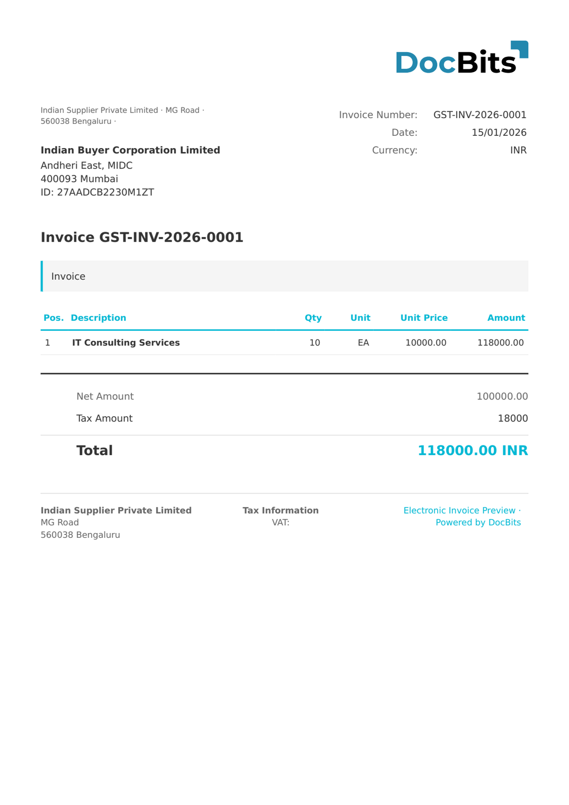

# 🇮🇳 印度 GST 电子发票

<!-- edocs-country-scope -->


请参阅国家指南，了解版本限制、实际生效的配置和国家说明视频。 [印度](countries/india.md). 文档所述的适配器处理 SignedInvoice XML。不要假定原始 IRP JSON、二维码图片或扫描 PDF 使用相同的提取路径。


| 属性                 | 值                                                 |
| -------------------- | -------------------------------------------------- |
| **国家 / 地区**      | 印度                                              |
| **文档类型**         | 发票 (INV)、贷项通知单 (CRN)、借项通知单 (DBN)     |
| **格式**             | XML (`<SignedInvoice>`)                            |
| **标准**             | GST 电子发票 (GSTN 发票注册门户)                   |
| **区域设置**         | `en_IN`                                            |

印度 GST 电子发票是印度商品及服务税 (GST) 制度下的强制性电子发票标准，由 GSTN（GST 网络）运营。营业额超过规定门槛的企业必须通过发票注册门户 (IRP) 生成电子发票。IRP 会对发票进行签名，并返回 **IRN**（发票参考编号——一个 64 字符的 SHA-256 哈希值）和二维码。

DocBits 通过根元素 `<SignedInvoice>` 识别 GST 电子发票文档。该格式包含三种 GST 税项：

| 税项   | 说明                                                              |
| ------ | ----------------------------------------------------------------- |
| IGST   | 综合 GST — 适用于跨邦交易                                         |
| CGST   | 中央 GST — 适用于邦内交易（中央部分）                             |
| SGST   | 邦 GST — 适用于邦内交易（邦级部分）                               |

纳税人识别号为 **GSTIN**（商品及服务税识别号码），是一种 15 位字母数字代码，格式为 `29AABCU9603R1ZM`（2 位邦代码 + 10 位 PAN + 实体编号 + 校验位）。日期采用 `DD/MM/YYYY` 格式。

## 支持状态

| 组件       | 状态       |
| ---------- | ---------- |
| 预览       | ✅ 支持     |
| 字段提取   | ✅ 支持     |
| 转换       | ✅ 支持     |

## 默认预览

<figure><figcaption>
DocBits 中印度 GST 电子发票的默认预览
</figcaption></figure>

## 字段映射

### 表头字段

| DocBits 字段          | 源 XML 元素                                      | 说明                                           |
| --------------------- | ------------------------------------------------ | ---------------------------------------------- |
| `invoice_id`          | `Invoice/DocDtls/No`                             | 发票编号                                       |
| `invoice_date`        | `Invoice/DocDtls/Dt`                             | 开票日期 (`DD/MM/YYYY`)                        |
| `invoice_type`        | `Invoice/DocDtls/Typ`                            | INV=发票，CRN=贷项通知单，DBN=借项通知单       |
| `currency`            | 固定值：`INR`                                    | 始终为印度卢比                                 |
| `net_amount`          | `Invoice/ValDtls/AssVal`                         | 应税金额                                       |
| `tax_amount`          | `Invoice/ValDtls/IgstVal` + `CgstVal` + `SgstVal` | GST 总税额                                   |
| `total_amount`        | `Invoice/ValDtls/TotInvVal`                      | 发票总金额（含 GST）                           |
| `igst_amount`         | `Invoice/ValDtls/IgstVal`                        | 综合 GST 金额                                  |
| `cgst_amount`         | `Invoice/ValDtls/CgstVal`                        | 中央 GST 金额                                  |
| `sgst_amount`         | `Invoice/ValDtls/SgstVal`                        | 邦 GST 金额                                    |
| `cess_amount`         | `Invoice/ValDtls/CesVal`                         | 附加税金额（如适用）                           |
| `supplier_name`       | `Invoice/SellerDtls/LglNm`                       | 卖方法定名称                                   |
| `supplier_id`         | `Invoice/SellerDtls/Gstin`                       | 卖方 GSTIN（15 位，例如 `29AABCU9603R1ZM`）    |
| `supplier_trade_name` | `Invoice/SellerDtls/TrdNm`                       | 卖方商号                                       |
| `supplier_address`    | `Invoice/SellerDtls/Addr1`                       | 卖方地址第 1 行                                |
| `supplier_city`       | `Invoice/SellerDtls/Loc`                         | 卖方城市 / 地点                                |
| `supplier_postal_code`| `Invoice/SellerDtls/Pin`                         | 卖方邮政编码                                   |
| `supplier_state_code` | `Invoice/SellerDtls/Stcd`                        | 卖方邦代码（2 位）                             |
| `buyer_name`          | `Invoice/BuyerDtls/LglNm`                        | 买方法定名称                                   |
| `buyer_id`            | `Invoice/BuyerDtls/Gstin`                        | 买方 GSTIN                                     |
| `buyer_trade_name`    | `Invoice/BuyerDtls/TrdNm`                        | 买方商号                                       |
| `buyer_address`       | `Invoice/BuyerDtls/Addr1`                        | 买方地址第 1 行                                |
| `buyer_city`          | `Invoice/BuyerDtls/Loc`                          | 买方城市 / 地点                                |
| `buyer_postal_code`   | `Invoice/BuyerDtls/Pin`                          | 买方邮政编码                                   |
| `buyer_state_code`    | `Invoice/BuyerDtls/Stcd`                         | 买方邦代码                                     |
| `irn`                 | `Irn`                                            | 发票参考编号（64 字符的 SHA-256 哈希值）       |
| `ack_number`          | `AckNo`                                          | IRP 确认编号                                   |
| `ack_date`            | `AckDt`                                          | IRP 确认日期                                   |

### 行项目表 (`INVOICE_TABLE`)

行路径：`Invoice/ItemList/Item`

| 列            | 源 XML 元素                           | 说明                                         |
| ------------- | ------------------------------------- | -------------------------------------------- |
| `POSITION`    | `SlNo`                                | 行序号                                       |
| `DESCRIPTION` | `PrdDesc`                            | 产品 / 服务说明                              |
| `QUANTITY`    | `Qty`                                 | 开票数量                                     |
| `UNIT`        | `Unit`                                | 计量单位（例如 `OTH`、`NOS`、`KGS`）          |
| `UNIT_PRICE`  | `UnitPrice`                           | 单价                                         |
| `VAT_RATE`    | `GstRt`                               | GST 税率（%）（例如 18%）                    |
| `VAT`         | `IgstAmt`（或 `CgstAmt` + `SgstAmt`） | 每行 GST 金额                                |
| `NET_AMOUNT`  | `AssAmt`                              | 每行应税金额                                 |

## 分类规则

DocBits 通过匹配根元素来识别印度 GST 电子发票文档：

| 电子文档类型             | 模式                                    |
| ------------------------ | --------------------------------------- |
| 印度 GST 电子发票        | 根元素包含 `<SignedInvoice`             |

## 相关内容

* [当前支持的电子发票标准](https://github.com/Fellow-Consulting-AG/docbits/tree/main/readme/administration-and-setup/settings/global-settings/document-types/currently-supported-e-invoice-standards/README.md)
* [支持的电子文档](./)
