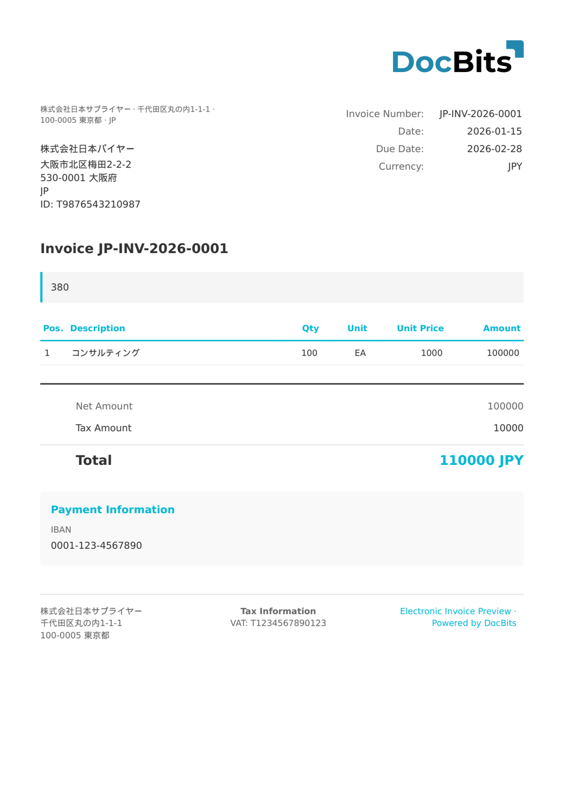

# 🇯🇵 JP PINT

| 属性                 | 值                                             |
| -------------------- | ---------------------------------------------- |
| **国家 / 地区**      | 日本                                           |
| **文档类型**         | 发票                                           |
| **格式**             | UBL 2.1 XML                                    |
| **标准**             | JP PINT（日本 Peppol 国际模型）                |

JP PINT 是 Peppol 国际（PINT）发票模型在日本的实施方案。它将全球 Peppol 标准调整为符合日本业务要求，其中包括支持《消费税法》修订后引入的合格发票制度（適格請求書）。

## 支持状态

| 组件       | 状态       |
| ---------- | ---------- |
| 预览       | ✅ 支持     |
| 字段提取   | ✅ 支持     |
| 转换       | ✅ 支持     |

## 默认预览

<figure><figcaption>
日本 JP PINT 发票的 DocBits 默认预览
</figcaption></figure>

## 相关内容

* [支持的电子文档](./)
* [JP PINT 自开票](jp-pint-self-billing.md)
