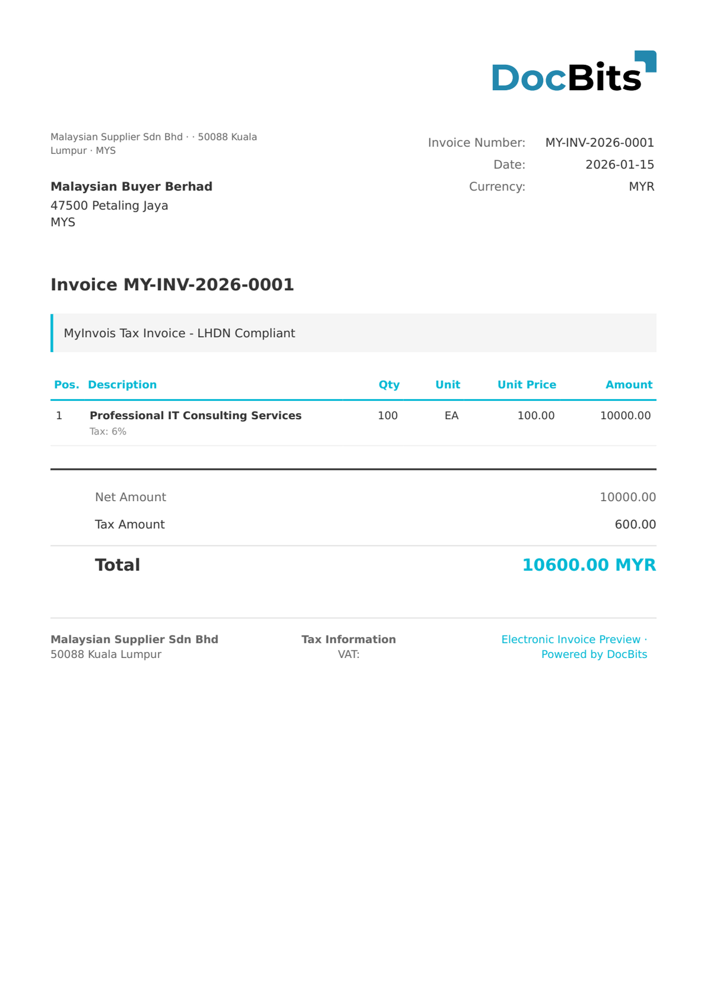

# 🇲🇾 MYINVOIS

<!-- edocs-country-scope -->


请参阅国家指南，了解版本限制、实际生效的配置和国家说明视频。 [马来西亚](countries/malaysia.md). 已检查的提取路径基于 XML。国家平台也接受 JSON，但这并不能证明此 DocBits 映射支持 JSON 导入。


| 属性                 | 值                                                   |
| -------------------- | ---------------------------------------------------- |
| **国家 / 地区**      | 马来西亚                                             |
| **文档类型**         | 发票、贷项通知单、借项通知单、自开票发票             |
| **格式**             | UBL 2.1 XML                                   |
| **标准**             | MyInvois（LHDN - 马来西亚内陆税收局）                |

MyInvois 是由马来西亚内陆税收局（LHDN）运营的电子发票系统。该系统自 2024 年 8 月起适用于大型企业，要求所有发票提交至 MyInvois 门户进行验证并获取唯一标识符。该系统使用 UBL 2.1，并支持 XML 和 JSON 两种提交格式。

## 支持状态

| 组件               | 状态         |
| ------------------ | ------------ |
| 预览               | ✅ 支持       |
| 字段提取           | ✅ 支持       |
| 转换               | ✅ 支持       |

## 默认预览

<figure><figcaption>
马来西亚 MyInvois 发票的 DocBits 默认预览
</figcaption></figure>

## 相关内容

* [支持的电子文档](./)
