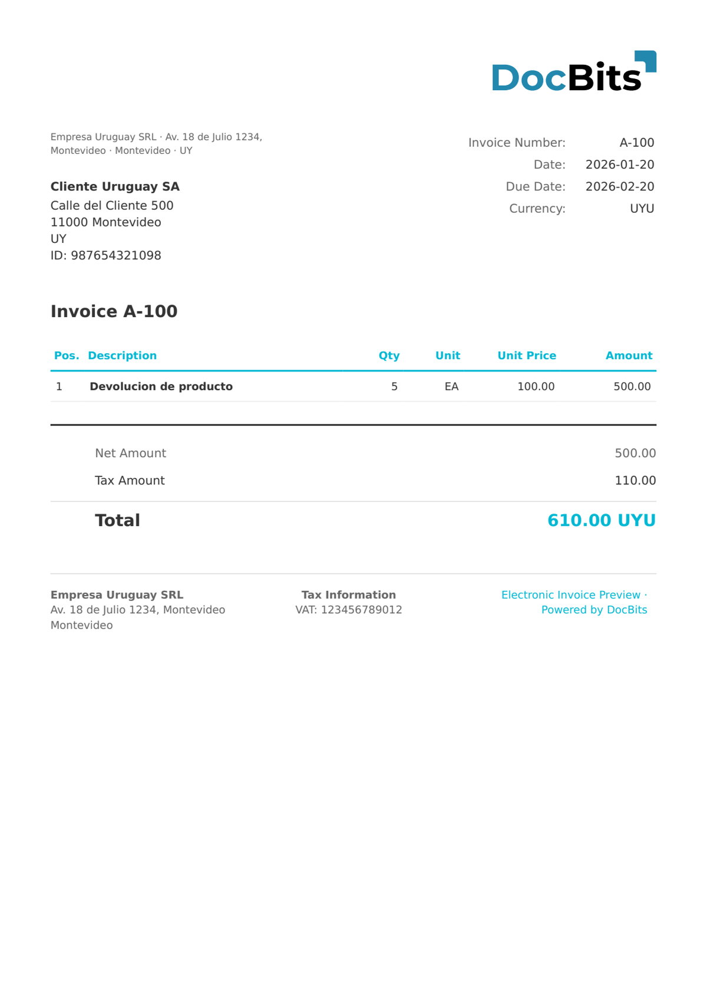

# 🇺🇾 乌拉圭 E-NOTA CREDITO

| 属性                 | 值                              |
| -------------------- | ------------------------------- |
| **国家 / 地区**       | 乌拉圭                          |
| **文档类型**          | 贷项通知单（e-Nota de Crédito） |
| **格式**              | XML                             |
| **标准**              | e-Nota de Crédito（CFE 类型 112）|

乌拉圭 e-Nota de Crédito 是 CFE 系统中的电子贷项通知单文档类型，类型代码为 112。它用于调整或取消先前签发的 e-Factura，并且必须引用原始文档。

## 支持状态

| 组件       | 状态       |
| ---------- | ---------- |
| 预览       | ✅ 支持     |
| 字段提取   | ✅ 支持     |
| 转换       | ✅ 支持     |

## 默认预览

<figure><figcaption>
乌拉圭 E-Nota Credito 发票的 DocBits 默认预览
</figcaption></figure>

## 相关内容

* [支持的电子文档](./)
