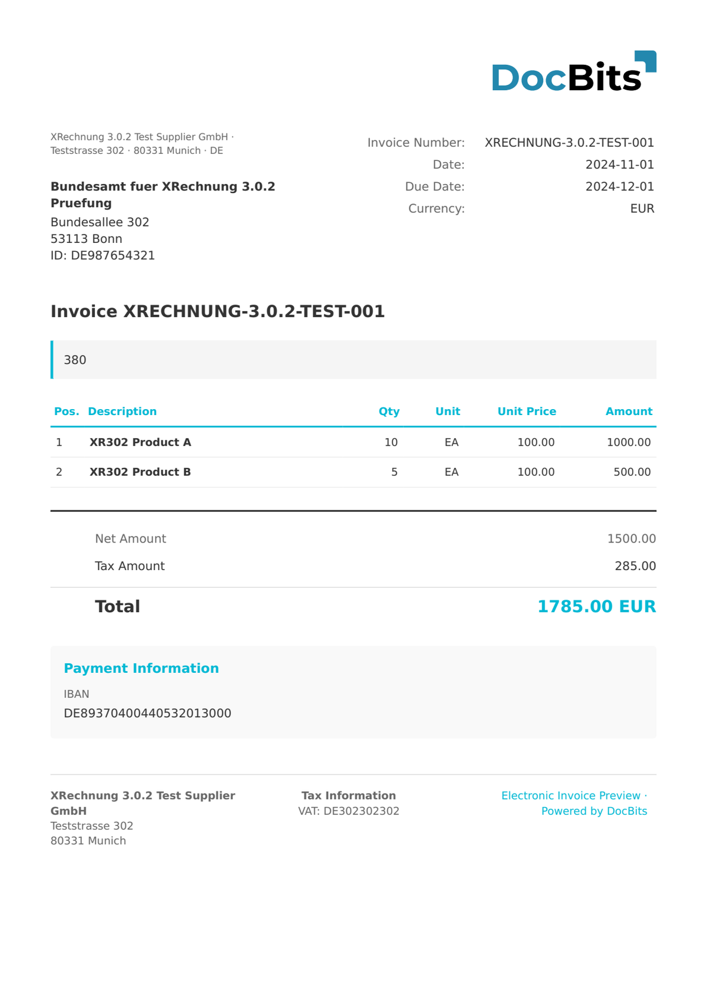

# 🇩🇪 XRECHNUNG 2.3 UBL

<!-- edocs-country-scope -->


请参阅国家指南，了解版本限制、实际生效的配置和国家说明视频。 [德国](countries/germany.md). 语法、发布版本和业务规范是不同的选择。不要根据共用的 1p0 标记推断 Factur-X 发布版本。


| 属性                   | 值                       |
| ---------------------- | ------------------------ |
| **国家 / 地区**        | 德国                     |
| **文档类型**           | 发票、贷项通知单         |
| **格式**               | UBL                      |
| **标准**               | XRechnung 2.3            |
| **基于**               | EN 16931（OASIS UBL 2.1） |

XRechnung 2.3 实现了 EN 16931 核心发票标准，并扩展了德国 CIUS（核心发票使用规范）。此版本引入了与 Peppol 的对齐，以确保与泛欧公共采购在线网络无缝集成。

## 支持状态

| 组件         | 状态       |
| ------------ | ---------- |
| 预览         | ✅ 支持     |
| 字段提取     | ✅ 支持     |
| 转换         | ✅ 支持     |

## 默认预览

<figure><figcaption>
DocBits 中德国 XRechnung 2.3 UBL 发票的默认预览
</figcaption></figure>

## 相关内容

* [XRechnung 配置](../xrechnung/)
* [XRechnung 字段映射](../xrechnung/mapping-xrechnung-in-docbits/)
* [支持的电子文档](./)
