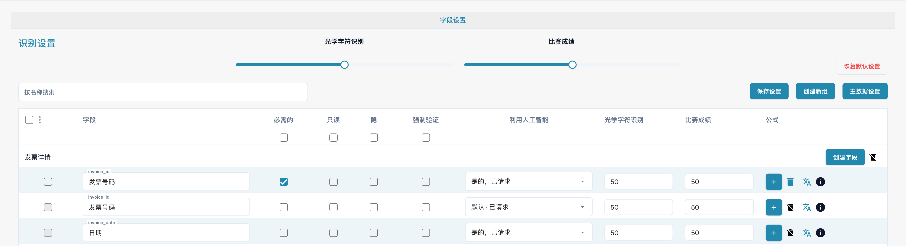

# 字段

字段决定文档类型需要采集哪些数据以及如何检查这些数据。在设置中打开文档类型，然后查看其字段。

<figure><figcaption>
发票文档类型的字段。
</figcaption></figure>

## 属性与识别

* **必填**要求在验证时提供字段值。
* **只读**阻止编辑；**隐藏**将字段从常规视图中移除。
* **强制验证**要求对字段进行明确检查。此选项不会创建比较规则或正则表达式；自定义验证规则需要单独配置。
* **OCR**设置识别置信度的数值阈值，不是开启或关闭 OCR 的开关。
* **匹配分数（Match Score）**设置匹配的数值阈值，不是参考文本或值列表。
* **AI**选项控制是否请求对该字段进行提取。

按名称搜索字段，并在修改属性前检查对应行。您可以整理字段组、添加字段，以及打开公式或主数据选项。可用操作取决于字段和权限；标准字段的删除可能受到限制。

只保存预期的更改，并使用有代表性的文档检查验证结果。图片不证明已保存任何更改。

参阅[字段属性](configuring-field-properties-1.md)、[验证与匹配分数](setting-validation-and-match-score.md)和[带费用的字段](new-fields-with-charges.md)。
