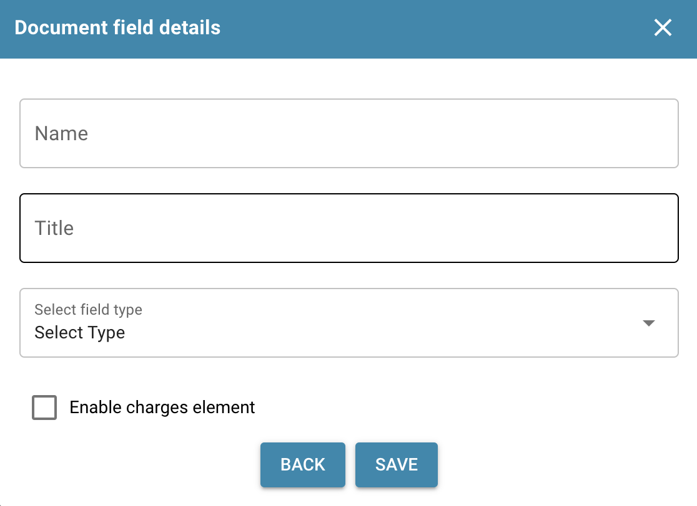

# 添加和编辑字段

## 以下是如何在 DocBits 中添加新字段或修改现有字段的步骤，包括如何访问高级配置选项：

### 添加新字段

* 登录并访问文档管理：

<figure><figcaption>
设置
</figcaption></figure>

<figure><figcaption>
设置文档类型
</figcaption></figure>

**添加新字段：**

* 点击“Create Field”选项。

<figure><figcaption></figcaption></figure>

**基本配置：**

<figure><figcaption></figcaption></figure>

* **名称**
  * 选择一个有意义且能清楚描述字段的名称。
  * 名称必须唯一。
  * <mark style="color:red;">**注意：**</mark> **创建后，名称无法更改。**
* **标题**
  * 这是字段显示的名称。
  * 它定义了字段在用户界面中的显示方式。
  * <mark style="color:red;">**注意：**</mark> **之后可以根据需要更改标题。**
*   **选择字段类型**

    * 从下拉列表中选择字段类型。
    * 可用的字段类型包括多种选项，可满足不同的数据录入需求。
    * <mark style="color:red;">**注意：**</mark> **创建后，类型无法更改。**

    <figure><figcaption></figcaption></figure>
* **可选：启用费用元素**
  * 可以勾选标记为 **Enable Charges Element** 的复选框。
  * 勾选后，必须从下拉列表中选择一个费用元素。
  * **重要：**必须事先配置费用元素。
    * [费用元素配置](../../../../../infor-integration-and-configuration/importing-customer-master-data/m3/table-extraction-for-costing-element.md)

**高级配置：**

* 在此可以设置验证规则、匹配值、只读模式、隐藏选项和 OCR 设置等其他属性。

<figure><figcaption></figcaption></figure>

**保存：**

* 完成所有必要配置后，点击“Save”或类似按钮以创建新字段。

<figure><figcaption></figcaption></figure>

### 编辑现有字段

**访问字段编辑：**

* 前往现有字段列表，找到要编辑的字段。

<figure><figcaption></figcaption></figure>

**选择字段：**

* 点击相应字段以访问编辑选项。

<figure><figcaption></figcaption></figure>

**更改配置：**

* 根据需要更改字段属性。这可能包括更改名称或字段类型、添加或移除验证规则、设置匹配值，或调整其他高级设置。

<mark style="color:red;">**注意：**</mark> 如果更改字段的 **Title**，必须在布局构建器中删除并重新添加该字段，所做更改才会生效。

<figure><figcaption></figcaption></figure>

**保存：**

* 点击“Save”以保存对字段所做的更改。

<figure><figcaption>
保存设置
</figcaption></figure>

按照这些步骤添加新字段和编辑现有字段，并使用高级配置选项，可以最大限度地提高文档处理系统的灵活性和适应性。这样，您就可以根据需要组织和处理数据。
