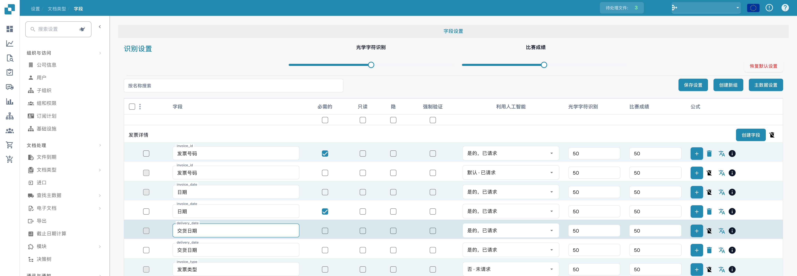
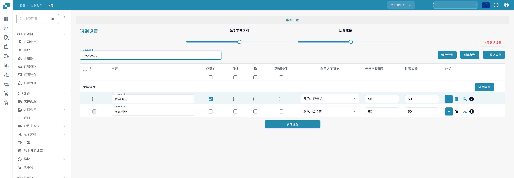

# 配置字段属性

打开 **设置 → 文档类型 → 字段**，然后选择文档类型。图片展示中文界面中的发票字段；`invoice_id` 等技术标识符保持不变。

<figure><figcaption>
字段属性：必填、只读、隐藏和强制验证。
</figcaption></figure>

## 查找字段并更改其属性

1. 在 **按名称搜索** 中输入字段名称或标签。此操作会筛选列表，不会更改字段。
2. 找到字段所在行。例如，**发票号码** 的技术名称为 `invoice_id`。
3. 调整该行中的控件，然后选择 **保存设置**。表格上方和下方均提供相同的保存按钮。

<figure><figcaption>
按 invoice_id 筛选的字段及 OCR、Match Score 阈值。
</figcaption></figure>

| 控件 | 用途 |
| --- | --- |
| **必填** | 将验证时必须填写的信息标记为必填。更改此设置后，请检查文档的验证结果。 |
| **只读** | 显示字段，但不允许用户编辑其值。 |
| **隐** | 在常规文档视图中隐藏该字段。 |
| **强制验证** | 要求对字段进行明确检查。此选项不会创建比较规则或正则表达式；自定义验证规则需要单独配置。 |
| **利用人工智能** | 请求或停止对该字段进行 AI 提取。该行会显示是否已请求提取。 |
| **OCR** | 输入字段的 OCR 置信度阈值。这是一个数值，不是开关或语言设置。 |
| **匹配分数** | 输入字段的匹配阈值。这是一个数值，不是开关。 |

**识别设置** 下的 **OCR** 和 **匹配分数** 滑块会将相应的值应用到整个字段列表。列标题正下方的复选框会将 **必填**、**只读**、**隐** 或 **强制验证** 应用到整个列表。选择 **保存设置** 前，请检查受影响的行。**恢复默认值** 会重置字段配置；只有在确实要替换自己的更改时才使用此选项。

## 此视图中的其他控件

- **创建新组** 和 **创建字段** 分别用于添加分组或字段。请参阅[添加和编辑字段](adding-and-editing-fields.md)。
- **主数据设置** 会打开[主数据配置](master-data-settings.md)。
- 最左侧的复选框用于选择字段。相邻菜单中的 **重新分配字段组** 可用于重新分配所选字段的分组。
- **公式** 加号按钮会打开该字段的公式编辑器。**info** 图标会显示字段信息。标准字段无法使用删除图标。

有关验证和匹配的更多信息，请参阅[设置验证和匹配分数](setting-validation-and-match-score.md)。
