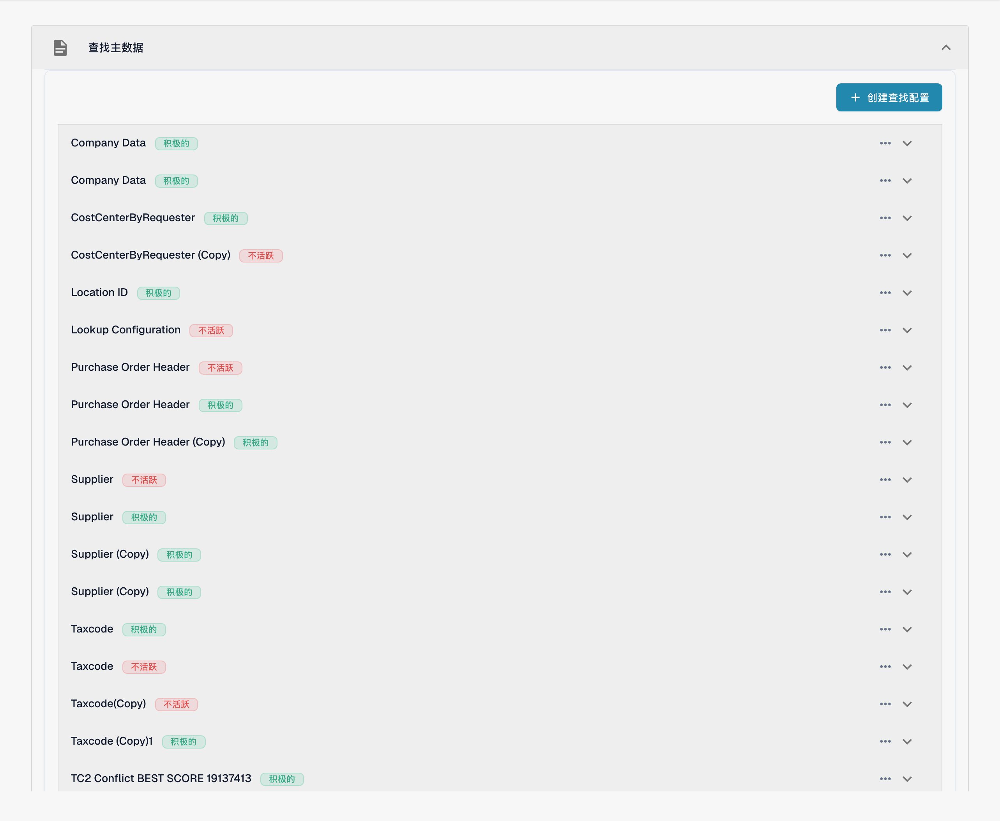
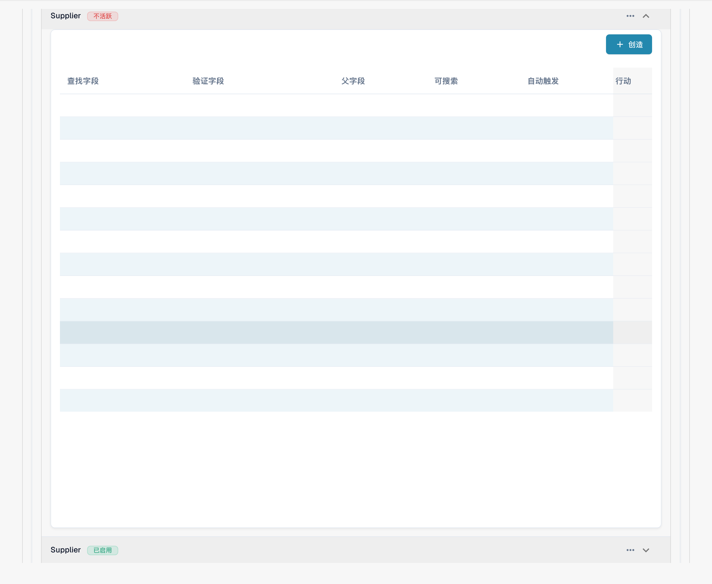
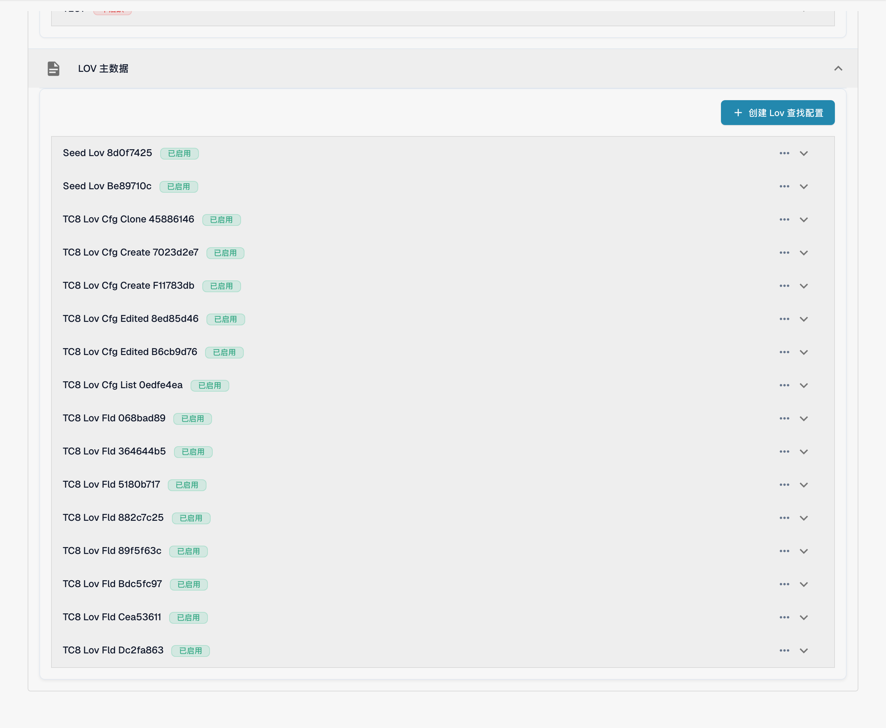
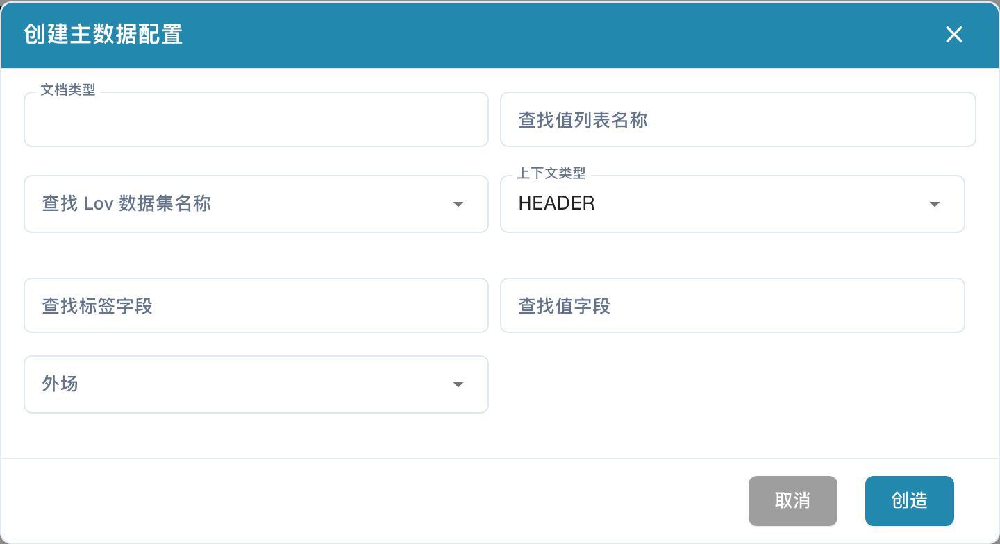

# 主数据设置

主数据设置将文档的验证字段连接到存储在[查找主数据](../../../document-processing/master-data-lookup.md)中的数据。使用 **Lookup Master Data** 查找并填入匹配的记录。使用 **LOV Master Data** 提供来自数据集的值列表。

## 打开设置

1. 在 **Settings** 中，打开 **Document Processing → Document Types**。
2. 打开要配置的文档类型，例如 **Invoice**，然后选择 **Fields**。
3. 选择 **Master Data Settings**。此页面分为 **Lookup Master Data** 和 **LOV Master Data** 两个区域。选择区域标题可展开该区域。

<figure><figcaption>
中文主数据查找配置入口。配置名称（如 Supplier 和 Purchase Order Header）是已有标识；绿色“积极的”在此指已生效，红色“不活跃”指未启用。
</figcaption></figure>

## 使用 Lookup Master Data 匹配记录

**Lookup Master Data** 配置会搜索数据集，并将匹配的记录映射到文档字段。列表会显示每个配置的名称及其是否启用。**Default** 徽标表示这是 DocBits 配置；你可以停用该配置，但不能编辑或删除它。

### 创建查找配置

1. 选择 **Create Lookup Config**。
2. 输入 **Lookup Name**，并选择包含要搜索记录的 **Lookup Dataset Name**。
3. 为匹配多条记录的情况选择 **Conflict Handler**：
   * **Best Score** 选择匹配度最高的记录。
   * **Return None** 将结果留空，供用户决定。
   * **Return First** 使用第一条结果。
4. 文档字段请选择 **HEADER**，文档表格中的字段请选择 **LINE**。如果选择 **LINE**，还要选择查找所应用的表格，即 **Context Detail**。
5. 如果配置的每个搜索字段都必须匹配记录，请开启 **Match All**。如果任一字段匹配即可，请保持关闭。选择 **Create**。

<figure><figcaption>
中文主数据查找配置空白表单；Best Score 等冲突处理选项及 HEADER、LINE 技术标识保留原文，未创建配置。
</figcaption></figure>

**Match All** 和 **Conflict Handler** 会影响供应商的自动识别。请参阅[使用主数据配置模糊数据](../../../../setup/document-types/fuzzy-data-configuration-with-master-data.md)中的示例。

### 在配置中映射字段

展开配置可查看其映射字段。例如，可以让供应商名称参与搜索，并为供应商编号配置自动触发；实际映射以组织设置为准。下图中的映射值已隐藏，只展示列结构。

<figure><figcaption>
已展开的 Supplier 查找配置及中文映射列。Supplier 是配置标识；映射数据已隐藏，本图不表示某个字段映射或自动触发选项已启用。
</figcaption></figure>

在展开的配置中选择 **Create**，即可添加映射：

* **Lookup Field** 是要搜索的数据集列。
* **Validation Field** 是用于接收结果的文档字段。
* **Parent Field**（父字段） 可选，用于根据相关字段检查结果。
* **Search Operator** 控制文本的比较方式。**Smart** 会忽略空格和标点符号；其他选项包括 Contains、Starts With、Ends With 和 Exact。
* **Auto Trigger** 会在此字段填入内容时启动查找。**Searchable** 允许该字段参与搜索，并支持在验证期间手动查找。

选择 **Create** 添加映射。使用行上的三点 **Actions** 菜单编辑或删除可编辑的映射。默认映射只能查看。

<figure><figcaption>
中文“创建主数据字段”空白对话框，显示查找字段、验证字段、父字段、搜索运算符和两个选项；未创建映射。
</figcaption></figure>

使用配置上的三点菜单可启用或停用配置、复制配置或编辑配置。默认配置会显示 **View** 而非 **Edit**，且无法删除。删除自定义配置或字段会移除其映射；请先检查依赖于该映射的文档字段。

## 使用 LOV Master Data 提供列表

**LOV Master Data** 会根据主数据数据集创建下拉选项。你还可以添加筛选字段，使先前的选择缩小后续显示的选项范围。

展开 **LOV Master Data**，然后选择 **Create Lov Lookup Config**。如果尚无配置，此区域只会显示此按钮。

<figure><figcaption>
已展开的中文 LOV 主数据区域和“创建 Lov 查找配置”入口。列表名称是已有测试配置标识；本图未修改启用状态。
</figcaption></figure>

在表单中输入 **Lookup Lov Name**，选择 **Lookup Lov Dataset Name**，并将 **Context Type** 设为 **HEADER** 或 **LINE**。如果选择 **LINE**，请通过 **Context Detail** 指定文档表格。然后选择：

* **Lookup Label Field**：用户在下拉列表中看到的值。
* **Lookup Value Field**：为所选项存储的值，也是筛选时使用的值。
* **Out Field**：由所选标签填入的文档字段。

选择 **Create** 保存配置。展开配置可查看其字段，也可以使用配置上的三点菜单启用、复制、编辑或删除配置。

<figure><figcaption>
中文 LOV 查找配置空白表单；界面中的“外场”在此指输出字段（Out Field），HEADER、LINE 是上下文标识。未创建配置。
</figcaption></figure>

要创建级联下拉列表，请在展开的 LOV 配置中选择 **Create**，然后选择 **Lookup Field** 和 **Filter Field**。筛选字段的值会缩小查找返回的选项范围。你也可以设置静态的 **Filter Value**，并将字段标记为 **Required**。使用行上的三点菜单编辑或删除自定义筛选字段。
