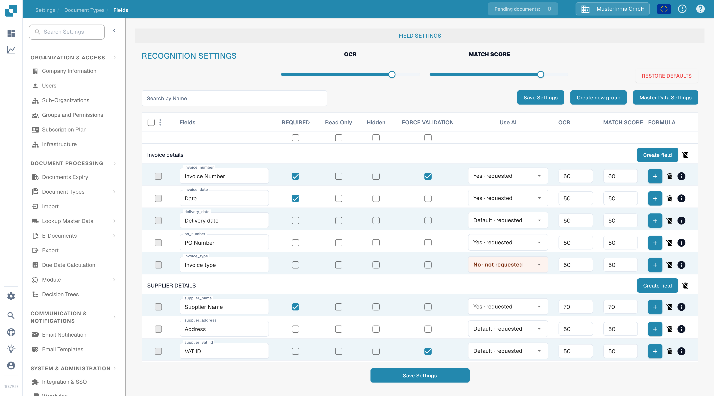
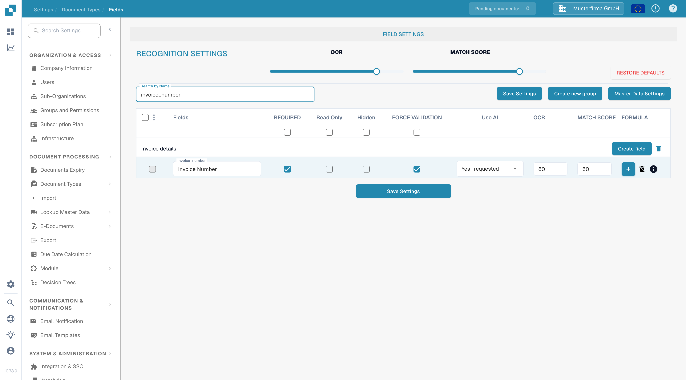

# 设置验证和匹配分数

在 **Fields** 中，您可以为文档类型设置验证和识别阈值。本页以文档测试组织中的 **Invoice** 为例，介绍当前的 **Force Validation** 复选框和 **Match Score** 控件。

## 打开字段设置

1. 前往 **Settings → Document Types → Invoice → Fields**。
2. 使用 **Search by Name** 查找字段，例如 `invoice_id`（显示为 **Invoice number**）。
3. 更改设置前，请先检查字段所在行。**Required**、**Read Only**、**Hidden** 和 **Force Validation** 是彼此独立的复选框。

<figure><figcaption>识别控件显示在字段列表上方。</figcaption></figure>

## Force Validation

选中字段所在行的 **Force Validation**，即可对该字段应用更严格的验证。该复选框与 **Required** 相互独立：将字段标记为必填不会自动选中 Force Validation。当字段被隐藏或设为只读时，此复选框可能不可用。更改字段配置后，点击 **Save Settings**。

旧版说明建议在此处输入数值限制或正则表达式。当前的 Fields 表格在 Force Validation 单元格中不显示规则编辑器。有关字段专属规则，请参阅[配置字段属性](configuring-field-properties-1.md)。

## Match Score

**Match Score** 是数值阈值，而不是固定的参考值。**Recognition Settings** 中的 **MATCH SCORE** 滑块会将其值应用于该文档类型的字段行；如需为单个字段设置数值，请使用该字段行中的 **MATCH SCORE** 输入框。在测试组织中，滑块和 `invoice_id` 均显示 **50**。请检查受影响的字段，然后点击 **Save Settings**。

<figure><figcaption>搜索字段，以检查其 Force Validation 复选框和 Match Score 数值。</figcaption></figure>

**OCR** 是 Match Score 旁边的独立识别阈值。**Restore Defaults** 会重置设置；仅在您打算放弃自定义阈值时使用。如需了解其他字段选项，请参阅[Fields 概览](README.md)。
