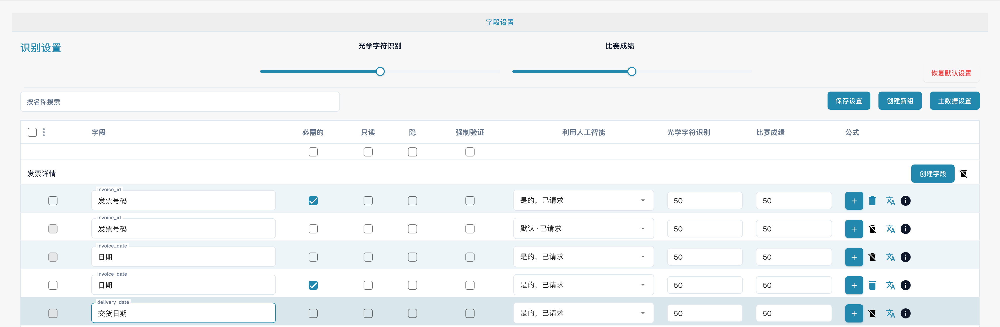
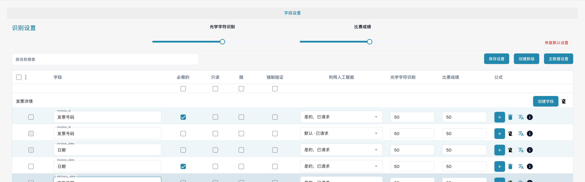
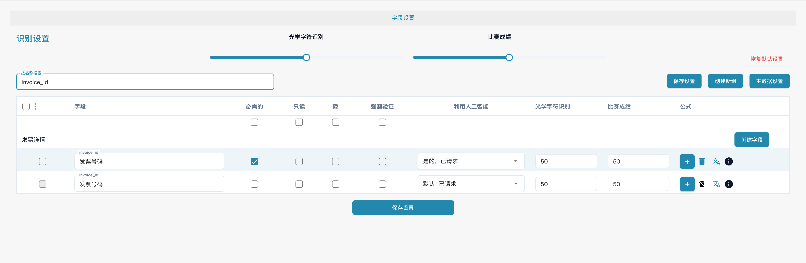

# 验证和匹配阈值

文档类型的字段设置分别提供强制验证、OCR 和 Match Score。

<figure><figcaption>
强制验证、OCR 和 Match Score 的独立列。
</figcaption></figure>

**强制验证**要求明确检查字段。它不是自定义比较规则或正则表达式的编辑器；这些规则另行配置。

**OCR**是识别置信度的数值阈值，不是 OCR 开关。**匹配分数**是匹配分数阈值，不是参考文本或值列表。

<figure><figcaption>
每个字段的验证和识别设置相互独立。
</figcaption></figure>

按字段名称查找具体行，检查该行的设置。

<figure><figcaption>
按发票编号筛选的强制验证与 Match Score 设置。
</figcaption></figure>

保存预期更改后，使用有效、不完整和不匹配的文档检查验证行为。图片没有保存配置，也没有验证某个阈值适合所有发票。
