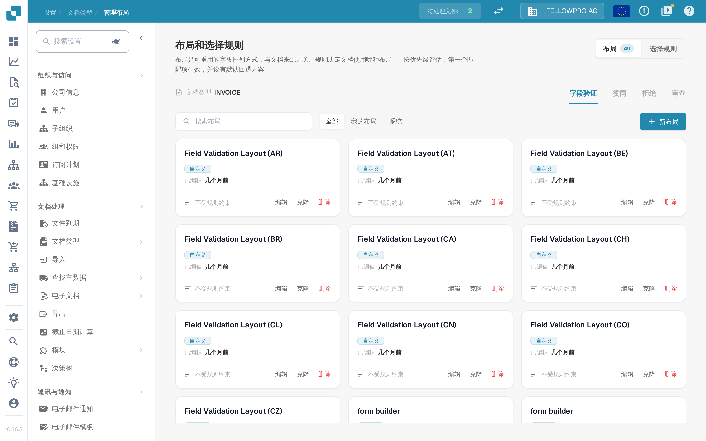

# 布局管理器

<figure><figcaption>Invoice 文档类型的布局管理器。</figcaption></figure>

**布局管理器**决定了文档类型在验证、审批、拒绝和审查文档的人员眼中是什么样子：屏幕上显示哪些字段和分组、按什么顺序显示，以及每个字段的行为方式。每个文档类型都有自己的布局。

该页面以**布局和选择规则**打开：布局是可重用的字段排列方式，与文档来源无关；规则决定文档使用哪种布局。

#### 屏幕与布局类型

验证、审批、拒绝和审查是彼此独立的屏幕，每个屏幕都有自己的布局、自己的规则和自己的默认布局——审批规则绝不会改变验证屏幕。使用**字段验证**、**赞同**、**拒绝**和**审查**选项卡切换屏幕。

#### 布局卡片

在**布局**选项卡中，所选屏幕的每个布局都是一张卡片。卡片会显示布局名称、它属于您的组织（**自定义**）还是系统默认布局、最后一次编辑的时间，以及是否有选择规则指向它。**编辑**会在 Layout Builder 中打开该布局，**克隆**会以您指定的名称复制它，**删除**则将其移除——系统默认布局只能查看，无法修改或删除。**新布局**会询问名称，并在新的空白布局上打开 Layout Builder。卡片上方的筛选器可在**全部**、**我的布局**和**系统**之间切换。

#### Layout Builder

**编辑**会打开 [Layout Builder](navigating-the-layout-manager.md)：

* 左侧的**结构**、**字段**和**元素**——以树形展示的布局、文档类型的每个字段及已放置字段的计数，以及可拖到画布上的分组和表单元素。
* 中间的**画布**按用户看到的样子显示布局。**主布局**和**表格**在页面与行项目表之间切换，**文档**则在画布旁打开示例文档。
* 右侧的**属性**面板会跟随所选元素，其设置分为显示、行为、值和列表、自动化以及边框和间距几个部分。

页眉中的**保存**用于保存布局。页眉的其他操作请参见[保存和应用更改](save-and-apply-changes.md)。

#### 文档会使用哪种布局

每个屏幕的**选择规则**选项卡包含用于挑选布局的规则：按优先级评估，第一个匹配项生效；若没有规则匹配，则使用默认回退方案。请参见[布局选择规则](layout-selection-rules.md)。
