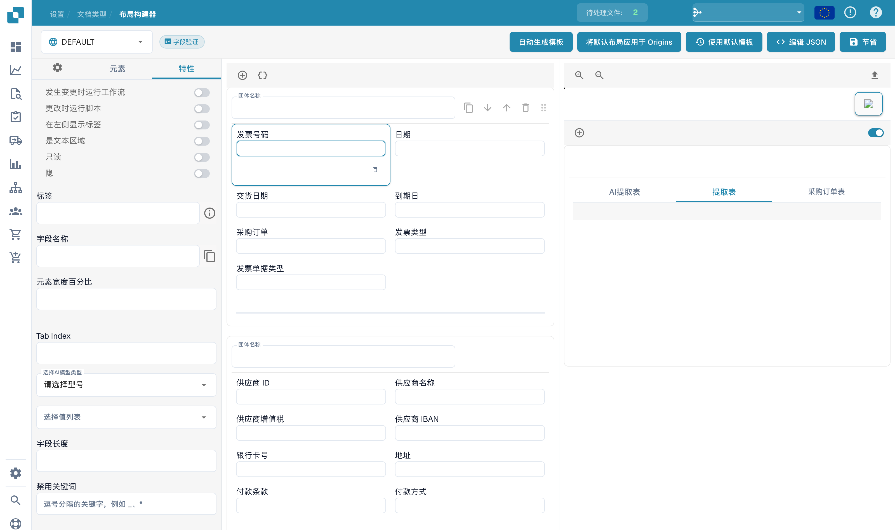

# 配置字段属性

布局构建器中的字段属性控制该布局内的显示与提取设置。选择已有布局中的字段，打开属性面板。

<figure><figcaption>
布局构建器中的字段属性。 “Tab Index”是当前界面保留的英文控件标签。
</figcaption></figure>

检查所选字段和布局，再查看可用的标签、尺寸、位置、识别及格式设置。不同字段类型提供的选项可能不同。

不要将布局构建器的字段属性与文档类型的全局字段验证设置混淆。保存预期布局后，使用其他文档检查显示和提取结果。图片没有保存配置更改。
