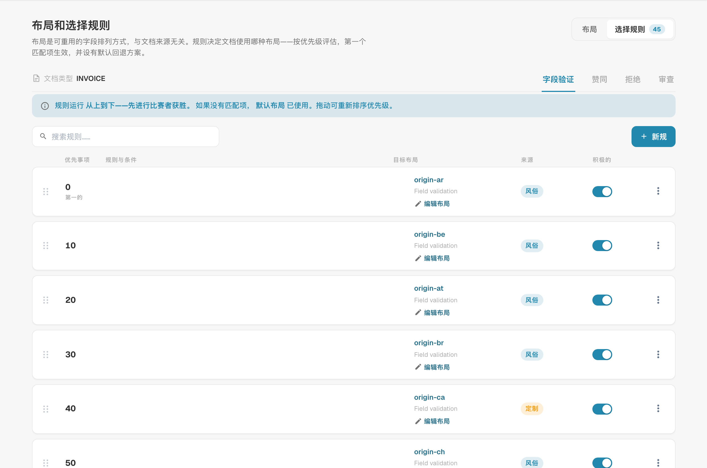

# 布局选择规则

## 概述

**布局**决定用户在文档的**验证**、**审批**、**驳回**和**审核**界面上看到哪些字段和分组，以及它们的显示顺序。您可以在[布局管理器](README.md)中设计布局。

传统上，DocBits 根据文档的**来源地**选择布局：来源地取自文档语言设置中的国家或地区，例如 `DE` 或 `US`。每个来源地都有自己的布局副本，其他因素都不会影响布局选择。

使用**布局选择规则**后，布局将成为与来源地无关、可重复使用的构建模块，文档使用哪个布局则由**规则**决定：

> *当*文档满足某个条件时，*则*使用指定的布局。规则按从上到下的顺序检查；**第一个匹配的规则生效**。如果没有规则匹配，则使用**默认布局**。

来源地仍然可用，只是现在它是众多条件之一。规则也可以根据供应商、金额、文档状态、提取方法或任何标题字段进行判断。

### 解决的问题

| 需求 | 传统的基于来源地的布局 | 使用选择规则后 |
| --- | --- | --- |
| 某个供应商的发票需要额外字段（项目、海关编号） | 无法实现，除非新增一个来源地 | 规则 *Supplier ID is 20723* → 布局“包含项目字段的发票” |
| DE、AT 和 CH 文档应使用相同的外观 | 需要维护三个相同的布局副本 | 使用一个布局，每个来源地对应一条指向该布局的规则（或使用一个 ANY 分组） |
| 电子发票需要比扫描 PDF 更简单的界面 | 无法实现 | 规则 *Extraction Method is ELECTRONIC_DOCUMENT* → 布局“电子发票” |
| 高金额发票在审批界面上需要更多字段 | 无法实现 | 审批规则 *Total Amount greater than 10000* → 布局“高金额审批” |
| 第二位审批人应看到与第一位审批人不同的界面 | 需要单独的“第二次审批”布局类型 | 审批规则 *Document Status is Pending second approval* → 布局“第二次审批” |

## 启用基于规则的布局

基于规则的布局由**组织管理员**按**文档类型**启用。

1. 前往**设置 → 全局设置 → 文档类型**。
2. 点击文档类型卡片上的**设置**（齿轮）图标。
3. 打开**管理布局**并启用开关。

<figure><figcaption>
文档类型其他设置中的管理布局开关
</figcaption></figure>

现在，文档类型卡片上的**布局**链接会打开**布局与选择规则**。

### 启用后会发生什么

DocBits 会按文档类型和每个界面，将现有的基于来源地的布局转换为规则，此操作仅执行一次：

* 来源地为 **DEFAULT** 的布局会成为**默认布局**（回退布局）。
* 每个特定来源地的布局都会转换为一条名为**“XX 的布局”**的规则，条件为 *Document Origin is XX*，并指向该布局。这些规则的优先级按 10 递增（例如 2000、2010、2020……），因此您可以在它们之前、之间或之后添加自己的规则。

<figure><figcaption>
选择规则列表末尾的备用布局。 “Field validation”是当前界面保留的英文布局类别；已配置的来源名称保持原样。
</figcaption></figure>

布局本身不会被删除或更改。因此，启用后，每个文档获得的布局与启用前完全相同。只有在添加或更改规则后，行为才会改变。

**关闭此功能**会立即使文档类型恢复为基于来源地的选择方式。规则会保留，但不会使用；重新启用开关后，规则会再次生效。

## “布局与选择规则”界面

<figure><figcaption>
布局及选择规则概览。
</figcaption></figure>

* 右上角的**布局 / 选择规则**用于切换布局列表和规则列表。数字表示相应项目的数量。
* **字段验证 / 审批 / 驳回 / 审核**用于切换**界面**。每个界面都有自己的布局、规则和默认布局；审批规则不会更改验证界面。
* 在**布局**选项卡中，您可以创建、编辑、克隆和删除布局。每张卡片都会显示是否有规则使用该布局（如果没有规则使用，则显示“未被规则指定”）。可使用**全部 / 我的布局 / 系统**进行筛选；DocBits 随附系统布局，您可以查看和克隆，但不能更改。


首次审批和第二次审批共用**审批**布局和规则。如需让第二个审批阶段使用自己的界面，请添加一条条件为 *Document Status is Pending second approval* 的审批规则，参见[示例](#different-screens-for-first-and-second-approval)。


## 如何选择布局

每次打开文档以及保存文档后，DocBits 都会为当前界面确定布局：

1. 按**优先级**从低到高检查该界面的**启用规则**。**第一个条件为真的规则生效**，并使用其布局。
2. 如果没有规则匹配，则使用**默认布局**。
3. 如果也没有默认布局，DocBits 则回退到传统的基于来源地的选择方式。

如果规则指向的布局已被删除或为空，则会跳过该规则。

### 示例

**字段验证**界面的规则：

| 优先级 | 规则 | 条件 | 布局 |
| --- | --- | --- | --- |
| 5 | Example Supplier 发票 | *Supplier ID is HP0000278* | 包含项目字段的发票 |
| 10 | 电子发票 | *Extraction Method is ELECTRONIC_DOCUMENT* | 电子发票 |
| 2020 | DE 的布局 | *Document Origin is DE* | 字段验证布局（DE） |
| — | 默认布局 | — | 字段验证布局（基础） |

各文档获得的布局：

| 文档 | 供应商 | 提取 | 来源地 | 布局 | 原因 |
| --- | --- | --- | --- | --- | --- |
| 1 | HP0000278 | 电子发票 | DE | 包含项目字段的发票 | 优先级 5 的规则首先匹配；不再检查后续规则 |
| 2 | 10040 | 电子发票 | DE | 电子发票 | 优先级 5 的规则不匹配，优先级 10 的规则匹配 |
| 3 | 10040 | 扫描 PDF | DE | 字段验证布局（DE） | 仅来源地规则匹配 |
| 4 | 10040 | 扫描 PDF | US | 字段验证布局（基础） | 没有规则匹配 → 使用默认布局 |

**顺序很重要**：将特定规则（单个供应商）放在通用规则（单个国家）之前。

### 用户更改规则所依据的字段时

始终根据文档的**当前**值选择布局。例如，如果用户在验证界面上更正了供应商，DocBits 会在保存后重新选择布局，界面可能会切换到另一个布局。不会丢失数据：不属于新布局的字段会保留其值，只是在适用包含该字段的布局之前不会显示。

## 管理选择规则

<figure><figcaption>
布局选择规则；已配置的名称已隐藏。 “Field validation”是当前界面保留的英文布局类别；已配置的来源名称保持原样。
</figcaption></figure>

每行都会显示**优先级**（第一行标有 **FIRST**）、包含条件的**规则名称和键**、**目标布局**、**来源**徽标以及**启用**开关。

| 任务 | 操作方法 |
| --- | --- |
| 创建规则 | **新建规则** |
| 编辑规则 | 点击该行 |
| 更改顺序 | 拖动行左侧的拖动手柄，将其向上或向下移动。新顺序会立即保存。 |
| 关闭规则 | 使用**启用**开关。已停用的规则会被忽略。 |
| 复制或删除 | 使用该行的 **⋮** 菜单 |
| 查找规则 | 使用**搜索规则…** |

**来源**徽标会显示规则的来源：**系统**规则由 DocBits 随附。编辑系统规则会为您的组织创建一个副本，并显示为**已自定义**；原始规则保持不变，也可以恢复。您创建的规则为**自定义**规则。

### 默认布局

标有 **FALLBACK** 和 **is_default** 的最后一行就是默认布局：当上面的规则都不匹配时，会使用此布局，且此布局没有条件。启用此功能时，系统会从来源地为 DEFAULT 的布局创建默认布局。


如需使用其他回退布局，请创建一条**不带任何条件**的规则，并为其设置最高的优先级数字，使其最后接受检查。它会匹配所有未被前面的规则匹配的文档，并在使用默认布局之前生效。


## 创建规则

在要更改的界面的选择规则选项卡中点击**新建规则**。

<figure><figcaption>
布局选择规则的作用范围、条件和目标布局。 界面中的“场地”指字段，“价值”指字段值；部分运算符及“Field validation”名称仍为英文。
</figcaption></figure>

随着您构建规则，顶部的句子会概括规则内容：“当 header.supplier_id = HP0000278 时，INVOICE 文档会在 Field validation 界面使用 Field Validation Layout (Base) 布局。检查优先级为 5——第一个匹配的规则生效。”

### 步骤 1 — 范围与优先级

| 设置 | 作用 |
| --- | --- |
| **规则名称** | 显示在规则列表中。请描述业务场景，例如“Example Supplier 发票”“电子发票”“高金额审批”。 |
| **规则键** | 根据名称生成；重命名规则后保持不变。 |
| **文档类型** / **布局类型** | 规则适用的文档类型和界面。根据您点击**新建规则**的位置确定。 |
| **优先级** | 数字越小，越早检查。请保留间隔（5、10、20……），以便稍后插入规则。 |

### 步骤 2 — 适用条件

文档必须满足的条件。您可以使用：

* **文档属性**：Document Origin、Extraction Method、Document Status、Sub Document Type，
* **标题字段**：Supplier ID、Total Amount、Currency、Purchase Order 以及该文档类型的其他所有字段，
* **自定义 JSON 路径**（高级）。

表格列不可用：布局一次针对整个文档进行选择。

将此步骤留空可让规则在此优先级下匹配所有文档。条件的工作方式——ALL / ANY、嵌套分组、所有运算符、空值、大小写——请参阅[规则条件（适用条件）](../rule-conditions-applies-when.md)。

### 步骤 3 — 目标布局

点击文档应使用的布局。列表会显示您自己的布局，以及所选界面的系统布局。只要仍有规则指向某个布局，就不能删除该布局。

### 实时预览 · /resolve

右侧面板会显示此规则对示例文档的效果。示例文档包含与规则条件相同的值：

| 行 | 含义 |
| --- | --- |
| **示例文件** | 用于预览的值，取自您的条件 |
| **matched_by** | 如果规则匹配，则为 `rule`；否则为默认布局 |
| **已解决的布局** | 示例文档将使用的布局 |
| **匹配规则的优先级** | 匹配规则的优先级 |
| **watched_fields** | 布局选择所依赖的字段。用户更改其中一个字段后，会重新选择布局。 |

点击**创建规则**（编辑时点击**保存规则**）以保存。点击**取消**返回规则列表。

## 示例

### 为一个供应商添加额外字段

界面 **字段验证** · 优先级 **5** · *Supplier ID is HP0000278* · 目标布局 *包含项目字段的发票*（标准布局的克隆版本，额外包含项目和成本中心字段）。

### 多个国家使用一个布局

界面 **字段验证** · 优先级 **100** · **任一条件**：*Document Origin is Deutsch*、*Document Origin is Austria*、*Document Origin is Switzerland* · 目标布局 *DACH invoice*。如果迁移的“AT 的布局”和“CH 的布局”规则指向旧布局副本，请停用这些规则。

### 为电子发票提供更简单的界面

界面 **字段验证** · 优先级 **10** · *Extraction Method is ELECTRONIC_DOCUMENT* · 目标布局 *E-invoice*（不包含与 OCR 相关的字段）。

### 高金额发票使用更严格的审批界面

界面 **赞同** · 优先级 **10** · *Total Amount greater than 10000* · 目标布局 *High value approval*（显示成本中心、预算负责人和合同编号）。

### 首次审批和第二次审批使用不同界面 

界面 **赞同** · 优先级 **5** · *Document Status is Pending second approval* · 目标布局 *Second Approval Layout*。处于首次审批阶段的文档不匹配此规则，会使用审批默认布局。

<figure><figcaption>
未保存的布局选择规则草稿。 界面中的“场地”指字段，“价值”指字段值；部分运算符及“Field validation”名称仍为英文。
</figcaption></figure>

### 为部分供应商设置专用驳回界面

界面 **拒绝** · 优先级 **10** · *Supplier ID is one of* `10040, 10041` · 目标布局 *Reject with reason codes*。

## 最佳实践

* **先处理特定情况，再处理一般情况。** 将供应商规则放在国家规则之前，将国家规则放在默认布局之前。
* **为优先级保留间隔**（5、10、20……），方便插入新规则而无需重新编号。
* **根据可靠字段设置条件。** 供应商和来源地会较早确定，且很少变化。若条件依据用户经常编辑的字段，用户工作时界面可能会切换布局。
* **克隆布局，而不是从头开始。** 克隆标准布局并进行调整，使所有布局都保留相同的基本结构。
* **检查实时预览**，并在更改规则后打开各类真实文档。
* **为每个界面设置有实际用途的默认布局**，避免文档没有布局可用。

## 故障排除

| 问题 | 检查内容 |
| --- | --- |
| 文档使用了错误的布局 | 更早的规则首先匹配。检查其上方的规则，或查看预览中的**优先级命中**。 |
| 使用了默认布局，但预期应有规则匹配 | 规则是否**已启用**？条件是否与准确值匹配（大小写、空格）？规则是否位于正确的**界面**选项卡中？ |
| 用户工作时布局发生变化 | **watched_fields** 中的某个字段已更改。请改用更稳定的字段设置规则条件。 |
| 无法删除布局 | 仍有规则指向该布局。请先更改该规则的目标布局或删除规则。 |
| 完全没有显示布局 | 没有规则匹配，也没有默认布局，且此界面不存在基于来源地的布局。请添加一条不带条件的兜底规则。 |
| 启用后没有变化 | 这是预期行为：启用功能后会复现之前基于来源地的选择结果。请添加自己的规则。 |
| 第二次审批显示首次审批的布局 | 请在其他审批规则之前添加一条条件为 *Document Status is Pending second approval* 的审批规则。 |

## 相关内容

* [规则条件（适用条件）](../rule-conditions-applies-when.md)
* [自定义验证规则](../custom-validation-rules.md)
* [转换规则](../transformation-rules.md)
* [浏览布局管理器](navigating-the-layout-manager.md)
