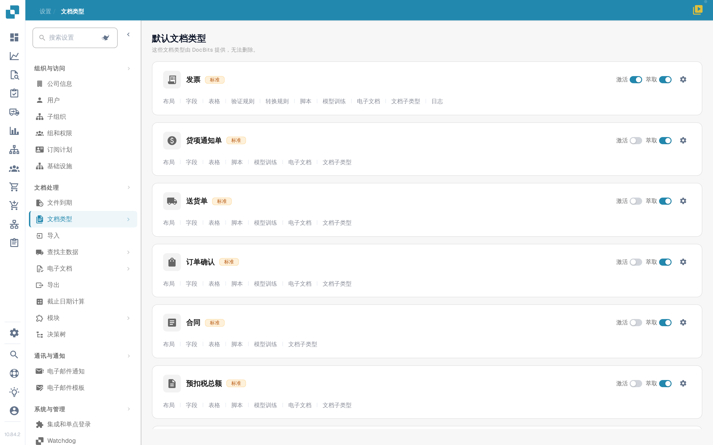
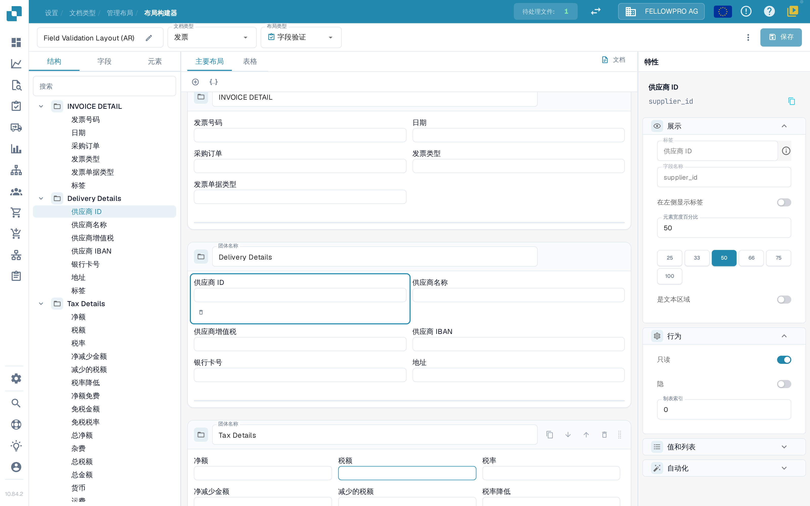
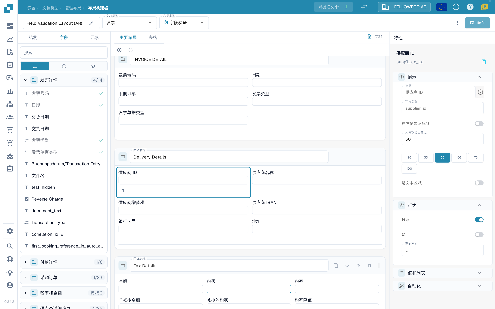
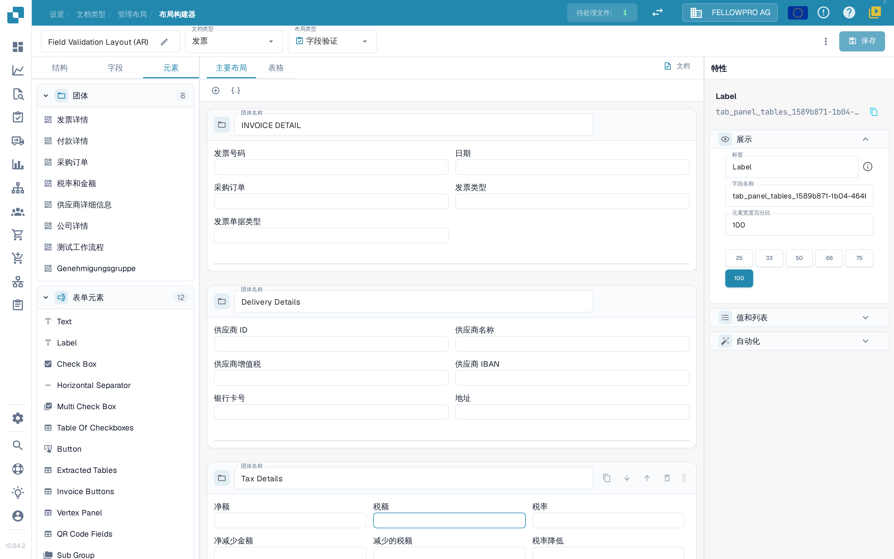

# 导航布局构建器

使用 **布局构建器** 排列用户在文档上看到的分组和字段。本指南以沙盒组织中的 **发票** 布局为例，文中截图均取自中文界面。

## 打开发票布局

1. 前往 **设置 → 文档类型**。
2. 找到 **发票**，在其卡片上选择 **布局**。此时会打开该文档类型的布局构建器。
3. 页面顶部显示布局名称（可用铅笔图标重命名）、**文档类型** 和 **布局类型**。通过 **布局类型** 可以切换到同一文档类型下的其他布局。

<figure><figcaption>
在发票卡片上打开 <strong>布局</strong>。
</figcaption></figure>

## 使用左侧面板的三个选项卡

左侧面板包含三个选项卡：**结构**、**字段** 和 **元素**。布局构建器默认打开 **字段** 选项卡。

**结构** 以树形方式展示布局，顺序与分组和字段在文档上的排列一致。点击分组前的箭头可展开，查看其中包含的字段；字段的技术名称显示在右侧的**特性**面板中。**搜索** 框可以过滤这棵树，选中某一行时，画布上的对应元素也会同时被选中。

<figure><figcaption>
结构树、画布与特性面板。
</figcaption></figure>

**字段** 按分组列出该文档类型提供的所有字段。分组名称旁的计数表示其中已经放入布局的字段数量，例如 **4/14**。搜索框下方有三个图标按钮，分别用于显示全部字段、仅显示尚未放入布局的字段，以及仅显示已隐藏的字段。每一行显示字段标签，已经在布局中的字段呈灰色并带有绿色对勾。

<figure><figcaption>
过滤字段列表，并通过对勾识别已放入布局的字段。
</figcaption></figure>

**元素** 提供可以拖到画布上的模块：**团体** 列出当前布局的各个分组，**表单元素** 包含 Text、Label、Check Box、Horizontal Separator、Multi Check Box、Table Of Checkboxes、Button、Extracted Tables、Invoice Buttons、Vertex Panel、QR Code Fields 和 Sub Group。

<figure><figcaption>
团体与表单元素两个面板。
</figcaption></figure>

## 放置并排列元素

- 从 **字段** 中拖出字段，或从 **元素** 中拖出元素，放入它应当出现的分组。已经放入布局的字段会在 **字段** 选项卡中带有对勾标记。
- 在分组内部或不同分组之间拖动字段，即可调整顺序。
- 画布上方的 **+** 可添加一个空分组；旁边的 JSON 图标可以根据 JSON 定义创建分组。
- 在分组标题栏中，可以通过 **团体名称** 重命名分组，也可以复制其 JSON、将分组上移或下移，或将其删除。使用标题栏右侧的拖动手柄可以移动整个分组。
- 在画布中选择字段，右侧会显示它的特性。选中字段下方出现的小工具栏可将该字段从布局中移除。

## 特性面板

右侧的 **特性** 面板始终显示，并跟随当前选中的元素。其设置分为 **展示**、**行为**、**值和列表** 和 **自动化** 四个部分。**展示** 中包含标签、字段类型以及 **元素宽度百分比**，可从 25、33、50、66、75 和 100 这几个预设值中选择。各项设置的详细说明请参阅[配置字段属性](configuring-field-properties.md)。

验证、OCR 和匹配设置属于字段本身，而不属于布局，请在单独的[字段设置](../fields/configuring-field-properties-1.md)中进行配置。

## 预览并保存

画布会按照字段在文档上的实际效果显示布局。使用 **主要布局** 和 **表格** 选项卡可在页面视图和行项目表格之间切换，**文档** 则会在画布旁打开示例文档。详见[使用模板预览](using-the-template-preview.md)。

编辑完成后，在顶部栏中选择 **保存**。顶部栏中的其他操作（包括生成模板、默认模板以及将布局应用到各个来源）请参阅[保存并应用更改](save-and-apply-changes.md)。
