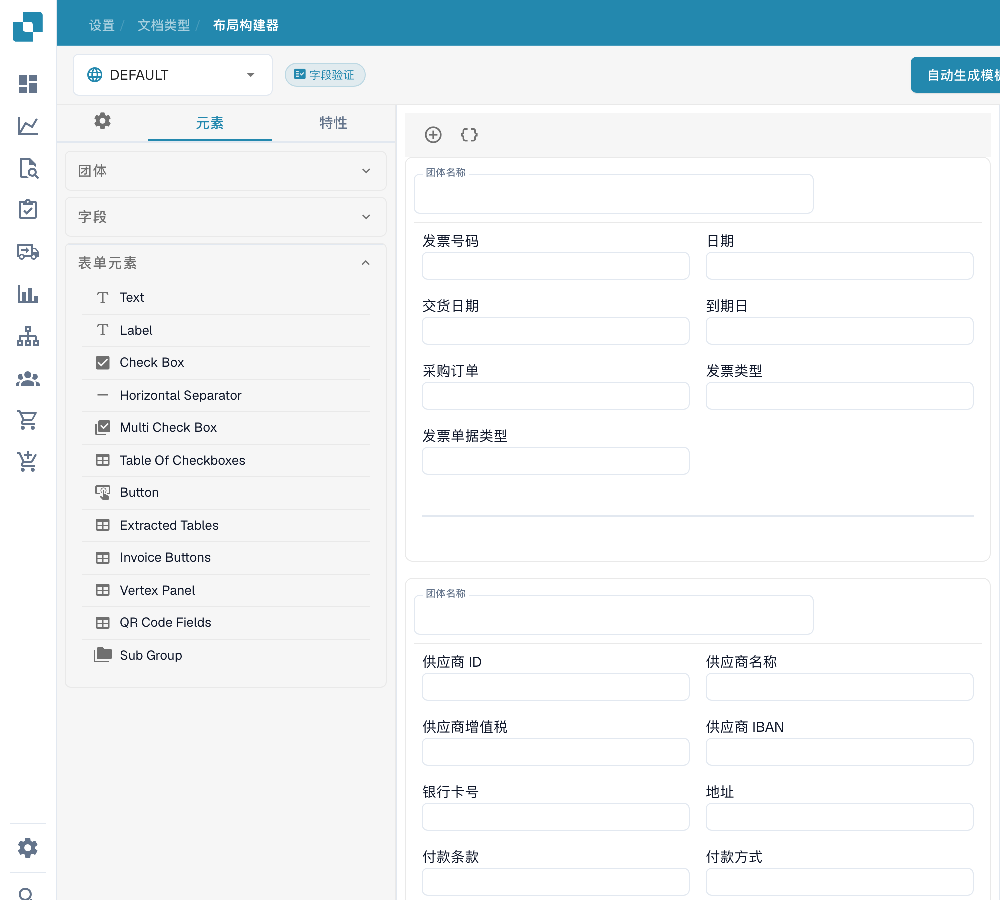

# 导航布局构建器

使用 **Layout Builder（布局构建器）** 来排列用户在文档上看到的字段和分组。本指南以沙盒组织中的英文 **Invoice（发票）** 布局为例。

## 打开 Invoice 布局

1. 前往 **Settings → Document Types**。
2. 找到 **发票**，然后在其卡片上选择 **布局**。此时会打开该文档类型的布局构建器。
3. 查看左上角的布局选择器。下方示例显示的是 **DEFAULT**。

<figure><figcaption>
从设置页面打开文档类型。 “Standard”和“Extraction”仍是当前界面保留的英文标签。
</figcaption></figure>

## 查找分组和字段

左侧的 **元素** 面板包含三个部分。**团体** 列出文档分区；中间的画布显示这些分区当前的排列方式。在画布中选择一个字段，然后打开 **特性** 以更改其显示设置。可用选项请参阅[配置字段属性](configuring-field-properties.md)。

<figure><figcaption>
现有布局的元素和分组。
</figcaption></figure>

打开 **字段** 查找可用的文档字段。如果列表较长，可使用搜索框，然后将字段拖到画布中的目标分组。已放入布局的字段在列表中可能会显示为不可用。

<figure><figcaption>
布局构建器中可用的字段。
</figcaption></figure>

打开 **表单元素** 查看 Text、Label、Check Box、分隔线、Button 和 Sub Group 等视觉控件。将所需元素拖到画布中，然后查看其 **特性**。

<figure><figcaption>
布局构建器中的表单元素。 表单元素类型列表仍使用英文名称。
</figcaption></figure>

## 排列并保存

- 在画布中选择分组标题即可更改其标题。画布上方的 **+** 可添加分组；旁边的花括号图标会打开高级 JSON 分组表单。
- 将鼠标悬停在分组上，可使用复制 JSON、上移、下移、删除和拖动手柄等操作。要调整字段顺序，可在分组内或分组之间拖动字段。
- 在画布中选择字段以打开 **特性**。字段上的删除图标会将其从此布局中移除。要配置验证、OCR 或匹配，请使用单独的[字段设置](../fields/configuring-field-properties-1.md)。
- 编辑完成后，在顶部栏中选择 **保存**。使用顶部栏中的其他操作（包括生成模板、默认模板以及将布局应用于来源）前，请参阅[保存并应用更改](save-and-apply-changes.md)。
