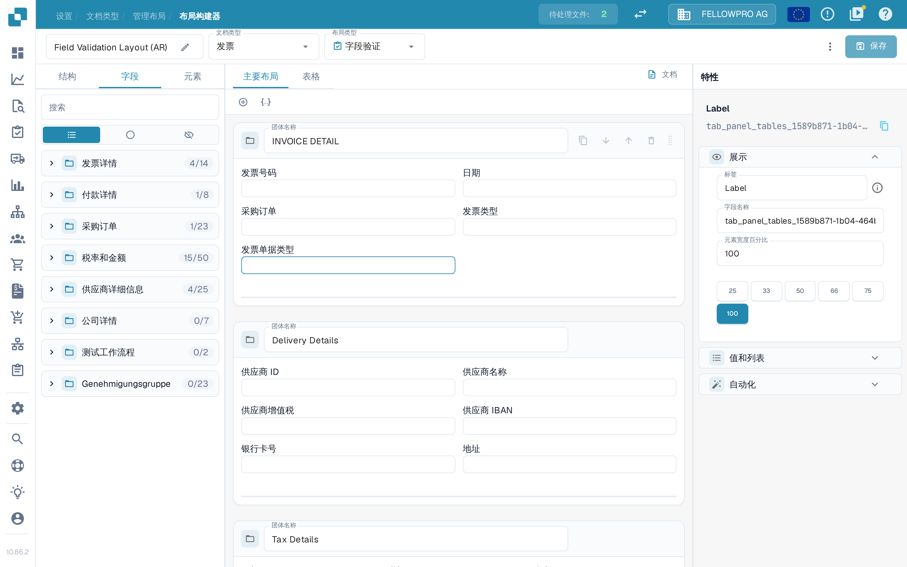
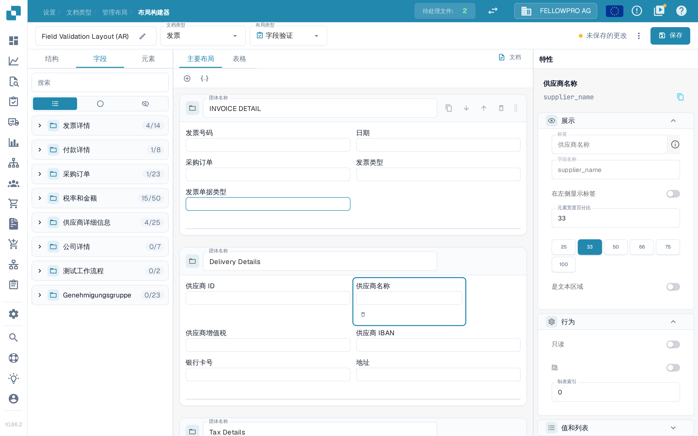
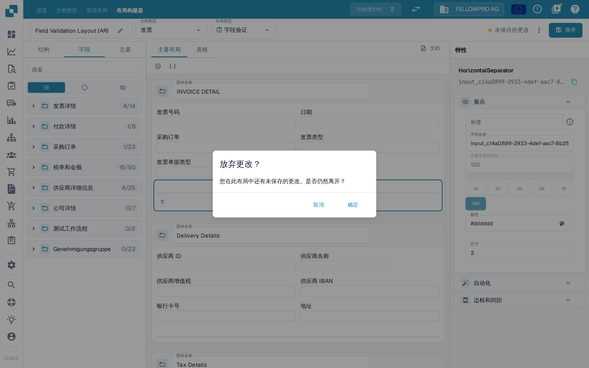

# 保存和应用更改

在 Layout Builder 中所做的更改只有保存后才会生效。保存会将布局与该文档类型关联，新文档随即使用该布局。

## 保存更改

编辑好布局后，选择页眉右上角的**保存**。

<figure><figcaption>**保存**按钮位于 Layout Builder 页眉右上角。</figcaption></figure>

工作过程中，页眉会显示更改的状态：

- **保存**按钮旁没有任何提示，表示布局未发生更改。
- 一旦修改布局，旁边就会出现**未保存的更改**。选择**保存**即可保存这些更改。

<figure><figcaption>布局尚未保存时会显示**未保存的更改**提示。</figcaption></figure>

保存成功后，该提示会被上次保存的时间取代。再次选择**保存**没有风险：如果自上次保存后没有任何改动，系统不会写入任何内容。

如果在存在未保存更改的情况下离开 Layout Builder，DocBits 会询问**放弃更改？**。选择**取消**可留在页面上保存更改，选择**确定**则不保存直接离开。

<figure><figcaption>存在未保存更改时离开所显示的确认提示。</figcaption></figure>

## 页眉中的其他操作

**保存**旁边的三点菜单包含其余的布局操作：

- **自动生成模板** — 根据文档类型的字段自动生成布局。
- **编辑 JSON** — 直接以 JSON 格式编辑布局定义。
- **复制 JSON** — 将布局定义复制到剪贴板。
- **布局设置** — 打开布局的常规设置。

**自动生成模板**会替换现有布局，因此请先确认当前打开的是哪个布局。**编辑 JSON** 面向高级用户，只有熟悉模板格式时才建议使用。

<figure><figcaption>三点菜单中可用的操作。</figcaption></figure>

## 应用更改

保存后，该文档类型的文档处理工作流即会使用此布局：

- 使用该文档类型处理的新文档采用更新后的布局。
- 已处理过的文档仍保留其采集时所用的布局。

## 测试更改

保存后，打开一份该文档类型的文档，确认字段和分组按预期显示。如有缺失，请返回 Layout Builder 调整布局并重新保存。
