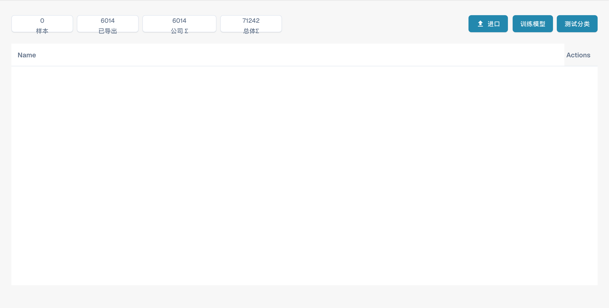

# 模型训练

模型训练管理界面提供训练模型及相关操作。打开模型训练设置。

<figure><figcaption>
中文模型训练概览。 “Name”和“Actions”列尚未翻译。
</figcaption></figure>

检查模型列表及可用操作。模型名称可能是已配置的值，并不随界面语言自动改变。

导入训练数据前，检查文件格式、金额格式和日期格式。训练完成后，使用独立且有代表性的文档验证提取效果。图片展示管理界面，没有执行训练或证明识别准确率。
