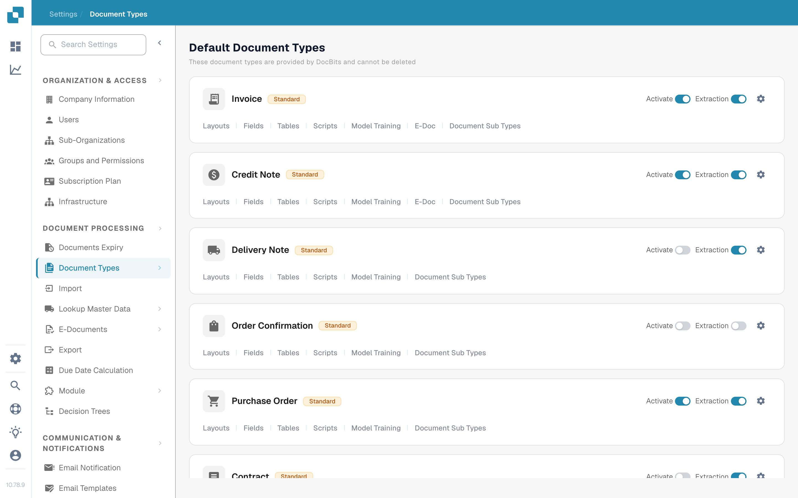
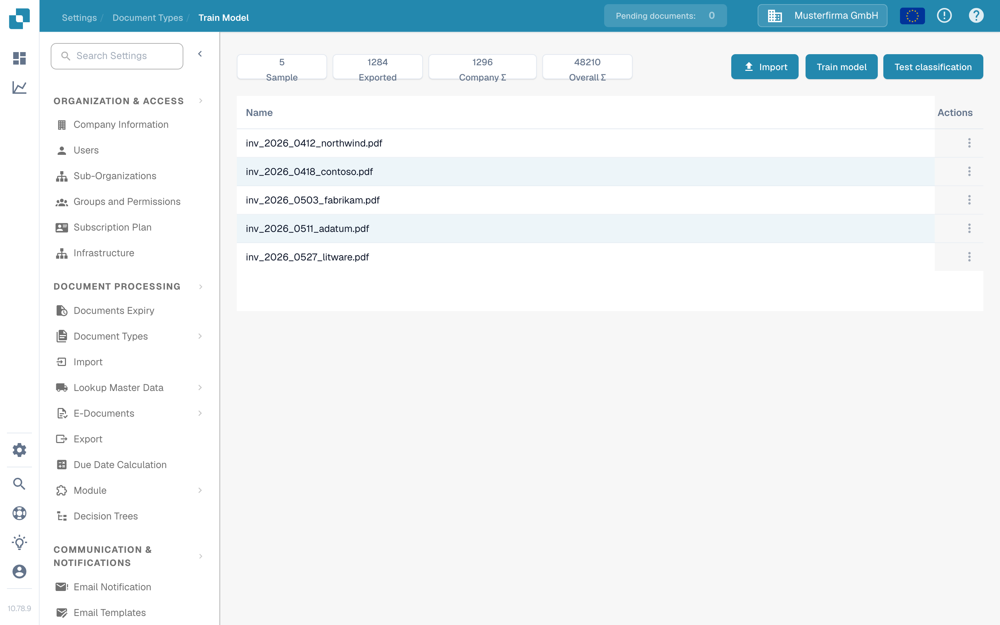
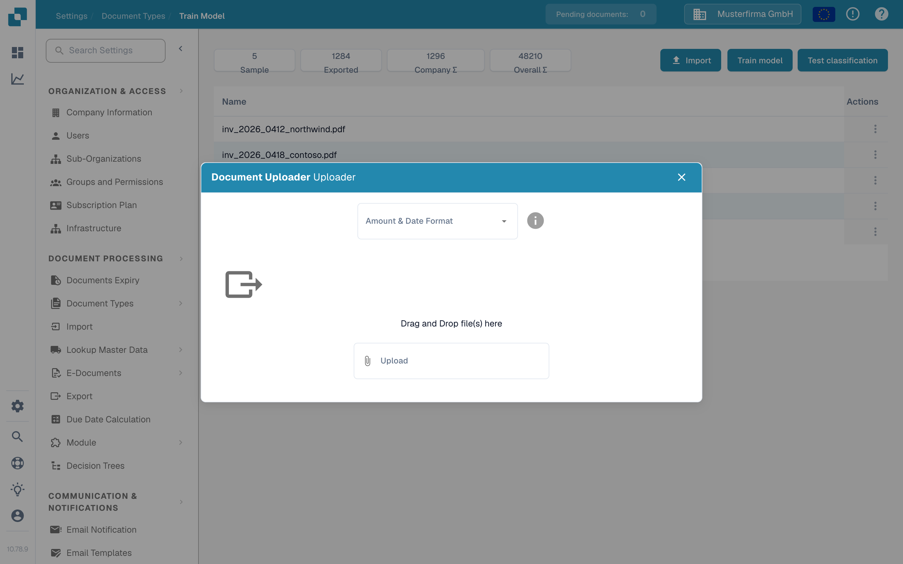
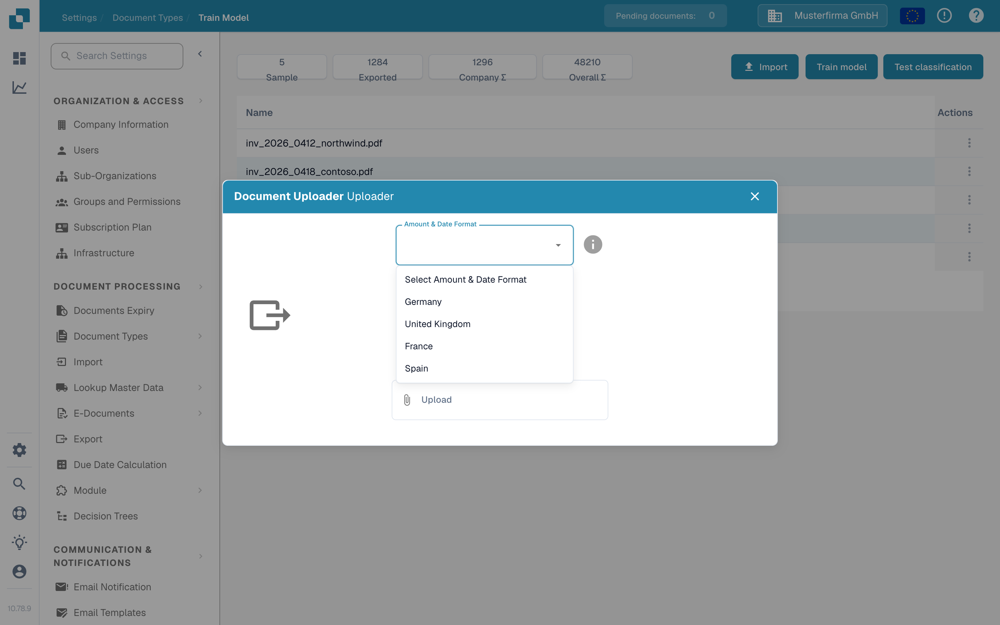
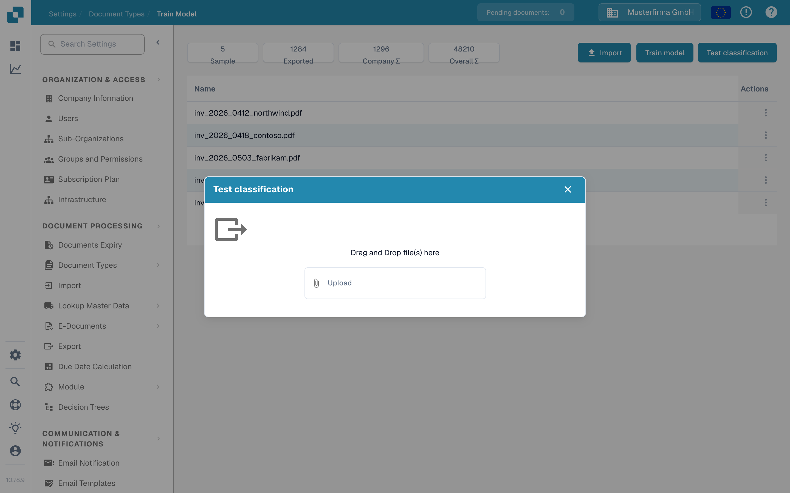

# 导入用于模型训练的示例文档

<figure><figcaption>
含金额和日期格式的训练数据导入。
</figcaption></figure>

使用此页面为文档类型添加示例 PDF，然后训练或测试其分类模型。你需要有权访问 **设置** 和 **文档类型**。有关训练功能的用途，请参阅[用途：模型训练](purpose-and-use-model-training.md)。

## 打开文档类型

1. 前往 **Settings → Document Types**。
2. 找到要训练的文档类型，然后在其所在行中选择 **模型训练**。以下示例使用 **发票**。

<figure><figcaption>
从所选文档类型打开 Model Training。
</figcaption></figure>

此卡片上的其他控件用途不同：**激活** 用于启用文档类型，**提取** 用于切换其提取模式，齿轮图标用于打开其设置，其余链接用于打开其他配置区域。仅打开 Model Training 时，无需更改这些控件。

**训练模型** 页面会显示示例数量以及已上传训练文档的列表。在示例组织中，该列表为空；你的组织中显示的文档和数量可能不同。

<figure><figcaption>
训练列表右上方有三个操作。
</figcaption></figure>

## 导入示例 PDF

1. 选择 **导入**。
2. 选择与示例文档相符的 **金额和日期格式**。例如，若使用美国的数字和日期格式，请选择 **美国**。此选项用于告知 DocBits 如何解析上传文档中的值；它不会更改应用语言。
3. 将 PDF 文件拖入对话框，或使用 **上传** 选择文件。当前的示例文档导入器只接受 **PDF 文件**，其他文件类型会被拒绝。选择文件后即开始上传。
4. 关闭对话框，并检查文档是否出现在训练列表中。如果 DocBits 报告上传错误或提示文档已存在，请修正文件，或选择其他示例后再继续。

<figure><figcaption>
选择格式后，再选择示例 PDF。
</figcaption></figure>

<figure><figcaption>
选择文档中使用的格式，而不是你偏好的界面语言。
</figcaption></figure>

有关导入示例的操作，请参阅[管理训练数据](manage-training-data.md)。

## 训练和检查模型

所需的示例 PDF 出现在列表中后，选择 **训练模型**。DocBits 可能会在后台处理训练；请等待完成提示后，再将新模型视为已就绪。此页面显示的示例数量和任何计划限制均适用于你的组织。

如需检查分类结果，请选择 **测试分类**，然后在对话框中上传另一个示例文件。处理完成后，DocBits 会显示预测的文档类型是否与此页面对应的类型一致，并提供分类详情。下方显示的是尚未提交文件的空测试对话框。

<figure><figcaption>
使用 Test classification，通过另一份文档检查模型。
</figcaption></figure>

有关如何解读结果，请参阅[测试模型](testing-the-model.md)。如果结果不理想，请先查看[训练数据](manage-training-data.md)和[故障排除指南](troubleshooting.md)，再添加更多示例。
