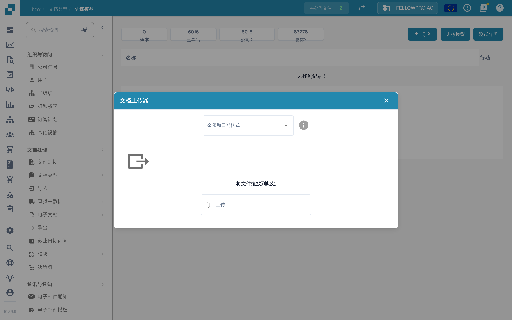

# 导入用于模型训练的示例文档

## 准备、导入并检查样本单据

<figure><picture><source srcset="../../../../../.gitbook/assets/intro-process-04-trainingsimport-zh-dark-20261029.png" media="(prefers-color-scheme: dark)"></picture><figcaption>
准备、导入并检查样本单据
</figcaption></figure>

选择有代表性的样本单据，设置可用的导入选项，并检查导入状态。只有成功导入的样本才能用于后续训练。进入下一步前应排查导入错误，并将独立测试单据与训练数据集分开保留。

准备能代表组织实际处理的格式、语言和文档类型的文档。仅使用当前安装版本接受的文件格式。排除重复文档，并将训练文档与评估文档分开。

## 打开导入功能

在相应文档类型的设置中打开模型训练，然后选择导入功能。

<figure><figcaption>
中文模型训练页面；所示版本将导入按钮误译为“进口”，此处指导入训练数据。未执行导入或训练。
</figcaption></figure>

## 选择格式和文件

选择与文件内容一致的数字和日期格式，再选择要导入的文档。例如，`1.234,56` 和 `1,234.56` 使用不同的分隔符；`05/06/2026` 这样的日期也必须按所选格式解释。

<figure><figcaption>
中文训练数据上传窗口，可选择金额和日期格式；未选择文件，未导入任何数据。
</figcaption></figure>

启动导入前检查所选文件。等待处理完成，并检查错误和分配的文档类型。将示例用于训练前，先纠正分类和数据提取错误。

## 训练与评估

根据当前版本提供的功能和权限训练模型。然后使用单独的样本评估结果。增加训练文档本身并不能保证提高准确率。请参阅[测试模型](testing-the-model.md)。
