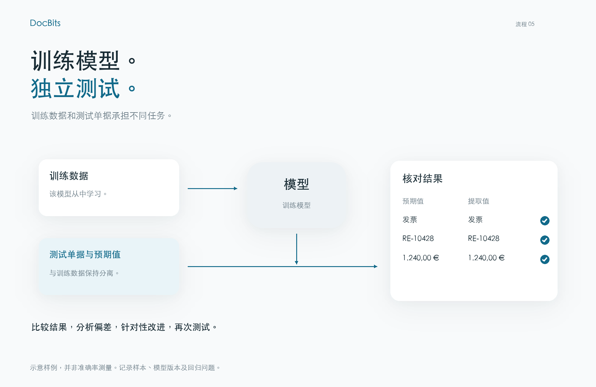
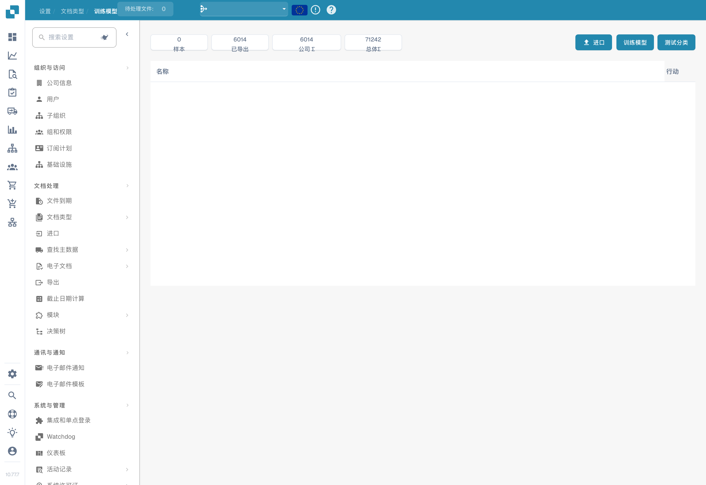

# 测试模型

## 使用独立测试单据评估模型

<figure><figcaption>
使用独立测试单据评估模型
</figcaption></figure>

训练数据与测试单据承担不同任务。请为独立测试单据设定预期的单据类型和字段值，并与模型预测进行比较。记录模型版本、样本、偏差和技术错误。针对问题改进后，使用相同的评估方法重新测试。图中数值仅为示例，并非准确率测量结果。

使用未参与训练的代表性文档测试模型。为每个文档准备预期答案：文档类型；如需评估数据提取，还应准备各字段的正确值。

## 执行测试

1. 打开待评估文档类型的模型训练页面。
2. 如果当前版本提供分类测试功能，选择该功能。
3. 选择测试样本，使用可用选项启动评估。
4. 等待测试完成，记录结果和错误。技术故障或未完成的测试不代表分类正确。

<figure><figcaption>
中文模型训练页面；所示版本将导入按钮误译为“进口”，此处指导入训练数据。未执行导入或训练。
</figcaption></figure>

## 解读结果

将预测结果与预期答案进行比较，并按类型和格式分析错误。如果计算准确率、精确率、召回率或 F1 分数，也应说明样本量和评估的类别。不要声称产品显示了当前版本并未提供的指标。可以根据导出或记录的结果单独计算这些指标。

分类规则和提取规则与模型训练是不同的设置。如果处理流程使用了这些规则，应检查其影响。不要仅为掩盖测试样本中的错误而修改规则。

## 改进并重新测试

纠正训练数据、标签或当前安装版本实际提供的设置，必要时重新训练模型。按同一测试方案重复评估，并保留独立样本。记录版本、数据、结果和回归问题。样本中的良好结果不能保证对所有未来文档都有相同性能。
