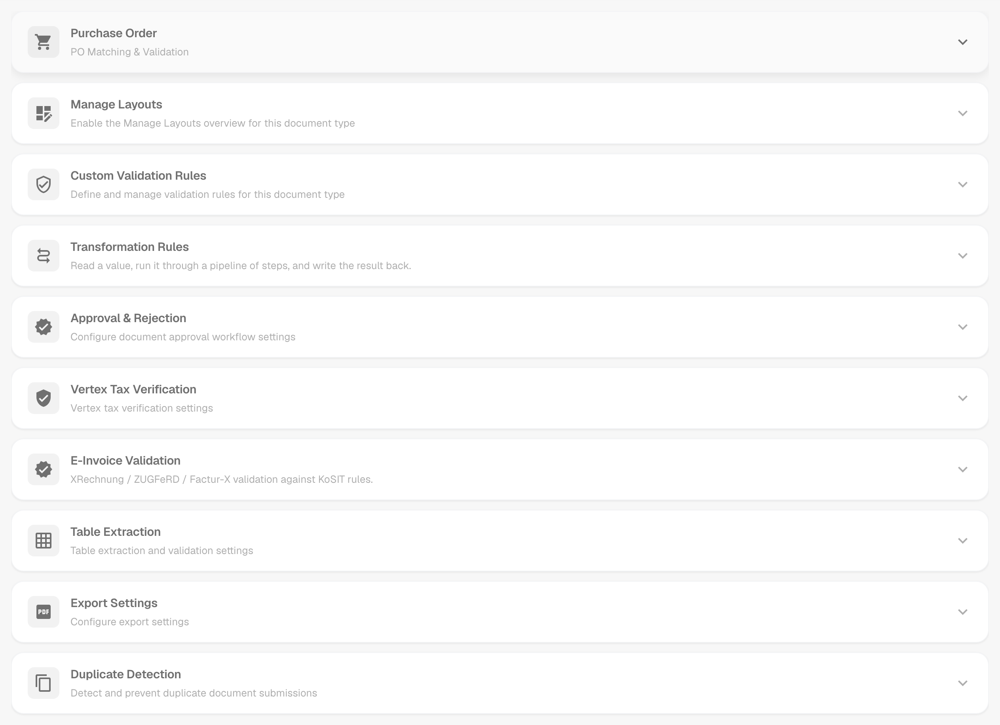
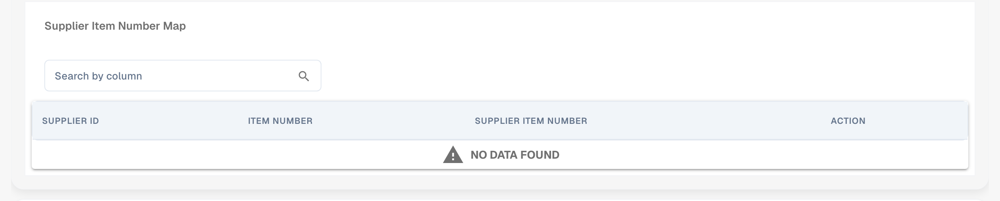
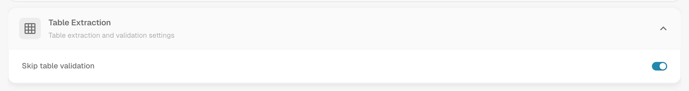
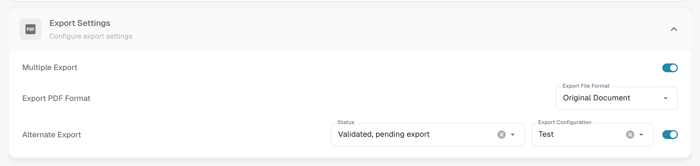

# 更多设置

## 概述

**更多设置**包含属于某一种文档类型的选项，例如发票。在此处启用的设置仅适用于该文档类型。本页面由多个可折叠卡片组成，每张卡片对应一个主题。展开卡片即可查看其中的设置。

<figure><figcaption>
“更多设置”页面中的卡片，当前均已折叠。
</figcaption></figure>

## 如何访问

1. 前往 **Settings** → **Global Settings** → **Document Types**。
2. 选择文档类型，然后点击 **More Settings**。

页面顶部的面包屑显示 **Settings / Document Types / More Settings**。页面右侧的设置助手会说明当前展开卡片中的设置。

| 卡片                                                                                          | 可在此设置的内容                                                 |
| --------------------------------------------------------------------------------------------- | ------------------------------------------------------------------ |
| [Purchase Order](./#purchase-order)                                                           | 采购订单匹配、容差、采购订单行导出、供应商物料编号 |
| [Manage Layouts](./#manage-layouts-custom-validation-rules-and-transformation-rules)          | “Manage Layouts”概览的开关                             |
| [自定义校验规则](./#manage-layouts-custom-validation-rules-and-transformation-rules) | 此文档类型的自定义验证规则                   |
| [Transformation Rules](./#manage-layouts-custom-validation-rules-and-transformation-rules)    | 读取一个值、分步更改并写回的规则      |
| [Approval & Rejection](./#approval-and-rejection)                                             | 审批工作流以及审核中和拒绝表单               |
| [Vertex 税额校验](vertex-tax-verification.md)                                         | 设计 Vertex 税务验证表单                    |
| [电子发票校验](./#e-invoice-validation)                                               | 验证 XRechnung、ZUGFeRD 和 Factur-X 发票             |
| [Table Extraction](./#table-extraction)                                                       | 跳过提取表格的验证                            |
| [Export Settings](./#export-settings)                                                         | 多次导出、PDF 格式、备用导出                      |
| [Duplicate Detection](./#duplicate-detection)                                                 | 检测并阻止重复文档                               |

## 采购订单 

**Purchase Order** 卡片（**PO Matching & Validation**）用于控制此类型的文档如何与采购订单匹配。

<figure><figcaption>
包含各项选项的 Purchase Order 卡片。
</figcaption></figure>

* [**Purchase Order**](purchase-order/purchase-order.md)：切换是否在“Purchase Order Matching”屏幕中处理该文档。你也可以指定匹配所依据的数量。
* [**PO match server side**](purchase-order/purchase-order-matching-rules.md)：使用可配置的规则集进行匹配。点击 **Configure PO Matching Rules** 可打开[规则页面](purchase-order/purchase-order-matching-rules.md)。
* [**PO table in layout builder**](purchase-order/po-table-in-layout-builder.md)：允许在布局生成器中加入采购订单表格，以自定义文档布局。
* [**Auto check for PO updates**](purchase-order/auto-check-for-po-updates.md)：当采购订单已更新时，在“Purchase Order Matching”屏幕中显示视觉提示，提醒用户刷新。
* **Auto update PO data**：有新数据时自动更新采购订单数据。此开关属于 **Auto check for PO updates**。
* [**Consumed PO line status**](purchase-order/consumed-po-line-status.md)：在匹配屏幕中为采购订单行应用颜色标记。
* [**Calculate PO unit price**](purchase-order/calculate-po-unit-price.md)：使用净金额和数量计算采购订单单价，而不是提取单价。
* [**Export not matched PO lines**](purchase-order/export-not-matched-po-lines.md)：关闭时仅导出已匹配的行。开启时导出所有采购订单行，即使它们尚未匹配。
* **Ignore Already Matched Lines**：在新的匹配过程中跳过已匹配的行。
* [**Update Document Purchase Order Status**](purchase-order/update-document-purchase-order-status.md)：每当采购订单状态发生变化时，更新仪表板上的 PO Status 列。
* [**Allow Auto Export For Non Matchable PO Lines**, **Auto Match & Export visible to** 和 **Use Lines Net Amount for Matched Total visible to**](purchase-order/auto-match-and-export-options.md)：决定谁可以看到 Auto Match & Export 快捷操作，以及哪些文档可以自动导出。

### 以图表形式查看匹配规则

PO 匹配规则不只是一个列表。DocBits 可以将当前启用的规则集绘制成流程图。你可以查看规则的尝试顺序以及匹配在哪一步停止。

1. 在 **Purchase Order** 卡片中开启 **PO match server side**，然后点击 **Configure PO Matching Rules**。
2. 点击页面顶部的 **Rule set as a diagram**。图表将在规则旁边的面板中打开。

<figure><figcaption>
规则集图表。自上而下共五个阶段。
</figcaption></figure>

从上到下阅读图表。DocBits 按以下顺序尝试各阶段：**Single match validation**、**Multi match validation**、**Total match validation**、**Single mismatch validation** 和 **Fallback logic**。每个阶段最多尝试三轮：**Exact match for all rules**、**Tolerance-based match** 和 **Package criteria**。绿色箭头表示已找到匹配项，处理随即停止。红色箭头表示未找到匹配项，因此 DocBits 会继续下一步。最后的结果为 **Match found** 或 **No match found**。

图表下方的面板列出 **Rules by priority, per stage**。对于每条规则，你可以看到它比较的列、容差以及 **Auto match**、**Manual match** 和 **Fallback** 选项。

<figure><figcaption>
图表下方：各阶段的规则及其比较的列。
</figcaption></figure>

**示例。**发票行的物料编号为 4711、数量为 10、单价为 10.40。采购订单行的物料编号为 4711、数量为 10、单价为 10.00。单价容差为 5 %。

* 第 **1.1 Exact match for all rules** 轮失败，因为 10.40 不等于 10.00。红色箭头指向下一轮。
* 第 **1.2 Tolerance-based match** 轮成功。差异为 4 %，在 5 % 的容差范围内。绿色箭头指向 **Match found**，处理随即停止。

在图表中，这条路径依次经过 1.1、1.2，然后到达 **Match found**。如需查看单个文档经过的路径，请参阅 [PO matching diagnosis](../../../../analytics-dashboard/touchless-intelligence/touchless-po-matching-diagnosis.md)。如需了解规则页面的全部详情，请参阅 [Purchase Order Matching Rules](purchase-order/purchase-order-matching-rules.md)。

### PO 容差设置

<figure><figcaption>
数量和单价的容差。
</figcaption></figure>

[**PO Tolerance Setting**](purchase-order/purchase-order-tolerance-settings-additional-purchase-order-tolerance.md)允许你为数量和单价设置容差级别，以免较小的差异被标记为不匹配。你可以为每个值选择金额和单位，单位可以是绝对**数值**（**Value**）或百分比（**%**）。此区块还包含用于运费、费用和税款的[**Additional PO Tolerance Setting**](purchase-order/purchase-order-tolerance-settings-additional-purchase-order-tolerance.md#setting-to-configure-additional-purchase-order-tolerance-settings)，以及 [**PO disable statuses**](purchase-order/purchase-order-disable-statuses.md)。


当文档类型属性 `CUSTOM_RANGE_FOR_PO_TOLERANCE` 启用时，单价和数量容差取自这些文档类型设置，而非规则集。如果是这种情况，[PO 匹配规则页面](purchase-order/purchase-order-matching-rules.md)上的规则图表会显示提示。


### 供应商物料编号映射

<figure><figcaption>
Supplier Item Number Map。
</figcaption></figure>

[**Supplier Item Number Map**](purchase-order/supplier-item-number-map-admin-documentation.md)将供应商物料编号映射到你的内部物料编号，这样即使供应商使用自己的编号，行项目也能匹配。按列搜索即可查找条目。

## Manage Layouts、Custom Validation Rules 和 Transformation Rules 

Purchase Order 卡片下方紧接着有三张卡片：

* **Manage Layouts**：为此文档类型启用 Manage Layouts 概览。请参阅 [Layout Manager](../layout-manager/)。
* **Custom Validation Rules**：启用自定义验证规则。点击 **Manage Validation Rules** 可打开规则。请参阅 [自定义校验规则](../custom-validation-rules.md)。
* **Transformation Rules**：启用转换规则。点击 **Manage Transformation Rules** 可打开规则。请参阅 [Transformation Rules](../transformation-rules.md)。

<figure><figcaption>
包含各自开关的三张卡片。
</figcaption></figure>

## 审批与拒绝 

**Approval & Rejection** 卡片包含审批工作流，以及用户在审核或拒绝文档时看到的表单。

<figure><figcaption>
Approval &#x26; Rejection 卡片。
</figcaption></figure>

* **Approve before export**：文档必须先获得审批才能导出。点击 **Design Approval Form** 可打开用于审批屏幕的 **Layout Builder**。
* **Approve before export V2**：启用 Approval V2，以动态字段替代静态字段。
* **Second Approval**：增加一层审批。
* [**Approval Stamp**](approval/approval-stamp.md)：文档获批时为其添加印章。
* [**Approval History**](approval/approval-history.md)：在审批屏幕和字段验证中显示审批历史记录。
* **Design In Review Form**：使用 **Layout Builder** 配置审核表单的布局。
* **Design Reject Form**：使用 **Layout Builder** 配置拒绝表单的布局。

有关 **Layout Builder**，请参阅 [Layout Manager](../layout-manager/)。

## Vertex 税务验证

**Vertex Tax Verification** 卡片包含 **Design Vertex Tax Verification**。点击后会打开 Layout Builder，用于设计 DocBits 比较供应商税额和 Vertex 计算税额时用户看到的表单。有关集成、容差和结果，请参阅 [Vertex 税额校验](vertex-tax-verification.md)。

## 电子发票验证 

**E-Invoice Validation** 卡片用于启用传入电子发票的验证，并允许你决定供应商在发票被拒绝时是否会收到通知。请参阅 [电子发票校验](../../../document-processing/e-documents/validation-rules/)。

## 表格提取 

<figure><figcaption>
Table Extraction 卡片。
</figcaption></figure>

* **Skip table validation**：跳过表格数据的标准验证。当需要灵活处理数据，或跳过某些验证步骤以提高性能时，可使用此选项。

## 导出设置 

<figure><figcaption>
Export Settings 卡片。
</figcaption></figure>

* **Multiple Export**：允许多次导出同一文档。
* **Export PDF Format**：**Export File Format** 用于设置导出文档时使用的 PDF 格式，例如 **Original Document**。
* [**Alternate Export**](purchase-order/alternate-export.md)：为指定的文档状态设置备用导出。选择对应的 **Status** 和 **Export Configuration**，然后启用此设置。

## 重复检测 

<figure><figcaption>
Duplicate Detection 卡片。
</figcaption></figure>

此卡片包含 **Duplicate Document Detection**，其中的字段用于确定重复文档的判定条件和比较文档的时间间隔；此外还包含 **Duplicate Invoice Detection**、**Block Duplicate Document Export** 和 **Ignore Tax Free Line** 选项。这三项都带有 **Recommended** 标签。有关如何处理被标记的文档，请参阅 [Duplicate Detection](duplicate-document-handling.md)。
