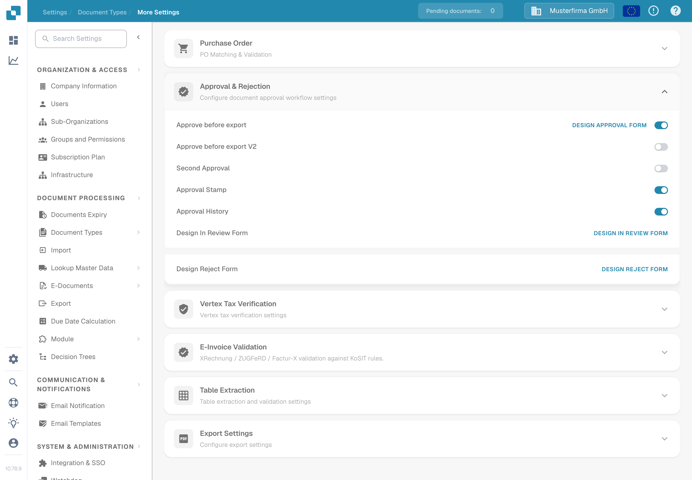

# 审批

使用审批选项决定文档离开 DocBits 前如何进行检查。选项按文档类型配置，因此请从团队使用的类型开始，例如 **Invoice**。

1. 打开 **Settings** → **Document Types**。
2. 选择文档类型并打开 **More Settings**。
3. 滚动到 **Approval & Rejection**。更改任何选项前，请先检查这四个开关。

<figure><figcaption>
DocBits Documentation Test A 中 Invoice 的当前英文 Sandbox 视图。此示例中的四个开关均处于关闭状态。
</figcaption></figure>

| 选项 | 用途 |
| ------------------------- | ------------------------------------------------------------------------------------------------------------------------------ |
| **Approve before export** | 导出文档前必须先作出审批决定。 |
| **Second Approval** | 当一个审批决定不足以满足流程要求时，添加另一个审批步骤。 |
| **Approval Stamp** | 为已审批的文档添加审批标记。有关设置和下载选项，请参阅 [审批印章](approval-stamp.md)。 |
| **Approval History** | 保留审批决定的记录。有关该设置以及如何查看历史记录，请参阅 [审批历史记录](approval-history.md)。 |

选择流程所需的选项。然后，使用非客户文档和预期的审核者角色检查审批路径，再将其应用于实际文档。屏幕截图展示了可用设置；本次文档检查未执行任何审批流程或导出操作。
