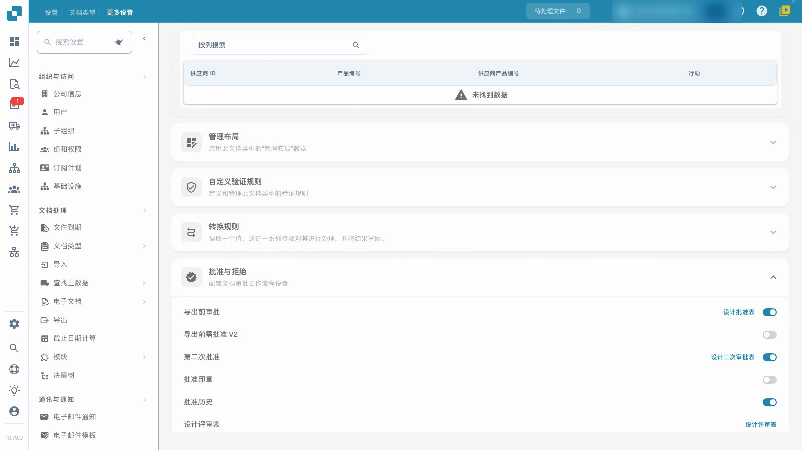
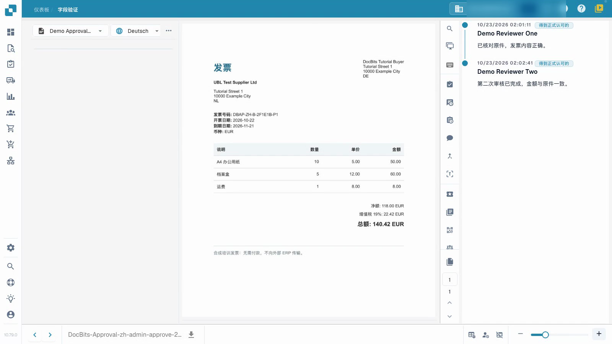

# 配置和测试发票审批

此视频展示了审批的配置和测试。


配置和测试发票审批


[观看带字幕的视频](https://docbits-videos.fra1.cdn.digitaloceanspaces.com/settings-assistant/invoice-approval-admin/v2/zh.html)

显示的是实际应用程序；选项的措辞可能取决于部署的版本。

为您的流程使用的文档类型配置审批。确定指定的审核人员，并决定是否需要第二次独立审核。视频使用单独的文档类型和临时的普通审核账号。

## 配置文档类型

打开 **设置 → 文档类型**，选择相应的类型并打开 **更多设置 → 批准与拒绝**。选择您的流程所需的设置，然后重新加载页面以检查保存的内容。

| 设置 | 目的 |
| --- | --- |
| 导出前审批 | 在文档继续导出之前需要审批决定。 |
| 第二次批准 | 在配置的流程中添加第二个审批阶段。 |
| 批准历史 | 保持记录的决定可供审核。 |
| 批准印章 | 在批准的文档上配置标记；请参阅单独的印章指南。 |

额外的V2选项和表单设计器是单独的设置。本教程使用准备好的标准审批表单。

## 使用指定角色进行测试

1. 将两位审核人员加入不同的用户组，并授予各自访问已分配文档所需的权限。在此示例中，第一个帐户具有第一阶段审批权限，第二个帐户具有第二阶段权限。仅靠开关不能分配人员或授予该权限。
2. 使用第一个普通帐户检查分配的、已验证的发票，添加说明并给予首次批准。验证保存的文档是否仍在等待二次审批。还要确认权限不允许的账号无法进行第二次审批。
3. 将等待的发票分配给另一位授权审核员。使用第二个普通帐户检查它并使用单独的说明给予二次批准。
4. 重新打开历史记录并验证两位不同的审核员、时间和说明。还要以特定原因拒绝单独的测试发票，并在重新加载后验证该决定。

<figure><figcaption>
已为专用测试文档类型保存的审批设置。
</figcaption></figure>

<figure><figcaption>
两位不同审核人员及各自保存的备注。
</figcaption></figure>

## 验证结果

将首次批准、等待第二次审批和拒绝作为不同的结果。确认发票数据在每次决定后均保持不变。本测试通道等待数据被读取，不会向外部 ERP 系统传输数据。当显示技术状态 `pending_data_fetch` 时，表示等待数据读取。仅凭审批历史记录不能证明ERP传输。

在将流程应用于正式业务单据之前，测试配置的角色、分配和完整的决定路径。

## 相关页面

- [组、用户和权限](../../../groups-users-and-permissions/README.md)
- [审批历史记录](approval-history.md)
- [审批印章](approval-stamp.md)
