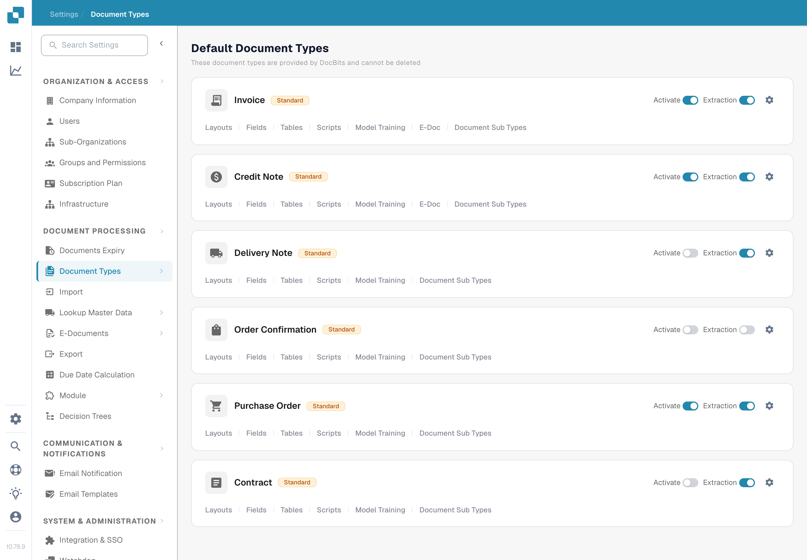

# 审批印章

启用该选项后，审批文档时会添加审批印章。当审核者需要查看谁在何时审批了文档时，此功能很有用。上一页展示了旧版界面的六张截图，并将印章、IDM 导出和 PDF 下载选项一并视为已验证。依赖这些结果之前，请先在自己的工作流中逐项检查。

## 查找此选项

1. 使用管理员帐户打开 **Settings → Document Types**。找到要配置的类型，例如 **Invoice**，然后选择该卡片上的**齿轮图标**。齿轮图标会打开该文档类型的 **More Settings**；**Layouts** 和 **Fields** 会打开不同的编辑器。

   <figure><figcaption>
点击相关文档类型上的齿轮图标。
</figcaption></figure>

2. 在 **More Settings** 中展开 **Approval & Rejection**。找到 **Approval Stamp** 开关，它位于 **Approve before export**、**Second Approval** 和 **Approval History** 旁边。截图显示的是合成的 **DocBits Documentation Test A** 组织，审批印章处于**关闭**状态。截图未展示带印章的文档。

   <figure><figcaption>
检查所选文档类型的 Approval Stamp 设置。
</figcaption></figure>

3. 只有在组织内就审批和导出方式达成一致后，才启用此开关。记录更改前的设置，以便验证其对测试发票的影响。

## 验证审批印章

将此文档类型的合成发票提交到已配置的审批工作流。在 **Ready for approval** 页面上，使用获授权的测试帐户审批该发票。当前 DocBits Web 客户端会在审批时检查 Approval Stamp 选项，并添加包含审批人姓名和日期的印章注释。重新打开已审批的文档，检查其中的注释以及工作流实际使用的下载版 PDF。如果未显示印章，请检查文档类型、审批状态、相关设置和导出配置。

审批印章与 **Second Approval** 和 **Approval History** 相互独立。启用其中一项并不能证明其他选项也已配置。可用的仪表板下载操作和 IDM 导出格式取决于具体环境，本页面尚未验证这些内容，因此本指南不承诺特定的下载菜单标签或自动 IDM 输出。

已在英文 Test A Sandbox 中对这两张新截图进行了目视检查。检查期间未更改开关，也未审批或导出任何文档；最终的带印章状态需要使用专门的合成已审批发票进行验证。
